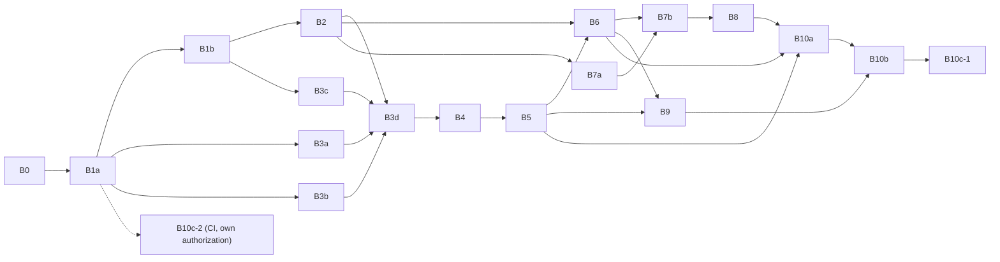

# Native identity, workforce and import — delivery plan

> **Design Accepted for implementation — 2026-10-04 (v1.2).** The Owner accepted the design, chose the four open points (`O-1`…`O-4`, Docs `QĐ-47`) and delegated the remaining technical choices through the B0 closure prompt of 2026-10-04. **This is an Owner decision, not a confirmation by the supervisor (GVHD), and it does not mean the Owner personally reviewed each diagram or test or confirmed the safety of code that does not exist yet.** Nothing in this plan is implemented or verified.
>
> This is the versioned hand-over plan for developers and AI agents who do **not** have the Git-ignored `docs/workspace/` of the author. **Implement only from Accepted documents** (`docs/README.md`): design v1.2, ADR-0009, ADR-0010, ADR-0005/0007/0008. A package whose contract is unclear stops and reports; it never fills a gap with a default.
>
> Entry page for a new developer: [native-handoff.md](../guides/native-handoff.md). Task prompts: [native-handoff-prompts.md](../guides/native-handoff-prompts.md). Design: [native-identity-workforce-design.md](native-identity-workforce-design.md) (v1.2). Owner decisions: [native-owner-decision-package.md](native-owner-decision-package.md). Test IDs: [native-identity-verification.md](../guides/native-identity-verification.md). Operations: [native-identity-maintenance.md](../guides/native-identity-maintenance.md). File list and checksums for a developer checkout: [native-handoff-manifest.json](../guides/native-handoff-manifest.json).

## 1. Baseline and authority

| Item                       | Value                                                                                                                                                                                                                                                                                                                                                                                                                                                                                                                                                        |
| -------------------------- | ------------------------------------------------------------------------------------------------------------------------------------------------------------------------------------------------------------------------------------------------------------------------------------------------------------------------------------------------------------------------------------------------------------------------------------------------------------------------------------------------------------------------------------------------------------ |
| Code baseline              | repository HEAD `78cb675` (foundation + `catalog` slice; OIDC authentication; 5 HTTP operations: health live/ready, catalog list/detail/create). `src/modules/{identity-access,organization,audit}` contain only empty leftover directories — they are **not** modules. Verify with `git rev-parse HEAD` and `git status` before starting.                                                                                                                                                                                                                   |
| Design baseline            | `native-identity-workforce-design.md` v1.2 (Accepted for implementation, 2026-10-04), `ADR-0009` (Accepted 2026-10-04), `ADR-0010` (Accepted), `ADR-0005`/`0007`/`0008` (Accepted). Accepted by the Owner through the B0 closure prompt, **not by GVHD**.                                                                                                                                                                                                                                                                                                    |
| Business owners            | BRD (v3.24), User Stories (v0.14), Decisions log (`QĐ-46`, `QĐ-47`), Conceptual ERD (v4.1), Logical ERD S0 (0.9: 41 entities, 98 relations, one tab). These live in the separate **Docs** repository; if you do not have it, ask the coordinator for the sections cited by each package instead of guessing business behaviour. Synchronization status of those sources per diagram group is recorded in `native-handoff.md` §5; it is an **Owner decision, not confirmed by the supervisor (GVHD)**, and the Docs repository is not committed by this work. |
| Not implemented            | everything in this plan. No native login, account, employee lifecycle, import, outbox or recovery code exists at HEAD. Historical results of the removed 2026-10-02 slice (159 unit / 41 e2e / 51 integration / 19 live tests) are **not evidence** for any package here, and the baseline's 137 unit / 23 e2e tests prove nothing about native authentication.                                                                                                                                                                                              |
| Forbidden in every package | resetting or migrating a database that is not a disposable test database created for the run; editing `.env`; sending real e-mail; committing/pushing/deploying without the Owner; restoring the removed S0 snapshot as a shortcut; creating a second login mechanism or an auth bypass; weakening validation/CORS/rate limits to make a test pass.                                                                                                                                                                                                          |

## 2. Roles and file ownership

Names are **placeholders until the Owner assigns people**: `DEV-1` (schema/transaction/audit), `DEV-2` (authentication/accounts), `DEV-3` (workforce), `DEV-4` (import), `REVIEWER`, `COORDINATOR` (owns shared files, sets package statuses, integrates packages in dependency order under the rule of §3 and the Owner's authorization; may be the Owner).

Shared files have exactly **one owner at a time**; everyone else proposes changes to that owner (or rebases after the owner merges). This prevents two developers editing the same migration or contract.

| Shared artifact                                                                                                                                       | Owner                                                              | Rule                                                                                                                                                                                                          |
| ----------------------------------------------------------------------------------------------------------------------------------------------------- | ------------------------------------------------------------------ | ------------------------------------------------------------------------------------------------------------------------------------------------------------------------------------------------------------- |
| `prisma/models/*.prisma`, `prisma/schema.prisma`, `prisma/migrations/**`                                                                              | DEV-1                                                              | exactly **one** migration per merge window, named after the package; other packages request model changes through DEV-1 before B1b merges, and by a new migration afterwards; never edit an applied migration |
| `src/architecture-boundaries.spec.ts` (`PRISMA_MODEL_OWNER`, repository confinement)                                                                  | DEV-1                                                              | each new model is added by the package that creates it, in a one-line change reviewed by DEV-1                                                                                                                |
| `package.json`, `pnpm-lock.yaml`, `.github/workflows/**`                                                                                              | COORDINATOR                                                        | dependency changes only after the dependency review recorded in the package (B3a, B7a); workflow edits only with the Owner's explicit authorization (B10c)                                                    |
| `openapi.json`, `test/support/api-coverage-manifest.ts`                                                                                               | COORDINATOR                                                        | regenerated by the package that changes an operation; conflicts resolved by regeneration, never by hand                                                                                                       |
| `src/infrastructure/**` shared capabilities                                                                                                           | the package named in its row below                                 | one module of `infrastructure` per package                                                                                                                                                                    |
| `src/modules/organization-setup/**` (no tables; HTTP orchestration of organization settings and setup completion across `organization` and `catalog`) | not part of B1–B10; owned by workspace work items 0009 (D8) / 0011 | B3d `scripts/bootstrap-native.ts` creates the organization **without** this module; it must call only public contracts of `organization`/`catalog` and own no repository (`docs/rules/architecture.md`)       |
| `docs/architecture/native-*.md`, `docs/decisions/*.md`, `docs/guides/native-*.md`                                                                     | COORDINATOR                                                        | a developer who finds a design defect writes it down with a reproducing example and stops that part (design section 1/2 of this plan); the coordinator edits the document                                     |

## 3. Package overview

**Status vocabulary** (one word per package; only the COORDINATOR sets or changes it, re-evaluating at every integration):

| Status            | Meaning                                                                                                                                                                                                                                                                                                |
| ----------------- | ------------------------------------------------------------------------------------------------------------------------------------------------------------------------------------------------------------------------------------------------------------------------------------------------------ |
| `DESIGN_ACCEPTED` | the contract is Accepted and complete, but a dependency package is not yet `IMPLEMENTED` or no developer is assigned                                                                                                                                                                                   |
| `READY_TO_START`  | `DESIGN_ACCEPTED` **and** every dependency is `IMPLEMENTED` (integrated) or closed (B0, closed in documents — counts as satisfied) **and** every document the package cites exists in the checkout **and** the package has the authority it needs (e.g. an explicit authorization for a workflow edit) |
| `BLOCKED(x)`      | missing dependency/authority `x` that cannot be supplied by integrating another package                                                                                                                                                                                                                |
| `IMPLEMENTED`     | the COORDINATOR integrated exactly the revision that received the REVIEWER verdict **READY TO MERGE** (rule below), under the Owner's authorization; it says no more about correctness than that verdict does                                                                                          |
| `VERIFIED`        | `IMPLEMENTED` **and** the second check on the integrated branch (rule below, item 4) passed: acceptance and boundary tests re-run there, the milestone gate the package lists, and the REVIEWER's acceptance-criteria-against-code check, with evidence                                                |

**Hand-over, review and integration rule** (stated once here; every other document refers to it):

1. **Developers never set or claim a status.** A developer finishes a package by handing it over: files changed, commands run with their results, checks skipped with the reason, open problems, next step. The package is then described in words as _submitted for review_; its status does not change (it stays `READY_TO_START` while it is built, reviewed and corrected).
2. **The REVIEWER issues one verdict per hand-over** (prompt 5): `READY TO MERGE`, `CHANGES REQUESTED` (findings listed; the package goes back to its developer — _changes requested_) or `BLOCKED` (names the missing gate, authority or decision; the COORDINATOR records `BLOCKED(x)` when no other package can supply it). **`READY TO MERGE` requires all of:** (a) every acceptance item and every test ID listed for the package exists and ran green, with the exact commands and results recorded in the PR, reproduced or run by the REVIEWER; (b) the mutation-style check of prompt 5 item 1 was done and recorded for each acceptance item (remove the guard/constraint/lock ⟹ the named test fails); (c) evidence that the boundary tests the package names (e2e, integration on a disposable PostgreSQL, live, browser, `test:discovery`) ran against real services — a listed gate that could not run makes the verdict `BLOCKED`, never `READY TO MERGE`; (d) no open finding of high or critical severity (prompt 5 items 3–5).
3. **Only the COORDINATOR changes statuses and integrates.** Integrating (committing, merging onto the shared integration branch, pushing) needs the **Owner's authorization** — gate G0: the baseline is not on a remote yet, and "chốt tài liệu khác với commit/push dùng chung"; this plan does not decide who commits — it happens per Owner authorization. The COORDINATOR integrates a package only on a `READY TO MERGE` verdict for the exact revision being integrated; the package is then `IMPLEMENTED`, and the COORDINATOR re-evaluates its dependents: a dependent becomes `READY_TO_START` only when **all** its dependencies are `IMPLEMENTED`. In this plan and its prompts, "merged"/"merge" always means _integrated by the COORDINATOR_ (`IMPLEMENTED`).
4. **`VERIFIED` differs from `IMPLEMENTED` by a second check on the integrated branch**: the REVIEWER re-runs the package's acceptance and boundary tests on the branch that contains it and the packages integrated before it, runs the milestone gate the package lists (M1 in B3d, M1–M5 in B10b) where it has one, and checks each acceptance criterion — the plan item and the traced User Story AC — against the integrated code; commands, exit codes, counts and skips go in the evidence file. The COORDINATOR then records `VERIFIED`. Durable documents use `IMPLEMENTED`/`VERIFIED` wording only as B10c-1 says.

Today nothing is `IMPLEMENTED` or `VERIFIED`. Only **B1a** is `READY_TO_START` (its only dependency, B0, is closed in documents and counts as satisfied — F8). Size S/M/L (L means one reviewer pass per half).

| Package    | Goal                                                                                                                                                                        | Depends on                                                 | Owner                  | Status today                                                                                            | Size |
| ---------- | --------------------------------------------------------------------------------------------------------------------------------------------------------------------------- | ---------------------------------------------------------- | ---------------------- | ------------------------------------------------------------------------------------------------------- | ---- |
| **B0**     | Contract sign-off and source sync (Owner prompt 2026-10-04; record in §5)                                                                                                   | —                                                          | Owner / COORDINATOR    | **DESIGN_ACCEPTED — closed in documents** (not verified by GVHD)                                        | S    |
| **B1a**    | Verification foundations: disposable DB guard, baseline preflight, test runners (`test:live`, `test:browser`), discovery check, concurrency harness, API inventory skeleton | B0                                                         | DEV-1                  | **READY_TO_START**                                                                                      | M    |
| **B1b**    | Native schema (incl. `recovery_operations`), forward migration, invariants, `PRISMA_MODEL_OWNER`                                                                            | B1a                                                        | DEV-1                  | DESIGN_ACCEPTED — W-19 closed 05/10/2026 (design 7.3a); `READY_TO_START` only when B1a is `IMPLEMENTED` | L    |
| **B2**     | `TransactionRunner` with the two lock classes and the actor-stability protocol, organization read facade, audit foundation                                                  | B1b                                                        | DEV-1                  | DESIGN_ACCEPTED                                                                                         | M    |
| **B3a**    | Password hasher and password policy                                                                                                                                         | B1a                                                        | DEV-2                  | DESIGN_ACCEPTED (starts when B1a merges, parallel with B1b)                                             | M    |
| **B3b**    | Access-token signer/verifier and key ring                                                                                                                                   | B1a                                                        | DEV-2                  | DESIGN_ACCEPTED (starts when B1a merges, parallel with B1b)                                             | M    |
| **B3c**    | Auth throttle, limiter order, hash queue, browser-request guard                                                                                                             | B1b                                                        | DEV-2                  | DESIGN_ACCEPTED                                                                                         | M    |
| **B3d**    | Login, principal resolution, guards switch (remove OIDC), bootstrap                                                                                                         | B2, B3a, B3b, B3c                                          | DEV-2                  | DESIGN_ACCEPTED                                                                                         | L    |
| **B4**     | Refresh/logout, activation/reset/change password, e-mail outbox and dispatcher, `RECOVER_CREDENTIAL` redemption                                                             | B3d                                                        | DEV-2                  | DESIGN_ACCEPTED                                                                                         | L    |
| **B5**     | Account administration, candidates, profile (`/me`)                                                                                                                         | B4                                                         | DEV-2                  | DESIGN_ACCEPTED                                                                                         | M    |
| **B6**     | Employee and Cost Center management, lifecycle rules L1–L9 (incl. handover change/cancel E09b/E09c, L3a/L3b), `workforce-access`                                            | B2, B5 (termination revokes sessions)                      | DEV-3                  | DESIGN_ACCEPTED                                                                                         | L    |
| **B7a**    | `files` module: private upload, immutable key, dependency review                                                                                                            | B2                                                         | DEV-4                  | DESIGN_ACCEPTED                                                                                         | M    |
| **B7b**    | Employee file parser and preview snapshot                                                                                                                                   | B6, B7a                                                    | DEV-4                  | DESIGN_ACCEPTED                                                                                         | L    |
| **B8**     | Commit, idempotency, reports, retention                                                                                                                                     | B7b                                                        | DEV-4                  | DESIGN_ACCEPTED                                                                                         | M    |
| **B9**     | Super Admin transfer, offline recovery (`CREDENTIAL`/`UNLOCK`/`REASSIGN`), continuity monitor and `/me.continuity`                                                          | B5, B6                                                     | DEV-2                  | DESIGN_ACCEPTED                                                                                         | L    |
| **B10a**   | Full API coverage manifest, `verify-api`                                                                                                                                    | B5, B6, B8 (final run after B9)                            | COORDINATOR + REVIEWER | DESIGN_ACCEPTED                                                                                         | M    |
| **B10b**   | Live and browser suites, M1–M5 runs, OpenAPI/FE handoff                                                                                                                     | B10a, B9                                                   | REVIEWER + DEV-2       | DESIGN_ACCEPTED                                                                                         | L    |
| **B10c-1** | Operations drills, dependency audit, log scan, documentation promotion, evidence                                                                                            | B10b                                                       | COORDINATOR            | DESIGN_ACCEPTED                                                                                         | M    |
| **B10c-2** | CI workflow change (`test:integration`, `test:discovery`, later live)                                                                                                       | B1a; **separate Owner authorization of the workflow edit** | COORDINATOR            | **BLOCKED(Owner authorizes the workflow edit)**; independent of every other package                     | S    |

**Nothing remains gated by an open business decision.** Decided and built as specified: `/me.continuity` and the handover banner (`QĐ-47b`, in B9), zero direct roles (`QĐ-47c`, B5), the `CREDENTIAL` recovery mode with `recovery_operations` (`QĐ-47a`, schema in B1b, command in B9), organization timezone chosen at bootstrap and immutable through ordinary APIs (`QĐ-47d`, B3d — **no** endpoint changes it, and none may be added without a new decision).

**Parallelism after contracts merge.** B1a is the first package and the only `READY_TO_START` one. B3a and B3b are independent of each other and run in parallel with B1b/B2 **after B1a merges** (they need only its test foundation). B3c needs B1b's `AuthThrottleWindow`. B6 and B7a can run in parallel once B2 and (for B6) B5's session-revocation interface exist; B7a can start right after B2. DEV-1 must not start B2 before B1b is merged. B10c-2 (CI) is independent of the code packages: it needs only its own authorization and never blocks or is blocked by B2–B10c-1 (it depends on B1a's `test:discovery`, F9). Never have two developers editing the same migration: B1b is the only migration in the first window; B3c, B4 and B6 add **only** columns/tables already created by B1b (B1b creates the whole native schema); anything else is a follow-up migration owned by DEV-1.

## 4. Global definition of done (applies to every package)

1. Failing test written first for each behaviour, shown failing for the right reason (a connection/harness failure is not a RED for a requirement), then passing.
2. `pnpm.cmd check` passes; additionally the boundary tests for the package: `pnpm.cmd test:e2e` for HTTP, `pnpm.cmd test:integration` for database/adapters (real PostgreSQL, disposable database), `pnpm.cmd test:live` / `pnpm.cmd test:browser` where the package says so, `pnpm.cmd openapi:export` and a reviewed `openapi.json` diff when an operation changes. Report the commands actually run, their results, and which were unavailable and why. Never re-use an old green run.
3. `pnpm.cmd test:discovery` (introduced by B1a) proves the new test files are discovered by their runner.
4. Every new HTTP operation has an entry in `test/support/api-coverage-manifest.ts` (policy, success, unauthenticated, wrong-role or documented exemption, validation or exemption, scope or exemption) and appears in `openapi.json` with a stable `operationId`, one business tag and the full envelope.
5. Architecture rules hold: no private cross-module imports, no cross-module table access, repositories only in `*.repo.ts`, new Prisma models registered in `PRISMA_MODEL_OWNER`, no `forwardRef`.
6. Security: no secret, token digest, hash or ciphertext in DTOs, audit allowlists or logs (verified by a test against the real logger); no auth bypass added for convenience.
7. Docs: durable documents describing the changed behaviour are updated in the same change; nothing is described as verified without evidence; status words in docs follow `docs/README.md`.
8. No automatic commit, push or deploy. Hand over changed files, commands, results, skipped checks and the next step; the hand-over is _submitted for review_, not a status (§3 rule).

## 5. B0 — Contract sign-off (closed in documents, 2026-10-04)

**What B0 was.** Recording the Owner's decision on the design, ADR-0009 and the four open points, and bringing the Docs sources and the BE documents into agreement. It is closed **in documents**: the Owner delegated it by prompt on 2026-10-04.

**Record** (the Owner decided through the prompt; none of this is a GVHD confirmation):

| Item                                                                                             | Decision                                                       | Date       | Where                                 |
| ------------------------------------------------------------------------------------------------ | -------------------------------------------------------------- | ---------- | ------------------------------------- |
| Native design v1.2                                                                               | Accepted for implementation                                    | 2026-10-04 | design banner                         |
| ADR-0009                                                                                         | Accepted                                                       | 2026-10-04 | ADR status line, `docs/README.md`     |
| ADR-0010                                                                                         | Accepted                                                       | 2026-10-04 | ADR status line                       |
| O-1 credential recovery (+ single `loginEmail` exception)                                        | chosen                                                         | 2026-10-04 | `QĐ-47a`                              |
| O-2 holder continuity controls (no two-person rule)                                              | chosen                                                         | 2026-10-04 | `QĐ-47b`                              |
| O-3 zero direct roles                                                                            | chosen                                                         | 2026-10-04 | `QĐ-47c`                              |
| O-4 timezone chosen at bootstrap, immutable                                                      | chosen                                                         | 2026-10-04 | `QĐ-47d`                              |
| `REASSIGN` two-phase clarification; phase-1 account creation                                     | derived (`QĐ-47e`); exception approved by the Owner (`QĐ-47f`) | 2026-10-04 | `QĐ-47e`, `QĐ-47f`                    |
| Source sync (BRD v3.24, US v0.14, Conceptual v4.1, Logical 0.9, UF-17, WF-03, Context, Use Case) | applied; sync level per group in `native-handoff.md` §5        | 2026-10-04 | closure report in the Docs repository |

**Limits kept in every later statement:** not GVHD-approved; the Owner did not personally review each diagram or test; the safety of an unbuilt implementation is not confirmed. A change of any decision above needs a new `QĐ`, not an edit of a developer's package.

## 6. Packages

Common to all: read `AGENTS.md`, `docs/rules/README.md`, `docs/rules/context.md` first; load the topic rules the package touches. Paths are relative to the backend root. "Interfaces" are the exact names the design fixes; changing one requires the coordinator.

### B1a — Verification foundations

**Why first.** Every later package needs real PostgreSQL, live/browser runners and a way to prove tests are discovered; the earlier plan created `test:live` in the last task, after tasks that required it.
**Create:** `test/support/disposable-database.ts`, `scripts/native-db-preflight.ts`, `test/integration/native-preflight.integration-spec.ts`, `test/live/jest-live.json`, `test/browser/playwright.config.ts` (only if the dependency review approves `@playwright/test`; otherwise B10b documents a manual browser checklist and says so), `test/support/concurrency-harness.ts`, `scripts/verify-test-discovery.mjs`, `test/api-inventory.e2e-spec.ts`, `test/support/api-coverage-manifest.ts` (initially the 5 baseline operations).
**Modify:** `package.json` scripts: `test:live` = `jest --config ./test/live/jest-live.json --runInBand`, `test:browser` = `playwright test -c test/browser/playwright.config.ts`, `test:discovery` = `node scripts/verify-test-discovery.mjs`; `.gitignore` if needed for Playwright output. (COORDINATOR applies the `package.json` edit.)
**Interfaces.** `assertDisposableDatabase(url, runId): Promise<void>` — accepts only hostname `localhost`/`127.0.0.1`, database name ending `_test`, and an ownership marker table carrying `runId`; `inspectMigrationBaseline(): Promise<PreflightResult>` — migration ids from `_prisma_migrations`, row counts of the baseline tables listed in B1b's mapping, `actionAllowed: boolean`, never credentials.
**Test discovery contract (corrects the old plan).** Jest regexes at HEAD are: unit `src/.*\.spec\.ts$` (root config in `package.json`); e2e `.e2e-spec.ts$` with `rootDir` = `test/` (`test/jest-e2e.json`); integration `.integration-spec.ts$` with `rootDir` = repository root (`test/integration/jest-integration.json`, 30 s timeout); live `.live-spec.ts$` (new). A file named `test/api-inventory.spec.ts` would be **discovered by none of them**, so the inventory test is `test/api-inventory.e2e-spec.ts` (HTTP-free, builds the OpenAPI document in-process). `scripts/verify-test-discovery.mjs` runs `jest --listTests` for each config and fails if an expected file is absent or if a file matching a naming pattern but living outside the runner's root exists; it is covered by its own self-test with a deliberately misnamed fixture.
**Acceptance.** preflight run against a fresh disposable database and against a database with baseline rows both produce a correct, credential-free report; `assertDisposableDatabase` refuses a non-`_test` name, a remote host and a missing marker (three tests); `test:discovery` passes and fails on the misnamed fixture; the concurrency harness provides `holdLock`, `queueBehind`, `release` and barrier primitives (no sleeps) with a self-test that proves two real connections interleave deterministically; `test:live` exits non-zero when its prerequisites (PostgreSQL, SMTP sink) are unavailable instead of skipping.
**Tests.** G01 (baseline operations still present in the inventory), N19 harness self-test. **Migration:** none. **Rollback:** delete the new files; scripts additions are additive.
**Reviewer checks.** The disposable guard cannot be defeated by `TEST_DATABASE_URL` pointing at a shared host; discovery check is not a no-op.

### B1b — Native schema, migration, invariants

**Create:** one forward migration under `prisma/migrations/<timestamp>_native_identity_workforce/` produced with `prisma migrate dev --create-only` and then hand-edited per ADR-0005; `test/integration/native-schema.integration-spec.ts`.
**Modify:** `prisma/schema.prisma` (add `previewFeatures = ["partialIndexes"]` — design §12 shows it validates and generates `CREATE UNIQUE INDEX … WHERE …` on Prisma 7.9.1), `prisma/models/identity-access.prisma`, `organization.prisma`, `audit.prisma`, `files-imports.prisma`, a new `prisma/models/notifications.prisma` (EmailOutbox), the technical `AuthThrottleWindow` model (identity-access file, owned by `infrastructure/security` in the ownership test), `src/architecture-boundaries.spec.ts`.
**Baseline → target mapping** (the migration must preserve or refuse, never silently destroy):

| Baseline table/model (HEAD)                                                                                                                                                                                                                                                                                                                                                                                                               | Target                                                                                                                                              | Rule                                                                                                                                    |
| ----------------------------------------------------------------------------------------------------------------------------------------------------------------------------------------------------------------------------------------------------------------------------------------------------------------------------------------------------------------------------------------------------------------------------------------- | --------------------------------------------------------------------------------------------------------------------------------------------------- | --------------------------------------------------------------------------------------------------------------------------------------- |
| `principals` / `Principal`                                                                                                                                                                                                                                                                                                                                                                                                                | replaced by `app_users` (+ `password_credentials`)                                                                                                  | refuse if non-empty; otherwise drop after dependents are re-pointed                                                                     |
| `identity_links` / `IdentityLink`                                                                                                                                                                                                                                                                                                                                                                                                         | **removed** (no IdP link in native)                                                                                                                 | refuse if non-empty; drop                                                                                                               |
| `departments` / `Department`                                                                                                                                                                                                                                                                                                                                                                                                              | **removed** (department is a display label only, `QĐ-23`)                                                                                           | refuse if non-empty; drop; `Employee.departmentLabel` replaces it                                                                       |
| `employees` / `Employee` (columns `principalId`, `departmentId`, `managerId`, `isActive`)                                                                                                                                                                                                                                                                                                                                                 | reshaped: organization FK, `employeeCode` unique per org, status/handover/hire/last-working dates; manager and Cost Center become **period tables** | refuse if non-empty or if any dependent row references it                                                                               |
| `audit_events` (actorId, requestId, metadata)                                                                                                                                                                                                                                                                                                                                                                                             | reshaped: organization, actor kind, roles snapshot, before/after, correlation id, append-only trigger                                               | refuse if non-empty; keep the table name                                                                                                |
| `stored_objects`, `import_jobs` (statuses `PENDING…`, `QUEUED…`)                                                                                                                                                                                                                                                                                                                                                                          | reshaped to the target purpose/lifecycle/preview columns                                                                                            | refuse if non-empty                                                                                                                     |
| `access_requests`, `approval_steps`, `license_assignments`, `financial_transactions`, `usage_records`, `license_pools`, `discovery_cases`, `catalog_applications`                                                                                                                                                                                                                                                                         | **untouched** except foreign keys to `employees` which keep the same UUID type                                                                      | the migration must keep these FKs valid; if a dependent table holds rows, refuse                                                        |
| (new) `organizations`, `cost_centers`, `employee_cost_center_periods`, `employee_manager_periods`, `employee_leave_periods`, `app_users`, `password_credentials`, `user_role_grants`, `approval_role_holders`, `auth_sessions`, `refresh_tokens`, `account_action_tokens` (with `recovery_operation_id`), `email_outbox`, **`recovery_operations`**, `import_row_results`, `auth_throttle_windows` (technical, not in the Logical figure) | created                                                                                                                                             | hand-written `CHECK`/`EXCLUDE`/trigger/grant objects each with an explicit name `<table>_<rule>_(check\|excl\|trg)` and a presence test |

`PRISMA_MODEL_OWNER`: remove `Principal`, `IdentityLink`, `Department`; add every new model with its owning module (`identity-access`: AppUser, PasswordCredential, UserRoleGrant, ApprovalRoleHolder, AuthSession, RefreshToken, AccountActionToken; `organization`: Organization, CostCenter, the three period models, Employee; `notifications`: EmailOutbox; `audit`: AuditEvent; `files`: StoredObject; `imports`: ImportJob, ImportRowResult; `infrastructure/security`: AuthThrottleWindow — encoded as an **explicit allowlisted exception** in the test, not an exemption of the table).
**Schema additions closed by design v1.2 (all in the one B1b migration).** (1) `recovery_operations`: kind `CREDENTIAL|UNLOCK|REASSIGN`, status `PENDING|COMPLETED|SUPERSEDED`, environment `SHARED|LOCAL_TEST`, `approvalRef` unique per organization, partial unique index "one `PENDING` per recipient", `identityCheckRef` required for `CREDENTIAL`, `newLoginEmail` only for `CREDENTIAL` and never applied to `app_users` before completion. (2) `account_action_tokens.purpose` gains `RECOVER_CREDENTIAL`; `recovery_operation_id` present **iff** the token was issued by a recovery operation (`CHECK`); `revoked_reason` has the five values `SUPERSEDED|ACCOUNT_LOCKED|EMPLOYEE_TERMINATED|CREDENTIAL_CHANGED|RECOVERY`. (3) `app_users.email_verification_source` gains `RECOVERY_REDEEMED`; an `ACTIVATED` account may exist **without** a `password_credentials` row only while a `CREDENTIAL` recovery is `PENDING`. (4) `email_outbox`: one row per action token (`email_outbox_action_token_uniq` partial unique index) and `email_outbox_template_token_check` (link templates require a token, `PASSWORD_CHANGED_NOTICE`/`RECOVERY_NOTICE` forbid it) — design `D-K15`; templates `CREDENTIAL_RECOVERY`, `RECOVERY_NOTICE` added. (5) `import_jobs`: unique `stored_object_id` (one job per object, `C-23`), `preview_revision` (starts at 1), `commit_idempotency_key_hash`, `commit_request_hash`, `commit_result`. (6) **Import/files value names and constraints (W-19, closed 05/10/2026, COORDINATOR chốt kỹ thuật 05/10/2026 (trong phạm vi Owner giao ở QĐ-47; không phải quyết định nghiệp vụ); design 7.3a):** B1b is the **only** package that creates or reshapes `stored_objects`, `import_jobs` and `import_row_results`; it creates the 18 named objects of design 7.3a item 7 — `stored_objects_purpose_check` (S0: `EMPLOYEE_IMPORT` only), `_status_check`, `_sha256_check`, `_quarantine_reason_check`; `import_jobs_kind_check` (S0: `EMPLOYEES` only), `_status_check` (all 7 Logical values), `_failure_code_check`, `_preview_columns_check`, `_commit_columns_check`, `_duplicate_ack_check`, unique `stored_object_id`; `import_row_results_outcome_check` (`VALID`/`ERROR`/`DUPLICATE_SKIPPED`/`EXISTING_WITH_DIFFERENCES`), `_error_fields_check`, `_difference_summary_check`, `_target_entity_check`, the deferred `_target_commit_trg`, `_frozen_trg` and `import_jobs_committed_targets_trg`. B7a/B7b/B8 add **no** migration; a later slice extends a list (purpose, kind) by its own migration (`PR-05`). Physical representation follows `PR-05`…`PR-07`, `PR-12` of the Logical ERD (§9 below); nothing outside these entities is decided here.
**Migration plan and fresh-database plan.** Use a **new disposable database** for development of this migration (never the existing `software_license_management` database, which may still hold the removed `20261002000000_s0_identity_audit_foundation` migration in `_prisma_migrations`; the preflight from B1a reports it). Apply the migration twice to the fixture database: first applies, second is a no-op. Run `prisma migrate diff --exit-code` against the schema after applying and review the SQL for `DROP INDEX`/`DROP CONSTRAINT` the author did not intend (ADR-0005 decision 5). The partial index, the manager-cycle trigger (organization-scoped lock), contiguity/overlap `EXCLUDE` constraints (needs `btree_gist`), append-only audit trigger and the separate application-role grants are hand-written in this migration.
**Acceptance (tests U05T/E03T/E04T/D01T/I13T of the verification guide).** second Super Admin grant fails; cross-organization FK fails; two active grants of the same role fail; Cost Center period gap/overlap fails; audit UPDATE/DELETE/TRUNCATE fails as application role **and** as table owner (trigger); preflight refuses on every baseline row-count case; one redeemable action token per `(appUser, purpose)`; one unconsumed refresh token per session; two concurrent connections cannot create two grants (barrier test); one `PENDING` recovery per recipient and one `approvalRef` per organization; a token with `recovery_operation_id` but a non-recovery purpose (and the reverse) is refused; two outbox rows for one token are refused; a second `ImportJob` for one stored object is refused; every one of the 18 import/files objects above has a presence test that fails when the object is removed (I13T).
**Rollback.** There is **no automatic down migration**. Rollback is "drop the disposable database"; for a shared database the only supported path is restore from the backup taken before applying (B10c drill). State this in the PR.
**Reviewer checks.** The migration SQL itself (not only the Prisma diff); no use of `db push`; every hand-written object is named and has a test that fails when it is removed.

### B2 — Transaction runner, organization facade, audit foundation

**Create:** `src/infrastructure/database/transaction-runner.ts` and `lock-classes.ts`; `src/modules/organization/{organization.module,organization.service,organization.repo,organization.contract}.ts`; `src/modules/audit/{audit.module,audit.service,audit.repo,audit.controller,audit.contract}.ts` with DTOs/mappers; `test/integration/native-transactions.integration-spec.ts`.
**Interfaces.** `TransactionRunner.run<T>(spec: { identity?: 'shared'|'exclusive'; structure?: 'shared'|'exclusive'; lockTimeoutMs?: number }, work: (tx: Tx) => Promise<T>): Promise<T>` acquires `IDENTITY` then `STRUCTURE` (design 9.1), sets `lock_timeout`/`statement_timeout`/`idle_in_transaction_session_timeout`, and never upgrades shared to exclusive; `TransactionRunner.runProtected(actor, spec, work)` implements design 9.1a: structure-class writers take `FOR SHARE` on the actor's four authority rows (account, direct grants, session, employee) in the fixed order of 9.1 so a reducer's UPDATE conflicts; `OrganizationService.getPrincipalContext(orgId, employeeId, tx?)`, `lockEmployeeContext(tx, orgId, employeeId)`; `AuditService.record(tx, event)` with a field allowlist.
**Acceptance (N19 subset, R02, D01T).** lock keys derived as in design 9.1; acquisition order enforced (a unit test fails if code requests `IDENTITY` while holding `STRUCTURE`, or requests a row lock out of the fixed order, or tries to upgrade a shared lock); barrier cases of design 9.1a (actor reduced while an import commit is in flight, two reducers, reducer vs. transfer) each with two real connections; the design's residual risk (a reducer holding `IDENTITY` exclusive waits for an in-flight import) is measured and recorded, not assumed absent — the 9.1/9.1a reasoning (including "deadlock-free" and the proof sketch) is **design reasoning, not PostgreSQL evidence**, until these tests pass; the order check enforces the complete table list and the same-table (ascending UUID) rule of design 9.1 (W-03, COORDINATOR chốt kỹ thuật 04/10/2026 (trong phạm vi Owner giao ở QĐ-47; không phải quyết định nghiệp vụ)), and barrier case 7 of design 9.1a (termination waiting for `STRUCTURE` held by an import commit, logins behind it) is measured; lock-timeout path returns `503 AUTH_BUSY`/`SYSTEM_BUSY` with `Retry-After` and no partial write; audit rolls back with the business write; org isolation; the Manager derivation inputs exclude TERMINATED managers and SUPER_ADMIN.
**Migration:** none (schema in B1b). **Rollback:** revert the package; no data written outside tests.

### B3a — Password hasher and policy

**Create:** `src/infrastructure/security/passwords/{password-hasher.port,argon2-password-hasher}.ts`, `src/modules/identity-access/policies/password.policy.ts`, `src/resources/password-blocklist-v1.txt` plus `docs/guides/password-blocklist-source.md` recording source, licence, version and SHA-256, tests.
**Dependency review (recorded in the PR):** `argon2` current supported release, advisories, licence, native build on Node 22 **and** 24 and on Windows **and** Linux (design §12 lists this as unverified); alternatives if it fails to build.
**Interfaces.** `PasswordHasher.hash(password): Promise<string>`, `verify(phc, password): Promise<boolean>`, `needsRehash(phc): boolean`; `PasswordPolicy.check(password, context): { ok: true } | { ok: false; reason }` with reasons `TOO_SHORT | TOO_LONG | INVALID_CHARACTER | COMMON_PASSWORD | CONTEXT_TERM | PATTERN`.
**Acceptance (N10, N20).** NFC applied once before length, blocklist and hashing, so composed and decomposed forms of the same Vietnamese password verify equal (test with at least five real strings, both forms); 14/15/128/129 boundaries counted in code points after NFC; control characters and unpaired surrogates refused; blocklist compares the whole password case-insensitively; context terms (email local part, employee code, name tokens ≥ 4 characters, product/organization names) refused; startup refuses Argon2 parameters below the floor (m=19456 KiB, t=2, p=1); `needsRehash` true when parameters or `hashPolicyVersion` are lower, and rehash on login does not change `credentialVersion` (integration test in B3d); the dummy hash is generated at start-up with the current parameters; a measurement of verification time on the build machine is recorded.
**Migration:** none. **Rollback:** revert; remove the dependency.

### B3b — Access token and key ring

**Create:** `src/infrastructure/security/tokens/{local-access-token.service,access-token-claims,key-registry}.ts`, tests, key-generation script `scripts/auth-keys.ts` (prints a key id and writes keys only to a path given by the operator, never to the repository).
**Interfaces.** `LocalAccessTokenService.sign({ appUserId, sessionId, credentialVersion }): Promise<{ accessToken, expiresIn }>`, `verify(token): Promise<AccessClaims>`; `KeyRegistry` selects by `kid` from configuration loaded at start-up and on `SIGHUP`.
**Acceptance (N03, N13).** all claims required, wrong type/`typ`/algorithm/issuer/audience/`kid` refused, `exp` required (the HEAD OIDC verifier does not require it — do not copy that gap), lifetime ≤ 600 s, clock tolerance ≤ 30 s, unknown or compromised `kid` refused and never fetched from a header, key rotation keeps old verification keys for one token lifetime; verify with `jose` that `typ=at+jwt` is enforced (design §12 lists this as unverified — if `jose` does not enforce it, enforce it in the verifier and test it).
**Migration:** none. **Rollback:** revert.

### B3c — Throttle, limiter order, hash queue, browser-request guard

**Create:** `src/infrastructure/security/throttle/{auth-throttle.repo,auth-limiter.service,hash-queue}.ts` (the **only** code allowed to query `auth_throttle_windows`), `src/infrastructure/security/guards/browser-auth-request.guard.ts`, tests.
**Interfaces and order** exactly as design 5.4.3 (body cap → per-IP window → per-email 24-hour cap → per-pair window → hash-queue admission → verify; counters updated on failure/success as specified); fail-closed `503 AUTH_UNAVAILABLE` when the store is unreachable.
**Acceptance (N11, N12, N21).** unknown and known emails are counted identically; five failures from one IP block only that pair (a second IP is not blocked); 100 failures per 24 hours block the email with `429` and `Retry-After`, and a successful reset clears the counter; per-IP queue cap of 2 and global 4/32 produce `503 AUTH_BUSY`; limiter state survives across two API processes (two-instance integration test); keys are HMAC digests (assert no raw email/IP in table rows and logs); missing `X-CSRF-Guard`, wrong content type, `null`/untrusted Origin refused before any hashing (spy proves the hasher is not called).
**Migration:** none (table in B1b). **Rollback:** revert.

### B3d — Login, principal resolution, guards switch, bootstrap

**Create:** `src/modules/identity-access/{identity-access.module,identity-access.service,identity-access.repo,identity-access.contract,identity-access.guard}.ts`, `services/{login,resolve-principal,session}.service.ts`, `auth.controller.ts`, DTOs/schemas, `scripts/bootstrap-native.ts`, `test/native-auth.e2e-spec.ts`, `test/integration/native-login.integration-spec.ts`, `test/live/native-identity.live-spec.ts` (first scenario M1).
**Modify/remove (atomically, in this package only):** OIDC adapter/port/guard wiring and its specs, `env-schema.ts` (OIDC variables removed, native variables added with floors), `bootstrap.ts`, `app.module.ts`, `.env.example`, `compose.yaml` (Keycloak removed; Mailpit-style SMTP sink added in B4), `package.json`, OpenAPI Swagger configuration (OAuth removed, Bearer kept), architecture tests. Do not delete `@Public()`, request-id or logger guards.
**Acceptance (N01, N02, R01, R02, R04, G01, U08T).** the route-policy rule: a route without `@Public`, `@AuthenticatedOnly` or `@RequireRoles` is denied and the inventory test fails; login follows design 5.3 (shared `IDENTITY` lock, re-read, session + audit atomic, token signed after commit, rehash when due); unknown/INVITED/locked/terminated give the specified responses; roles never come from the token; bootstrap uses a hidden prompt, refuses when an organization exists, creates the organization, COMPANY Cost Center, bootstrap Employee, ACTIVATED Super Admin with `emailVerificationSource = BOOTSTRAP_ASSERTED`, one designated IT Employee without an account, audit `BOOTSTRAP_VERIFIED`; bootstrap takes the **organization timezone as a required input and stores it once**; no HTTP route or script changes it afterwards (`QĐ-47d`); running bootstrap twice changes nothing; milestone M1 passes on real PostgreSQL with Keycloak stopped (live test).
**Migration:** none. **Rollback:** revert restores the OIDC wiring; no data migration involved.

### B4 — Refresh, logout, activation, reset, change password, outbox

**Create:** `identity-access/services/{refresh-session,password-actions,change-password}.service.ts`; notifications module (`notifications.module/service/repo/contract`), `services/email-dispatch.service.ts`, SMTP adapter and port, outbox poller in `WorkerModule`; local SMTP sink service in `compose.yaml`; `scripts/auth-outbox-status.ts`, `scripts/auth-cleanup.ts`; `test/integration/native-session-races.integration-spec.ts`, `native-mail.integration-spec.ts`; extend the live spec.
**Acceptance (N04–N09, N15, N16, N22, N23, N05b is B10b).** rotation, replay revocation committed before the error, idle 30 min / absolute 8 h enforced, forgot generic 202, activation/reset one-use with supersession, change password revokes all sessions and clears the cookie, outbox as design 5.4.1–5.4.2: claim statement with `SKIP LOCKED`, lease owner fence (stale worker updates zero rows — barrier test), AAD binding (ciphertext moved to another row fails and marks `FAILED(PAYLOAD_INTEGRITY)`), retries 1m/5m/15m/1h/4h, cancel on expired/superseded token, payload purged at terminal states, key rotation procedure verified with the status script, cleanup script idempotent; no token in logs or in any queue payload; no real e-mail is sent (sink only); the Super Admin is eligible for forgot-password; `POST /auth/reset-password` also redeems `RECOVER_CREDENTIAL` tokens as design 6.2 specifies (completion of the bound `recovery_operations` row, `loginEmail` replaced only when `newLoginEmail` is set and still unique, verification label `RECOVERY_REDEEMED` only for the address the link went to) — the **command** that issues them is B9, so B4 tests the redemption with a hand-inserted operation row in the disposable database; one outbox row per token (K15) and resend creates a new token and a new row while cancelling the old one.
**Dependencies/review:** `nodemailer` dependency review. **Migration:** none. **Rollback:** revert; the outbox rows are test data.

### B5 — Account administration, candidates, profile

**Create:** `identity-access/services/{manage-app-users,profile}.service.ts`, app-user and profile controllers/DTOs/mappers, `test/native-accounts.e2e-spec.ts`, `test/integration/native-actor-race.integration-spec.ts`.
**Acceptance (U01T–U04T, P01T/P02T, R03, R05, N28).** account create/list/lock/unlock/grant/revoke/invitation/resend as the inventory U01–U08, U10, U11; `roles: []` accepted and **no role added implicitly** (`QĐ-47c`): revoking the last direct role succeeds, the account then has only the derived roles it validly holds (none for most) and self-service; the `IT_ADMIN`+`EMPLOYEE` account that loses `IT_ADMIN` keeps `EMPLOYEE` (`US-01-01` AC-7); no constraint "at least one role" may be added; "a 0-role account is refused on Employee-only operations" (`US-01-01` AC-16) is proven by a policy unit test **plus** a test-only route registered only in the test module (no product route requires `EMPLOYEE` in B1–B10), and the B5 evidence says so (W-05, COORDINATOR chốt kỹ thuật 04/10/2026 (trong phạm vi Owner giao ở QĐ-47; không phải quyết định nghiệp vụ)); each write re-reads actor/role/session/employee under the lock (stale actor revoked, locked or terminated: no write, no audit); self-change refused while own password change is allowed; generic role endpoints refuse `SUPER_ADMIN` with `409 IDENTITY.SUPER_ADMIN_TRANSFER_REQUIRED` in the ADR-0009 order; `/me` returns direct/derived/effective roles; `continuity` is built in B9, not here (it needs the employee lifecycle of B6).
**Migration:** none. **Rollback:** revert.

### B6 — Employee, Cost Center, lifecycle, `workforce-access`

**Create:** `organization/services/{manage-employees,manage-cost-centers}.service.ts`, `policies/manager-tree.policy.ts`, `src/modules/workforce-access/{workforce-access.module,workforce-access.controller,workforce-access.service}.ts`, DTOs/mappers, `test/native-workforce.e2e-spec.ts`, `test/integration/native-workforce.integration-spec.ts`.
**Interfaces.** as the plan of design 3 and 7.1; `IdentityAccessService.revokeEmployeeAccess(tx, orgId, employeeId, reason)` (owned by B4/B5) is called by `WorkforceAccessService.terminate`.
**Acceptance (E01T–E06T, R03, R04, N25, N34).** rules L1–L9 of design 7.1, each with a test: future `hireDate`; future-dated and retroactive changes with `RETROACTIVE_CHANGE`; handover creates future-dated successor periods and refuses without a complete mapping; termination requires `lastWorkingDate` (`422 LAST_WORKING_DATE_REQUIRED`/`_FUTURE`), ends open periods at `lastWorkingDate + 1`, cancels never-effective future periods with audit, refuses effective post-departure history with `409 TERMINATION_PREDATES_HISTORY`, re-validates the subtree (accepts a handover mapping for exactly the new instant, recreates a mapping for a later instant), revokes sessions atomically and blocks access from the next request; derived Manager excludes TERMINATED managers; Finance owns Cost Centers, IT cannot create one; a Cost Center with members in effect cannot be deactivated; concurrent cycle creation is refused by the `STRUCTURE` lock (barrier test); locks exactly as the canonical table of design 9.1 — employee and Cost Center writes take `STRUCTURE` exclusive only and then `FOR SHARE` on the actor's authority rows (9.1a Rule 2), E09 on an employee already in handover → `409 EMPLOYEE_ALREADY_IN_HANDOVER` (W-08, message points to E09b/E09c), and E09/E09b/E09c on a `TERMINATED` employee → `409 EMPLOYEE_TERMINATED`; **handover change E09b and cancellation E09c (W-08, Owner `QĐ-48a`–`QĐ-48c`, design L3a/L3b; tests N34):** change only while `today <= lastWorkingDate` (else `409 HANDOVER_ALREADY_EFFECTIVE`), new date `>= max(today, hireDate)` (same `422` as E09), mappings carried to the new instant and re-validated (`409 SUCCESSORS_REQUIRED` for reports newly in scope or an ineligible successor), no-op → `409 HANDOVER_UNCHANGED`, not in handover → `409 EMPLOYEE_NOT_IN_HANDOVER`, mandatory `reason`, `expectedVersion`; cancel any time before `TERMINATED`: not-yet-effective successor periods cancelled with before-state audit and the closed periods' ends restored, effective successor periods kept and listed in `effectiveSuccessorPeriodsKept` (no automatic hand-back), flags/warnings cleared; one audit event with before/after plus one per period under one correlation id; both take `IDENTITY` shared **then** `STRUCTURE` exclusive like E09 (B6 stays size L: it reuses E09's locks, period logic and test harness); handover E09 takes `IDENTITY` shared **then** `STRUCTURE` exclusive, termination E10 takes `IDENTITY` exclusive **then** `STRUCTURE` exclusive; LONG_LEAVE and handover do not block access; **nothing terminates an employee automatically at `lastWorkingDate`** (no scheduled job — `QĐ-41a`); E09/E10 on the Super Admin holder's employee return the warning `SUPER_ADMIN_HOLDER_LEAVING` and an audit row flagged `superAdminHolder` and never block (`QĐ-41b`, `QĐ-47b`).
**Migration:** none. **Rollback:** revert.

### B7a — `files` module and private upload

**Create:** `src/modules/files/{files.module,files.service,files.repo,files.contract}.ts`, multipart handling, `test/integration/native-files.integration-spec.ts`.
**Decisions (technical, Accepted with design v1.2):** no browser presigned PUT in this slice; the API receives multipart, inserts the `stored_objects` row first (status PENDING), writes **one** immutable generated key `org/<orgId>/<purpose>/<uuid>`, then marks AVAILABLE (or QUARANTINED with a reason; there is no separate confirm step — Logical 6.7 note of 04/10/2026), purpose `EMPLOYEE_IMPORT` (design 7.3a item 5: the only value in the S0 `CHECK`; `SEAT_IMPORT_SOURCE` and `CONTRACT_ATTACHMENT` come with work item 0011); downloads only through an authorized short-lived presigned GET; a cleanup task removes PENDING rows and unattached objects older than 24 hours (object first, then row); a test covers a crash between the row insert and the object write.
**Dependency review:** multipart parser advisories (mandatory before shipping upload), actual size/abort tests. **Acceptance (I10T–I12T subset).** 5 MiB cap enforced on actual bytes with abort; checksum of bytes written; ownership and purpose checked before download and before attaching; key never derived from the file name; bucket private. **Migration:** none. **Rollback:** revert.

### B7b — Employee file parser and preview

**Create:** `workforce-access/services/employee-import-preview.service.ts`, `adapters/employee-file-parser.ts`, `policies/employee-import.policy.ts`, `src/modules/imports/{imports.module,imports.service,imports.repo,imports.contract}.ts`, import controller/DTOs, parser tests against `docs/examples/employee-import/` fixtures, `test/integration/native-import-preview.integration-spec.ts`.
**Dependency review:** CSV, XLSX and ZIP parser candidates from primary documentation and advisories; formula/macro/external-link/zip-bomb rejection with real hostile fixtures.
**Acceptance (I01T–I03T, I07T, I10T–I12T, I14T, I15T, I17T).** design 7.2–7.3: exactly 8 columns, case-sensitive headers, extra columns (role/password/status) rejected, `Employees` sheet only, ISO dates and real Excel dates, limits (5 MiB, 1000 rows, ZIP ≤ 100 entries, inflated ≤ 25 MiB), formula-leading cells escaped in CSV error exports, row `outcome` values `VALID/ERROR/DUPLICATE_SKIPPED/EXISTING_WITH_DIFFERENCES` with the error-code → column table and the scenarios IMP-1…IMP-5 of design 7.3a/7.3b, all seven compared columns, "current" value with `scheduledFrom`, normalized comparison, the validation order for rows of existing employees and terminated/in-handover employees (QĐ-48d; I14T, I17T), the S0 job-status subset (no `PARSED`/`CANCELLED`) and the `stored_objects` checks of `C-23` (I15T), manager resolution independent of row order, cycles and invalid-parent propagation detected, preview writes **zero** employees, the snapshot binds source checksum, schema version, revision and reference versions, 15-person CSV and XLSX give the expected counts of the fixtures' `expected-results.json`, a changed source cannot reuse a preview; one stored object ↔ one `ImportJob` (a second job for the same object is refused), and a re-preview of the same job increments `previewRevision` instead of creating a job (`C-23`). **Migration:** none. **Rollback:** revert.

### B8 — Commit, idempotency, reports, retention

**Create:** `workforce-access/services/employee-import-commit.service.ts`, imports cleanup service and report mapper, `test/integration/native-import-commit.integration-spec.ts`, `test/live/workforce.live-spec.ts`.
**Acceptance (I04T–I09T, I16T).** commit under `STRUCTURE` exclusive (no `IDENTITY`; actor frozen with `FOR SHARE` per design 9.1a Rule 2) with the preview/actor/reference rechecks of design 7.3; all `VALID` rows + periods + audit in one transaction in topological manager order; idempotency scoped to organization/actor/operation/job with persisted request hash; same key + different hash → `409 IDEMPOTENCY_CONFLICT`; `commitRequestHash` = SHA-256 of the canonical JSON (sorted keys, no insignificant whitespace) of the validated body plus the job id; a source flagged as duplicate (`duplicateOfImportJobId`, `US-02-01` AC-4) needs `acknowledgeDuplicateSource: true`, otherwise `409 DUPLICATE_SOURCE_NOT_ACKNOWLEDGED`, and the value is persisted to `duplicate_acknowledged` (the preview picks the most recently committed job when several share the checksum, and the commit recomputes the duplicate state under the lock — a change gives `409 PREVIEW_STALE`; design 7.3a item 6; scenarios IMP-6, IMP-7 of 7.3b); an expired preview (evaluated after the locks) is `410 PREVIEW_EXPIRED`, `FAILED`/`CANCELLED` is `409 IMPORT_NOT_COMMITTABLE` (W-16/W-17/W-18, COORDINATOR chốt kỹ thuật 04/10/2026 (trong phạm vi Owner giao ở QĐ-47; không phải quyết định nghiệp vụ)); committed job cannot commit under a new key: a retry with the **same** key and the same request hash replays the persisted `commitResult` (`alreadyApplied: true`, no second execution) while a **different** key on a `COMMITTED` job is `409 IMPORT_ALREADY_COMMITTED`; stale preview → `409 PREVIEW_STALE` with zero employees; reverse row order gives the same result; crash-after-commit retry returns the persisted result; zero `AppUser` created (independent database query); cleanup purges report PII after 7 days (then I05 and the report answer `410 IMPORT_REPORT_PURGED`, design 7.3) and **expires** previews after 24 hours (`EXPIRED`, never deleted); **measure and record the p95 commit duration for 1000 rows**; if it exceeds 3 seconds the batch is tuned, never split. **Migration:** none. **Rollback:** revert.

### B9 — Super Admin transfer, offline recovery, continuity monitor

**Authority.** ADR-0009 (Accepted 2026-10-04) and design 6.1/6.2, decided by the Owner as `QĐ-47a`/`47b`, with `QĐ-47e` (derived two-phase `REASSIGN`) and `QĐ-47f` (Owner-approved controlled exception: phase 1 may create the recipient's `INVITED` account; prompt 2026-10-04, not GVHD). **Create:** `identity-access/services/transfer-super-admin.service.ts`, `scripts/recover-super-admin.ts`, `scripts/identity-continuity-check.ts`, `/me.continuity`, transfer DTO/controller operation, `test/integration/native-transfer.integration-spec.ts`, `native-recovery.integration-spec.ts` in an isolated database.
**Contracts fixed by the design.** (0) _Locks:_ transfer and every recovery phase take `IDENTITY` exclusive only (design 9.1 table) with row locks in the canonical order — for the transfer, both `app_users` rows before any `user_role_grants` row (ADR-0009 decision 4.2). (1) _Transfer_ reads the real `approval_role_holders` table (created in B1b) inside the transaction through `ApprovalHolderLookup` — it is a contract of `identity-access`, not a mock — to refuse a successor who holds an approval role. (2) _Recovery_ is one command with three modes; replay of a `COMPLETED` `approvalRef` returns `ALREADY_APPLIED`; replay of a `PENDING` one re-issues the link only for the same recipient/destination (old token `SUPERSEDED`, old outbox row `CANCELLED`); a different recipient/destination/mode under one `approvalRef` is refused; a new `approvalRef` for the same recipient supersedes the pending operation; the `REASSIGN` phases are as design 6.2 — the mode runs only for `NO_HOLDER`, holder `EMPLOYEE_TERMINATED`, or holder `ACCOUNT_LOCKED` with a recipient other than the holder (aligned to `QĐ-44b(3)`/`QĐ-44d`); `NOT_ACTIVATED`/`CREDENTIAL_RESET_PENDING`, a usable holder or recipient = holder are refused in both phases with `REASSIGN_NOT_APPLICABLE` and a reason (usable holder → transfer; `CREDENTIAL_RESET_PENDING` → continue/re-send the pending `CREDENTIAL` operation; `NOT_ACTIVATED` → integrity anomaly, incident procedure, no recovery mode; recipient = holder → `UNLOCK`/`CREDENTIAL` — F11), both phases lock the recipient's `employees` row `FOR SHARE` (F1), phase 1 creates an `INVITED` account only for a working, successor-eligible employee with no `ACTIVE` + `ACTIVATED` account and grants no role (`QĐ-47f`) — and activation never grants the role; the command prints only the operation id, status and a masked destination; `--dry-run` writes nothing; output says "declared", never "verified". (3) _Continuity_ uses the single predicate of design 6.2: `NO_HOLDER` (exit 2), `HOLDER_UNUSABLE` with reason `EMPLOYEE_TERMINATED|ACCOUNT_LOCKED|NOT_ACTIVATED|CREDENTIAL_RESET_PENDING` (exit 3), warnings `HOLDER_LEAVING`/`HANDOVER_PAST_LAST_DAY` (exit 0), `MULTIPLE_HOLDERS` (exit 2); passing the last working date is **not** a reason and nothing is scheduled.
**Acceptance (U05T–U08T, T-series of design 6.2, N26, N27).** as ADR-0009 decisions 4–10: transfer with reauthentication bound to `credentialVersion`, one winner under concurrency, wrong `currentPassword` → `400 CURRENT_PASSWORD_INVALID`, a successor or `REASSIGN` recipient with a future `hireDate` refused (`NOT_YET_STARTED`), phase 2 sets `granted_by` null and supersedes every other `PENDING` `REASSIGN` operation with its invitations, a rerun of a `SUPERSEDED` `approvalRef` is refused naming the superseding ref, superseding prints the superseded ref (W-10/W-12–W-15/W-22, COORDINATOR chốt kỹ thuật 04/10/2026 (trong phạm vi Owner giao ở QĐ-47; không phải quyết định nghiệp vụ)), failure between revoke and grant rolls back, two audit rows with one correlation id; `UNLOCK` and `REASSIGN` with SoD pairs checked as **declared** inputs in the shared environment; `CREDENTIAL` mode: no password ever printed or chosen, the `loginEmail` label rule (the label attaches to the new address only after the link sent to it is opened), pending/expired/resend/same-`approvalRef`/replacement-link/concurrent-run cases; the terminated employee is never reactivated; the continuity script verified against crafted states for each exit code, and `/me.continuity` for the holder in handover. **Migration:** none (all schema is in B1b). **Rollback:** revert; recovery drills run only on isolated databases.

### B10a — Full API coverage manifest

**Create/finish:** `test/support/api-coverage-manifest.ts` with one entry per operation, `scripts/verify-api.ts`. The count **54 (49 new + 5 baseline) is the expected total at design time, not a requirement**: the test derives the set from the controllers/OpenAPI and compares set equality with the manifest, so removing or adding an operation updates the expectation through the manifest only. Fails when an operation lacks an entry, a case is stale, an `operationId` is duplicated or a policy is missing. **Acceptance:** each operation has success, unauthenticated, wrong-role (or documented exemption), validation (or exemption) and scope (or exemption) cases registered **and executed**; `verify-api` exits non-zero when a mandatory case is skipped.

### B10b — Live and browser suites, milestones, handoff

**Create:** `test/live/*.live-spec.ts` for M1–M5, `test/browser/native-auth.browser-spec.ts` (Swagger login, cookie refresh, reset link, **two-tab refresh race N24**, logout broadcast), FE contract note. **Acceptance:** M1–M5 run on real PostgreSQL, SMTP sink, private object storage and a browser, Keycloak stopped; production-like cookie flags over HTTPS; regenerated `openapi.json`; the FE-consumer handoff lists the exact contract changes and the unverified consumer behaviour (the FE is **not** implemented in this phase); no claim that a feature is complete without all of M1–M5.

### B10c-1 — Operations, dependency audit, documentation promotion

**Do:** run the maintenance drills of the maintenance guide in isolated resources (cleanup, key rotation, outbox retry, backup/restore with revocation of restored sessions and tokens, recovery drill); dependency audit with reachability notes; log scan for secrets; promote durable documents to `IMPLEMENTED`/`VERIFIED` wording only for packages that hold that status under the §3 rule, and only on the Owner's instruction. **Acceptance:** evidence file with commands, results and skips; no commit/deploy.

### B10c-2 — CI workflow change (separate authority)

**Specification now, edit later.** The spec is: run `pnpm.cmd check`, `test:discovery`, `test:integration` (with a PostgreSQL service container and the disposable-database guard) and, once stable, `test:live` in the workflow. The workflow file is **not edited** by this work or by any B-package; the edit needs the Owner's explicit authorization of the workflow edit. Until then the gates are run by hand and reported with their commands. This package does not depend on B2–B10c-1 and none of them depends on it.

## 7. Test IDs → packages

Authoritative case definitions are in the verification guide; this matrix says where each is first implemented.

| IDs                                                                              | First implemented in                                                |
| -------------------------------------------------------------------------------- | ------------------------------------------------------------------- |
| G01, N19 (harness self-test)                                                     | B1a                                                                 |
| U05T, E03T, E04T, D01T (schema invariants), I13T (import/files constraints)      | B1b                                                                 |
| N19 (lock races), R02, D01T                                                      | B2                                                                  |
| N10, N20                                                                         | B3a                                                                 |
| N03, N13                                                                         | B3b                                                                 |
| N11, N12, N17, N21                                                               | B3c (N17 hash-queue/`AUTH_UNAVAILABLE` parts) / B4 (no-store parts) |
| N01, N02, N18, R01, R04, U08T                                                    | B3d                                                                 |
| N04–N09, N14–N16, N22, N23 (+ `RECOVER_CREDENTIAL` redemption, K15 token–outbox) | B4                                                                  |
| U01T–U04T, P01T, P02T, R03, R05, N28                                             | B5                                                                  |
| E01T–E06T, N25, N34                                                              | B6                                                                  |
| I10T–I12T (files; the `failure_code` cases of I10T are parser cases → B7b)       | B7a                                                                 |
| I01T–I03T, I07T, I14T, I15T, I17T                                                | B7b                                                                 |
| I04T–I09T, I16T                                                                  | B8                                                                  |
| U05T–U08T (transfer), N26, N27 (+ `/me.continuity`)                              | B9                                                                  |
| manifest/inventory completeness                                                  | B10a                                                                |
| M1–M5, N24                                                                       | B10b                                                                |

## 8. Blockers register

No open Owner business decision blocks a package (`QĐ-47a`–`QĐ-47f`, `QĐ-48a`–`QĐ-48d`). The two items that were open on 04/10 are decided by the Owner on 05/10/2026: changing or cancelling a recorded handover (walkthrough W-08, `QĐ-48a`–`QĐ-48c`, built in B6 as E09b/E09c) and the fields compared for an existing employee row (W-19c, `QĐ-48d`, built in B7b). What can still stop a package:

| Blocker                                                                                                                                                                                                                                                                                                                                                                                                                                                                           | Blocks                                                                                                  | Who resolves                                                                                        |
| --------------------------------------------------------------------------------------------------------------------------------------------------------------------------------------------------------------------------------------------------------------------------------------------------------------------------------------------------------------------------------------------------------------------------------------------------------------------------------- | ------------------------------------------------------------------------------------------------------- | --------------------------------------------------------------------------------------------------- |
| A dependency package is not `IMPLEMENTED`                                                                                                                                                                                                                                                                                                                                                                                                                                         | the dependent package (`DESIGN_ACCEPTED` → `READY_TO_START`)                                            | REVIEWER verdict `READY TO MERGE`, then COORDINATOR integration under Owner authorization (§3 rule) |
| Dependency reviews                                                                                                                                                                                                                                                                                                                                                                                                                                                                | `argon2` (B3a), `nodemailer` (B4), multipart parser (B7a), CSV/XLSX/ZIP (B7b), `@playwright/test` (B1a) | the package's developer, recorded in the PR                                                         |
| ~~Logical ↔ design value names differ (walkthrough W-19)~~ — **closed 05/10/2026** (COORDINATOR chốt kỹ thuật 05/10/2026 (trong phạm vi Owner giao ở QĐ-47; không phải quyết định nghiệp vụ)): one name set, the Logical one, for `import_row_results.outcome` (`VALID`, `ERROR`, `DUPLICATE_SKIPPED`, `EXISTING_WITH_DIFFERENCES`), the S0 `import_jobs.status`/`kind` and `stored_objects.purpose` `CHECK`s and the 18 named import/files objects; recorded in design 7.3a/7.3b | nothing: B1b waits only for B1a (it is **not** `READY_TO_START` until B1a is `IMPLEMENTED`)             | COORDINATOR; the Logical md carries the matching notes (4.6, 6.6 — added 05/10/2026)                |
| Workflow edit not authorized                                                                                                                                                                                                                                                                                                                                                                                                                                                      | B10c-2 only                                                                                             | Owner (separate authorization; not part of B0)                                                      |
| Real services unavailable (PostgreSQL, SMTP sink, S3 emulator, browser)                                                                                                                                                                                                                                                                                                                                                                                                           | the corresponding gates stay **unverified**, never mocked                                               | whoever runs the gate                                                                               |

## 9. Physical S0 inputs by slice (no claim that Physical S0 is done)

The Logical ERD 0.9 section 15.2 records the Physical inputs. They are placed here by the package that must apply them; **Physical design of the whole of S0 is not finished** — only the entities B1b creates have a specification, and the later slices (`S0-D`…`S0-F`) are decided in their own work items.

| Logical item                                                                                                                                           | Applies in                                                                          | Rule                                                                            |
| ------------------------------------------------------------------------------------------------------------------------------------------------------ | ----------------------------------------------------------------------------------- | ------------------------------------------------------------------------------- |
| `PR-03` (partial unique on `user_role_grants`, `C-27`)                                                                                                 | B1b                                                                                 | ADR-0009 is Accepted                                                            |
| `PR-05` enumerations as text + named `CHECK <table>_<column>_check`                                                                                    | B1b (identity, organization, import, audit tables)                                  | adding a value = new migration editing the `CHECK`                              |
| `PR-06` list/structured domains (`actor_roles`, `flags` text arrays; `before_state`, `after_state`, `preview_summary`, `commit_result` JSON documents) | B1b (`audit_events`, `import_jobs`)                                                 | allowlisted fields only                                                         |
| `PR-07` two dangling foreign keys (`license_assignments.source_request_id`, `document_attachments.invoice_id`)                                         | the slice that creates the target entity                                            | added by an additive migration with its foreign key; B1b creates neither column |
| `PR-12` `auth_throttle_windows`                                                                                                                        | B1b creates, B3c is the only code that queries                                      | allowlisted ownership exception in the architecture test                        |
| `PR-04` case-insensitive uniqueness (`vendors.name`, `provider_account_ref`)                                                                           | catalog/license slices, not B1–B10                                                  | store the normalized value (ADR-0005 item 3)                                    |
| `PR-09` sketch tables on the shared environment                                                                                                        | **blocks shared-environment deploy** of the S0 migration; local work is not blocked | the team, before any shared deploy                                              |
