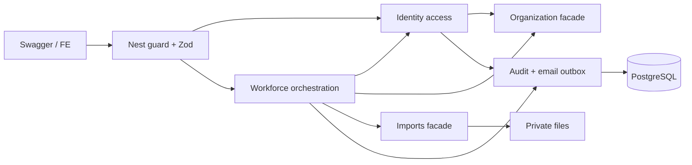

# Native Identity, Profile và Workforce — thiết kế v1.2

> **Status: Accepted for implementation — v1.2, 2026-10-04** (v1.1: 2026-10-04 Proposed; v1: 2026-10-03). **Source of acceptance:** the Owner's prompt of 2026-10-04 ("hoàn tất B0 và gói bàn giao native"), which chose `O-1`…`O-4` (recorded as Docs `QĐ-47`) and delegated the remaining technical choices inside the stated scope to the assistant. This is an **Owner decision, not a confirmation by the supervisor (GVHD)**, and it does **not** mean the Owner personally reviewed every diagram or test, nor that the implementation is safe — **nothing here is implemented or verified**. Accepting a document never authorizes a commit, push or deploy. The direction was already Accepted by [ADR-0010](../decisions/0010-native-password-authentication.md); the build plan and work packages for developers are in [native-delivery-plan.md](native-delivery-plan.md); the record of the Owner's choices is [native-owner-decision-package.md](native-owner-decision-package.md).
>
> **What v1.2 changed (B0 closure, 2026-10-04):** the four Owner points are now decided and no section is gated: credential recovery with the single `loginEmail` exception (6.2, `QĐ-47a`), no two-person rule for the holder leaving and three separate continuity outcomes — `NO_HOLDER`, `HOLDER_UNUSABLE`, and a **warning** `HANDOVER_PAST_LAST_DAY` that never makes a usable holder unusable (6.2, 7.1, `QĐ-47b`), zero direct roles with effective roles = direct ∪ derived (4, 6, `QĐ-47c`), organization timezone chosen at bootstrap and immutable through ordinary APIs (4, 7.1, `QĐ-47d`). `REASSIGN` recovery is one consistent two-phase procedure that also covers "no usable Super Admin and no eligible recipient yet" (6.2; two phases `QĐ-47e`, derived; phase-1 account creation `QĐ-47f`, Owner-approved exception to `QĐ-46a(3)`, prompt 2026-10-04, not GVHD). **Actor stability** is now a protocol, not a sentence: protected mutations freeze the actor's authority rows with `FOR SHARE` under a fixed lock order (9.1a). Contracts closed: approval-holder reverse check reads the real table created in B1b (6.1), one stored object ↔ one import job with re-preview as a revision and persisted idempotent commit (7.3), token↔outbox cardinality `D-K15` (4), `organization-setup` ownership (3). Physical decisions raised by the Logical review (`PR-04`→`PR-07`, `PR-12`) are placed with an owner and slice in 12. The v1.1 text below is kept where unchanged.
>
> **W-19 closed (05/10/2026; version number unchanged):** the employee-import value names are now **one set, the Logical one** (`VALID`, `ERROR`, `DUPLICATE_SKIPPED`, `EXISTING_WITH_DIFFERENCES`), and 7.3a/7.3b record the planned `CHECK`s, the row error code → column table, the job-status subset used in S0, the `stored_objects.purpose` refinement and a seven-case scenario table. These are **COORDINATOR chốt kỹ thuật 05/10/2026 (trong phạm vi Owner giao ở QĐ-47; không phải quyết định nghiệp vụ)** — not Owner and not GVHD decisions. The sub-point W-19c (which fields are compared for an existing employee) was decided by the Owner on 05/10/2026 (Docs `QĐ-48d`; not GVHD): all seven non-key columns (7.3a item 2a).
>
> **W-08 decided (05/10/2026):** a recorded handover can now be **changed** (E09b) or **cancelled** (E09c) under the rules L3a/L3b — Owner choices `QĐ-48a`–`QĐ-48c` (Owner chốt qua prompt phiên 05/10/2026 (Docs QĐ-48a–c), không phải xác nhận của GVHD); the derived details (codes, locks, response fields) are **COORDINATOR chốt kỹ thuật 05/10/2026 (trong phạm vi Owner giao ở QĐ-47/QĐ-48; không phải quyết định nghiệp vụ)**. Two operations are added (inventory 49 new + 5 baseline = 54).
>
> **What v1.1 changed (docs audit follow-up, 2026-10-04):** lock protocol replaced by two ordered classes (9.1, with a design argument to be confirmed by N19); password policy made explicit with NFC normalization (5.1.1); session lifetime idle 30 minutes/absolute 8 hours instead of 7 days (5.1.2); limiter order and victim lock-out analysis (5.4.3); frontend contract for lazy refresh and cross-tab single flight (5.2.1); a single authoritative outbox dispatcher with fenced leases, AAD-bound encryption, rotation and cleanup (5.4.1–5.4.2); `emailVerificationSource` and role semantics (direct/derived/effective, zero direct roles) in the data contract; lifecycle rules L1–L9 aligned with US-03-04, US-03-01 and US-01-02 (7.1); Super Admin recovery and continuity proposals (6.2); verified Prisma facts (12). The v1.1 sections replace the 2026-10-03 text in place; this file is not yet committed, so there is no git history of v1.
>
> Hướng tự quản password và phạm vi tính năng được Owner chọn theo [ADR-0010](../decisions/0010-native-password-authentication.md). Các lựa chọn kỹ thuật cụ thể dưới đây được **Accepted for implementation** từ v1.2 theo ủy quyền của Owner; giá trị cấu hình (TTL, giới hạn, tham số Argon2) vẫn chỉnh được bằng cấu hình mà không đổi hợp đồng. Đây là bộ thiết kế thay phần identity/workforce của S0 cũ; không thay thiết kế license/finance/usage ngoài phạm vi.

## 1. Mục tiêu, nguồn và đầu ra

Một AI mới phải đọc AGENTS → ADR-0010 → tài liệu này → [kế hoạch giao dev](native-delivery-plan.md) → [test/verify](../guides/native-identity-verification.md) → [maintenance](../guides/native-identity-maintenance.md). Không đọc trạng thái lịch sử “slice 1 done” rồi giả định code còn tồn tại sau restore.

Đích sử dụng: bootstrap Super Admin; login email/password trực tiếp qua Swagger; SA tạo account từ Employee, gửi invitation; nhân viên tự đặt/đổi/reset password, xem profile; IT nhập tay hoặc import nhân viên từ CSV/XLSX có preview và commit; mọi request được kiểm quyền từ DB. Không yêu cầu thao tác Keycloak hoặc tự tìm OIDC subject.

Nguồn business: BRD FR-8.1/3/5/7/8/9/10, FR-2.1, FR-3.1, FR-7.x, FR-9.3/7, INV-05/14a/14b/15, SoD-1..8; US-01-01/02/05/06/09, US-02-01/02/03, US-03-01/03/04 và US-04-09. Đổi riêng các điều kiện OIDC theo ADR-0010; không đổi cây quản lý thành phòng ban.

### Đã được Owner chọn

- Local password, không đăng ký tự phục vụ; SA tạo account, IT quản lý Employee.
- Email mời đặt password; profile chỉ xem hồ sơ + sửa ngôn ngữ trong đợt đầu.
- Nhập tay + CSV/XLSX preview/xác nhận; cung cấp file mẫu và dữ liệu giả 15 Employee.

### Quyết định của Owner trong prompt 2026-10-04 (Docs `QĐ-47`; không phải xác nhận của GVHD)

- **O-1** — chấp nhận khôi phục **thông tin đăng nhập** (`CREDENTIAL`) ngoài ứng dụng, kèm ngoại lệ duy nhất cho phép thay `loginEmail` khi hộp thư cũ đã mất; người nhận tự đặt mật khẩu; không operator nào đặt hay biết mật khẩu; không public bypass; không dùng bootstrap để sửa tài khoản có sẵn; giữ phân tách người theo `QĐ-41b`.
- **O-2** — không thêm quy trình hai người cho việc nghỉ của Super Admin; giữ chặn theo trạng thái `TERMINATED`; cảnh báo, audit, giám sát, hướng dẫn "chuyển giao trước, rồi mới cho nghỉ việc" và khôi phục khẩn cấp; quá ngày bàn giao **không** tự làm mất quyền.
- **O-3** — cho phép 0 vai trực tiếp, không tự thêm `EMPLOYEE`; vai hiệu lực vẫn gồm vai suy ra hợp lệ; thu hồi `IT_ADMIN` không thu hồi `EMPLOYEE`.
- **O-4** — múi giờ tổ chức chọn lúc bootstrap, bất biến qua API thông thường; đổi sau này cần thiết kế chuyển đổi riêng.
- Ngoài bốn điểm: hướng native và bộ chức năng (login/logout, kích hoạt, quên/đặt lại/đổi mật khẩu, quản lý phiên và phân quyền, hồ sơ, Super Admin quản lý tài khoản, IT nhập tay/import nhân viên, chuyển giao/khôi phục Super Admin) đã được Owner đồng ý; **các lựa chọn kỹ thuật còn lại trong phạm vi do trợ lý hoàn thiện** và được ghi ở tài liệu này.

Các điểm **chưa được kiểm chứng** (mục 12) vẫn là tiêu chí nghiệm thu của B1/B3, **không** phải cam kết thiết kế.

### Ngoài phạm vi

Public signup; social login/SSO; MFA UI; sửa email đăng nhập qua profile; avatar/upload ảnh; quản lý hồ sơ cá nhân nhạy cảm; tự tạo role khi import; cấp/thu hồi license; workflow phê duyệt; scheduled termination job; import sửa ngầm lịch sử. Nghỉ việc vẫn chặn truy cập ngay theo status, không tự reclaim seat. Mobile/device credential và collector là boundary riêng cho lát sau.

## 2. Baseline và migration

- HEAD restore: `78cb675`; 5 HTTP operations nền: health live/ready, catalog list/detail/create. Chưa có AppUser/Employee lifecycle service mới, dù schema phác thảo có Principal/Employee/Department.
- Giữ NestJS modular monolith, Express, Prisma/PostgreSQL, strict Zod DTO, envelope, logger, correlation ID, private object storage adapter, BullMQ infrastructure và architecture tests.
- Loại runtime OIDC guard adapter/config/Keycloak compose/Swagger OAuth sau khi local replacement có test; giữ lịch sử ADR. Giữ Bearer scheme cho access token do BE cấp.
- Không rewrite migration `20260812000000_initial_foundation`. Migration mới phải xử lý FK từ các bảng phác thảo còn tham chiếu Principal/Employee. Kiểm kê row counts và `_prisma_migrations` trước; nếu DB đã có migration S0 bị restore khỏi Git, không chạy migrate/reset vào đó. Dùng database mới được chỉ định cho thử nghiệm; dữ liệu cũ cần plan chuyển đổi riêng. Không tự chuyển password từ Keycloak.
- Chỉ archive/drop bảng phác thảo không dùng khi đã chứng minh rỗng và được phạm vi migration cho phép; bảng có dữ liệu làm preflight thất bại trước mọi destructive DDL. Company/Cost Center/period/employee được tạo bằng migration mới, không giữ Department làm auth scope.
- `.env`, DB, Docker volume và các process đang chạy không được restore theo Git. Generated Prisma phải generate lại theo schema; process cũ phải restart trước khi kết luận về API hiện tại.

## 3. Kiến trúc và ownership

| Boundary                | Sở hữu                                                                                                                                                                                                                                                                                             | Public interface dự kiến                               |
| ----------------------- | -------------------------------------------------------------------------------------------------------------------------------------------------------------------------------------------------------------------------------------------------------------------------------------------------- | ------------------------------------------------------ |
| `identity-access`       | AppUser, credentials, sessions, one-time tokens, role grants, approval holder refs                                                                                                                                                                                                                 | `IdentityAccessService`, `identity-access.contract.ts` |
| `organization`          | Organization, Employee, CostCenter, effective manager/CC/leave periods                                                                                                                                                                                                                             | `OrganizationService`, `organization.contract.ts`      |
| `workforce-access`      | Orchestration employee lifecycle + session invalidation, **employee file parser và apply adapter** (adapters/, policies/), không sở hữu bảng                                                                                                                                                       | `WorkforceAccessService` + employee HTTP controller    |
| `imports`               | ImportJob, row result, preview lifecycle, dedupe                                                                                                                                                                                                                                                   | `ImportsService`, `imports.contract.ts`                |
| `files`                 | StoredObject, private employee source upload lifecycle                                                                                                                                                                                                                                             | `FilesService`, `files.contract.ts`                    |
| `organization-setup`    | **Không sở hữu bảng**: controller HTTP của cài đặt tổ chức và hoàn tất khởi tạo cần gọi cả `organization` lẫn `catalog`/`licenses` (work item 0009 D8, 0011 D4); gọi use case của `OrganizationService` với `tx`; **không** có trong B1–B10 của native (lệnh bootstrap là script, không phải HTTP) | controller và orchestration, không có repo/model       |
| `audit`                 | Append-only audit rows, truy vấn SA                                                                                                                                                                                                                                                                | `AuditService.record(tx, event)`                       |
| `notifications`         | Email outbox, delivery attempts, retry                                                                                                                                                                                                                                                             | `NotificationsService.enqueue(tx, message)`            |
| infrastructure/security | Argon2 adapter, JWT signing/verify, header/cookie/CSRF, throttler                                                                                                                                                                                                                                  | Ports nhỏ, không query bảng business                   |

`identity-access` đọc organization qua facade; `organization` không inject identity-access. `workforce-access` gọi cả hai trong cùng Tx cho terminate/handover/manager update. `imports` không query Employee; parser/apply adapter nghiệp vụ ở workforce-access gọi OrganizationService. Controller-facing facades chỉ có khi có caller thật. Shared transaction/lock capability nằm infrastructure/database, không cấp quyền query bảng module khác. Audit/outbox dùng Tx của caller; SMTP chỉ chạy sau commit. Metadata decorator ở root contract không kéo service/private repo vào module khác. Không `forwardRef`.

## 4. Data contract

UUID IDs; UTC instants; business dates `YYYY-MM-DD` theo organization timezone; periods `[validFrom,validTo)`. Một organization mỗi instance. Composite org FKs tránh tham chiếu chéo; orgId/actor không nhận từ body. Optimistic `version`, `createdAt`, `updatedAt` are implied on every mutable aggregate and are **storage detail**: they are listed here only where the API exposes them (`expectedVersion`) and are not drawn in the Logical ERD.

Status legend: v1.2 has no gated rows. Everything in this contract is **Accepted for implementation** (Owner prompt of 2026-10-04); items that are not yet verified (section 12) stay acceptance items of the package that builds them. Build tasks implement exactly this contract and report a defect instead of choosing an interpretation.

| Table/model               | Field/invariant tối thiểu                                                                                                                                                                                                                                                                                                                                                                                                                                                                                                                                                                                                                                                                                                                                                                                                                                                                                                                                                                                                                                                                                                                        |
| ------------------------- | ------------------------------------------------------------------------------------------------------------------------------------------------------------------------------------------------------------------------------------------------------------------------------------------------------------------------------------------------------------------------------------------------------------------------------------------------------------------------------------------------------------------------------------------------------------------------------------------------------------------------------------------------------------------------------------------------------------------------------------------------------------------------------------------------------------------------------------------------------------------------------------------------------------------------------------------------------------------------------------------------------------------------------------------------------------------------------------------------------------------------------------------------ |
| Organization              | singleton, timezone (IANA; **chọn lúc bootstrap, bất biến qua API thông thường** — `QĐ-47d`; không có trường hay thao tác đổi, `UPDATE` trực tiếp bị trigger từ chối), reportingCurrency, bootstrapCompletedAt                                                                                                                                                                                                                                                                                                                                                                                                                                                                                                                                                                                                                                                                                                                                                                                                                                                                                                                                   |
| Employee                  | org, employeeCode unique, fullName, workEmail/raw+normalized nullable unique, employmentType STAFF/CONTRACTOR/FREELANCER/INTERN, hireDate (may be in the future, see 7.1), status ACTIVE/LONG_LEAVE/TERMINATED, inHandover, lastWorkingDate (null until handover or termination; required when status = TERMINATED; `hireDate <= lastWorkingDate`), departmentLabel nullable, version                                                                                                                                                                                                                                                                                                                                                                                                                                                                                                                                                                                                                                                                                                                                                            |
| CostCenter                | org, code unique, name, type UNIT/PROJECT/COMPANY, status ACTIVE/INACTIVE, version                                                                                                                                                                                                                                                                                                                                                                                                                                                                                                                                                                                                                                                                                                                                                                                                                                                                                                                                                                                                                                                               |
| EmployeeCostCenterPeriod  | employee, CC, validFrom/validTo; no overlap, full coverage of the employment timeline, `validFrom >= hireDate`; terminal end `lastWorkingDate+1`; future-dated periods allowed (7.1)                                                                                                                                                                                                                                                                                                                                                                                                                                                                                                                                                                                                                                                                                                                                                                                                                                                                                                                                                             |
| EmployeeManagerPeriod     | employee, manager (absence of a period = no manager), validFrom/validTo; no self/cycle/overlap, history retained, future-dated periods allowed (7.1); a period whose manager is TERMINATED must not contain the organization date                                                                                                                                                                                                                                                                                                                                                                                                                                                                                                                                                                                                                                                                                                                                                                                                                                                                                                                |
| EmployeeLeavePeriod       | employee, from, expectedReturnDate, actualReturnDate nullable; no overlapping leave; closed at `lastWorkingDate+1` on termination                                                                                                                                                                                                                                                                                                                                                                                                                                                                                                                                                                                                                                                                                                                                                                                                                                                                                                                                                                                                                |
| AppUser                   | org, employeeId unique, loginEmail canonical unique per org, status ACTIVE/LOCKED, activationState INVITED/ACTIVATED, emailVerifiedAt + emailVerificationSource (`INVITATION_REDEEMED` / `BOOTSTRAP_ASSERTED` / `RECOVERY_REDEEMED`; both null or both set; `RECOVERY_REDEEMED` is written only when the person opens the recovery link delivered to the address that is `loginEmail` **at that moment** — a label of the old address is never carried to a new address), preferredLocale VI/EN, credentialVersion (integer >= 1, incremented by every credential change and by every revocation-of-all), version. An account may hold **zero direct roles** (`QĐ-47c`); the role set is never defaulted                                                                                                                                                                                                                                                                                                                                                                                                                                         |
| PasswordCredential        | appUserId unique, Argon2id PHC hash, `hashPolicyVersion` (identifies normalization form + Argon2id parameter set), changedAt. Row absent until activation, and **removed (not blanked)** when credential recovery starts. `activationState = INVITED` implies no row; `ACTIVATED` implies a row **unless** a `CREDENTIAL` recovery operation is `PENDING` for the account ("reset pending")                                                                                                                                                                                                                                                                                                                                                                                                                                                                                                                                                                                                                                                                                                                                                      |
| UserRoleGrant             | appUserId, org, roleCode in {SUPER_ADMIN, IT_ADMIN, FINANCE, EMPLOYEE} (direct roles only), grantedBy/At, revokedBy/At; active unique `(appUser,role)`; partial unique `(org)` where role SUPER_ADMIN and revokedAt NULL. No minimum role count                                                                                                                                                                                                                                                                                                                                                                                                                                                                                                                                                                                                                                                                                                                                                                                                                                                                                                  |
| ApprovalRoleHolder        | employee, org, kind SPENDING/CONFLICT/ROOT, validity; future settings slice, no generic role-grant endpoint; no SA holder                                                                                                                                                                                                                                                                                                                                                                                                                                                                                                                                                                                                                                                                                                                                                                                                                                                                                                                                                                                                                        |
| AuthSession               | appUser, org, credentialVersion, createdAt, lastRotatedAt (idle clock), absoluteExpiresAt, revokedAt/revokedReason in {LOGOUT, LOGOUT_ALL, PASSWORD_CHANGED, PASSWORD_RESET, ACCOUNT_LOCKED, EMPLOYEE_TERMINATED, REPLAY_DETECTED, RECOVERY, EXPIRED}; one refresh family per browser login                                                                                                                                                                                                                                                                                                                                                                                                                                                                                                                                                                                                                                                                                                                                                                                                                                                      |
| RefreshToken              | sessionId, tokenHash unique, expiresAt, consumedAt, replacedById (storage detail: not drawn); retain consumed hashes until the session's absolute expiry + 1 day to detect replay                                                                                                                                                                                                                                                                                                                                                                                                                                                                                                                                                                                                                                                                                                                                                                                                                                                                                                                                                                |
| AccountActionToken        | appUser, purpose INVITE/RESET_PASSWORD/RECOVER_CREDENTIAL, tokenHash unique, expiresAt, consumedAt, revokedAt/revokedReason in {SUPERSEDED, ACCOUNT_LOCKED, EMPLOYEE_TERMINATED, CREDENTIAL_CHANGED, RECOVERY}, credentialVersion, createdBy nullable (null = system / forgot-password / recovery), recoveryOperationId nullable (set **iff** issued by a recovery operation); no plaintext token; at most one **redeemable** token per `(appUser, purpose)`: issuing a new one revokes the previous one in the same transaction. `RESET_PASSWORD` targets an `ACTIVATED` account **with** a credential; `RECOVER_CREDENTIAL` targets an `ACTIVATED` account **without** one (reset pending)                                                                                                                                                                                                                                                                                                                                                                                                                                                     |
| EmailOutbox               | recipientEmail (for recovery mail it can be the **new** address, not yet `loginEmail`), template (ACCOUNT_INVITATION, PASSWORD_RESET, PASSWORD_CHANGED_NOTICE, CREDENTIAL_RECOVERY, RECOVERY_NOTICE), locale, actionTokenId nullable, status PENDING/CLAIMED/SENT/FAILED/CANCELLED, attempts, nextAttemptAt, leaseUntil + leaseOwner (fence), payloadKeyId, payloadNonce, payloadCiphertext (nullable after purge), lastErrorCode, sentAt. Encrypted payload is bound to the row by AAD (5.4). **`D-K15` (closes Logical `K15`):** one outbox row per action token — partial unique index `email_outbox_action_token_uniq` on `(organization_id, action_token_id) WHERE action_token_id IS NOT NULL` plus the composite foreign key to `account_action_tokens`; `CHECK email_outbox_template_token_check` — templates that carry a link (`ACCOUNT_INVITATION`, `PASSWORD_RESET`, `CREDENTIAL_RECOVERY`) require `action_token_id`, templates that do not (`PASSWORD_CHANGED_NOTICE`, `RECOVERY_NOTICE`) forbid it. Retries reuse the row; a resend creates a **new** token and a **new** row; the old row is `CANCELLED` in the same transaction |
| RecoveryOperation         | `recovery_operations`: org, kind CREDENTIAL/UNLOCK/REASSIGN, approvalRef unique per org, status PENDING/COMPLETED/SUPERSEDED, environment SHARED/LOCAL_TEST, operatedByEmployee, approvedByEmployee, holderAppUser nullable (null = no holder), recipientAppUser, identityCheckRef (required for CREDENTIAL; a reference, never personal data), newLoginEmail nullable (CREDENTIAL only, normalized; **never applied to `app_users` until completion**), completedAt. At most one `PENDING` operation per recipient (partial unique index); a new approvalRef for the same recipient supersedes the pending one in the same transaction. Created **only** by `scripts/recover-super-admin.ts`; there is no HTTP route. Gives idempotency, resumability between the two `REASSIGN` phases, and monitoring for the offline procedure                                                                                                                                                                                                                                                                                                               |
| AuditEvent                | org, actor, roles snapshot, action/resource, before/after allowlist, correlationId; no UPDATE/DELETE/TRUNCATE                                                                                                                                                                                                                                                                                                                                                                                                                                                                                                                                                                                                                                                                                                                                                                                                                                                                                                                                                                                                                                    |
| StoredObject              | private generated object key, org, uploader, `purpose` (S0 CHECK: `EMPLOYEE_IMPORT` only; Logical `IMPORT_SOURCE` is refined physically, 7.3a item 5), bytes/`sha256` (computed by the server)/contentType, `status` PENDING/AVAILABLE/QUARANTINED/DELETED (`quarantine_reason` when QUARANTINED), expiry                                                                                                                                                                                                                                                                                                                                                                                                                                                                                                                                                                                                                                                                                                                                                                                                                                        |
| ImportJob/ImportRowResult | owner+org, **one job per stored object** (unique `stored_object_id`), sourceObject/checksum, `kind` (S0 CHECK: `EMPLOYEES` only), schemaVersion, status (CHECK lists all 7 Logical values UPLOADED/PARSED/PREVIEWED/COMMITTED/CANCELLED/EXPIRED/FAILED; S0 produces five transitions, 7.3a item 4), failureCode (file-level failures only), previewRevision (starts at 1; increases on every re-preview of the **same** job), previewHash, previewExpiresAt, duplicateOfImportJobId/duplicateAcknowledged (7.3a item 6), commitIdempotencyKeyHash + commitRequestHash + commitResult (written in the commit transaction; see 7.3). Row result: rowNumber, normalized data, `outcome` in {`VALID`, `ERROR`, `DUPLICATE_SKIPPED`, `EXISTING_WITH_DIFFERENCES`}, `error_code` + `error_column` (present iff `ERROR`), `difference_summary` (present iff `EXISTING_WITH_DIFFERENCES`), `target_entity_id` (only `VALID` rows, only after commit); planned constraints in 7.3a item 7; import employee only initially                                                                                                                                 |

Technical persistence (infrastructure support, **not** a business entity and not drawn in the Logical figure): `AuthThrottleWindow(scope, keyHash, windowStart, count, expiresAt)` with unique `(scope,keyHash,windowStart)`. Infrastructure/security owns its dedicated repo and queries only that table; `PRISMA_MODEL_OWNER` must record it as owned by `infrastructure/security` and the architecture test allowlist must encode the exception explicitly. Counters use atomic upsert/increment and TTL cleanup, never business-role tables. Keys are HMAC digests; no raw email or IP is stored.

**Roles — direct, derived, effective.** _Direct_ roles are the stored grants {SUPER_ADMIN, IT_ADMIN, FINANCE, EMPLOYEE}. _Derived_ roles are computed, never stored: MANAGER (the employee is not TERMINATED, and at least one other employee has a manager period naming them that contains the organization date; suppressed for SUPER_ADMIN) and SPENDING_APPROVER (the employee is the configured active holder). _Effective_ roles = direct ∪ derived, and are empty unless the account is ACTIVE, ACTIVATED **with a credential** and its employee is not TERMINATED. Authorization always evaluates effective roles read from the database in the same request. **An account is limited to self-service only when its effective set is empty — i.e. it has neither a direct nor a valid derived role (`QĐ-47c`).** An account with zero **direct** roles that is a derived Manager or the configured Spending Approver keeps those derived roles; revoking `IT_ADMIN` from an account that also holds `EMPLOYEE` leaves `EMPLOYEE` untouched. An account with an empty effective set can still reach `@AuthenticatedOnly` routes (profile, change password, logout) and nothing else.

No plain password, password hash, token digest, session secret or outbox ciphertext leaves API DTO/audit/log. Mailbox and workEmail are different concepts: changing Employee.workEmail never retargets loginEmail or invitation. Login normalization: trim + lowercase, preserve `+tag`. Employee.workEmail uses shared BRD normalizer (trim/lowercase/remove plus suffix for dedupe), not blindly reused for login. Raw work email remains display value. Test both normalizers independently.

## 5. Authentication/session design

### 5.1 Defaults (Accepted for implementation; configurable by environment)

Sources read 2026-10-04 (retrieved through a summarising fetch tool; section numbers as reported, re-check the exact wording before quoting in a submission): [NIST SP 800-63B-4 §3.1.1.2 and §3.2.2](https://pages.nist.gov/800-63-4/sp800-63b.html), [OWASP Password Storage](https://cheatsheetseries.owasp.org/cheatsheets/Password_Storage_Cheat_Sheet.html), [OWASP Session Management](https://cheatsheetseries.owasp.org/cheatsheets/Session_Management_Cheat_Sheet.html). All values below are **project proposals configurable by environment**; the floors marked _floor_ are enforced at startup (the process refuses to boot below them).

| Setting                | Default v1.1                                                                                                                                                                                                                                                                                                            |
| ---------------------- | ----------------------------------------------------------------------------------------------------------------------------------------------------------------------------------------------------------------------------------------------------------------------------------------------------------------------- |
| Login identifier       | email, no separate username                                                                                                                                                                                                                                                                                             |
| Password               | see 5.1.1                                                                                                                                                                                                                                                                                                               |
| Hash                   | Argon2id, library-generated unique salt, PHC string. _Floor_ m=19456 KiB, t=2, p=1 (OWASP minimum configuration); tune upward on deployment hardware to 150–500 ms per verification and record the measurement. Rehash on login when the stored parameters or `hashPolicyVersion` are below the configured ones (5.1.1) |
| Access token           | JWT RS256, 10 minutes, `iss=saas-sentry`, `aud=saas-sentry-api`, `sub=appUserId`, `sid`, `cv`, `iat`, `exp`, `jti`, header `typ=at+jwt`, explicit algorithm/claim allowlist; no `nbf`, no role claims                                                                                                                   |
| Session lifetime       | **idle 30 minutes** (measured from `lastRotatedAt`, updated at login and at each refresh) and **absolute 8 hours** from login; rotation never extends the absolute deadline. Replaces the 7-day absolute lifetime of the 2026-10-03 draft (see 5.1.2)                                                                   |
| Refresh                | 32 random bytes base64url, SHA-256 digest in DB; rotating one-use                                                                                                                                                                                                                                                       |
| Invitation/reset       | separate 32-byte tokens, 24h / 30min respectively, one-use, purpose-bound; activation/reset never auto-login                                                                                                                                                                                                            |
| Browser refresh cookie | production `__Host-slm_refresh`, HttpOnly, Secure, SameSite=Lax, Path=/, no Domain; local HTTP `slm_refresh`, Secure=false, development-only                                                                                                                                                                            |
| Access token client    | response JSON, FE memory; Swagger paste into Bearer Authorize; no localStorage/persistAuthorization                                                                                                                                                                                                                     |

JWT roles are absent; DB authoritative on every request. Guard checks account lock/termination before session revocation for an otherwise valid signed token: LOCKED →403, TERMINATED →403, absent/expired/revoked session or credentialVersion mismatch →401. Token decode/signature/expiry failure →401; dependency failure →503 `AUTH_UNAVAILABLE`, no fail-open and no second auth mode.

**Verifier contract:** require all listed claims, not only validate them when present. `sub`/`sid`/`jti` are non-empty identifiers, `cv` is a nonnegative safe integer, `iat`/`exp` are integer NumericDates with `exp > iat` and lifetime at most 600 seconds; reject missing/wrong-type claims, wrong `typ`/algorithm/issuer/audience, future-issued (`iat` ahead of server time) or expired tokens under an explicit bounded clock tolerance (at most 30 seconds). Resolve `sid` to the same `sub`, organization and credentialVersion; a valid signature alone is insufficient. A trusted local key registry selects keys by `kid`; reject unknown or compromised key IDs, never fetch a URL from token headers. Normal key rotation may retain old verification keys for the token lifetime; compromise removes the affected key from trust immediately on every API instance (the registry is loaded from configuration at startup and on `SIGHUP`/restart; there is no distributed revocation list in v1, so compromise response is a rolling restart plus session revocation) and revokes affected sessions. Operational dependency failures are 503; unexpected programming defects remain 500.

#### 5.1.1 Password policy

1. **Normalization — NFC (Unicode Normalization Form C), applied once to the raw submitted string before length counting, blocklist comparison and hashing.** Analysis: without any normalization, the same visible Vietnamese password typed through different IMEs/keyboards can arrive as precomposed or decomposed code points and fail on another device, which is a real usability failure for this user base; NIST SP 800-63B-4 §3.1.1.2 says the verifier SHOULD normalize with NFC. NFKC was considered and **not selected**: compatibility folding collapses visually/semantically distinct characters (fullwidth forms, ligatures, superscripts), shrinks the effective keyspace slightly, can surprise a user who deliberately typed such a character, and NIST does not ask for it. No trimming, no case folding of the secret itself. `hashPolicyVersion` records `nfc-1` so a later change of rule is detectable per credential.
2. **Length** — 15 to 128 Unicode code points **after** NFC (NIST: minimum 15 for single-factor passwords; maximum at least 64; each code point counts as one). Counting is by code point, not by grapheme cluster; the policy text shown to users says "characters" and the API reports `reason = TOO_SHORT | TOO_LONG`. Because 128 code points are at most 512 UTF-8 bytes, no separate byte cap exists; auth endpoints cap the request body at 4 KiB before parsing.
3. **Allowed characters** — any Unicode scalar value except control characters (U+0000–U+001F, U+007F–U+009F) and unpaired surrogates (`reason = INVALID_CHARACTER`). Spaces and any script are allowed. No composition rules and no periodic expiry (NIST: SHALL NOT impose them); a change is forced only on evidence of compromise (reset, recovery, replay detection).
4. **Blocklist** — whole-password comparison after NFC and case folding (NIST: the entire password is compared, not substrings), against (a) a bundled static list of known common/compromised passwords whose provenance, licence, version and SHA-256 are recorded in the repository when it is chosen (task B3a); because the minimum length is 15, the effective list is the subset of that source with at least 15 characters plus pattern rules; (b) context terms for the specific user: login email local part, employee code, any name token of at least 4 characters, the product and organization names; (c) rule patterns: a single repeated character, simple ascending/descending sequences, keyboard rows. An online breached-password service (k-anonymity range queries) was rejected for v1: it adds an outbound dependency and a privacy surface; revisit later. No claim is made about list size until it is selected.
5. **Rehash** — on a successful login (and on password change), if the PHC parameters or `hashPolicyVersion` are lower than the configured values, the plaintext already in memory is rehashed and the credential row updated in the same transaction under a row lock with a re-check; `credentialVersion` is **not** changed by a rehash. Raising parameters therefore never invalidates sessions.
6. **Unknown-account timing** — the dummy hash is generated at process start with the **current** configured parameters (so it can never drift), and login for unknown, INVITED, locked or terminated accounts performs one verification against it.
7. **No pepper in v1.** A pepper protects against offline attack after database theft but needs key custody and rotation; Argon2id at the floor parameters is judged sufficient for this system; recorded as a rejected alternative, revisit if the threat model changes.

#### 5.1.2 Session timeouts

Idle 30 minutes and absolute 8 hours follow OWASP Session Management (idle 15–30 minutes for lower-risk applications; absolute 4–8 hours for an application used through an office day) and sit inside NIST SP 800-63B-4 AAL2 recommendations (overall timeout no more than 24 hours, inactivity no more than 1 hour). The product handles spending decisions and account administration, so no "remember me" exists and privileged roles use the same values. Because the browser refreshes **lazily** (when the access token has expired and the next API call needs one, never on a timer), the effective idle window is the 30 minutes plus at most the 10-minute remaining life of the last access token. The 2026-10-03 draft's 7-day lifetime is withdrawn: it exceeds the AAL2 24-hour recommendation and is not justified by any requirement.

### 5.2 CSRF/CORS and browser behavior

Login, refresh, logout, forgot/reset/activate endpoints require `Content-Type: application/json` and header `X-CSRF-Guard: 1`, including `{}` for no-body actions. Reject form/text content types (415), missing/wrong header (403). If Origin exists it must exactly match API public origin or configured FE allowlist; reject `null`/wildcard/untrusted Origin. Origin-less nonbrowser clients are allowed only with required custom header/content type. Explicit OPTIONS preflight allows only configured origins/headers; no cookie authentication of business routes (a test must prove that a request carrying only the refresh cookie is rejected on every business route, because `__Host-` forces `Path=/` and the cookie therefore travels everywhere). These custom-header and strict CORS checks, cookie SameSite and no GET mutations are the CSRF design; SameSite alone is insufficient.

Swagger documents header default `1` on those operations, uses same-origin credentials, no OAuth scheme. Login returns `{accessToken, tokenType:"Bearer", expiresIn:600}` and sets refresh cookie. To renew, POST refresh `{}` then replace access token in Authorize. Logout needs only refresh cookie/custom header and clears cookie with identical attributes; cannot require unexpired access token. API responses involving credentials use `Cache-Control: no-store`. Refresh credential is never returned in JSON/query string.

**Deployment constraint:** the proposed `SameSite=Lax` cookie requires FE and API to be same-site (same scheme and registrable domain), preferably same-origin via reverse proxy. Different ports on local `localhost` are cross-origin but same-site; cross-origin fetch still needs `credentials: 'include'` and an exact CORS origin with credentials enabled. An allowlisted FE on an unrelated site will not receive/send the refresh cookie on cross-site fetch merely because CORS allows it. Such hosting requires a reviewed cookie/CSRF design change; do not silently switch to `SameSite=None`. Reject duplicate refresh-cookie names rather than choosing an ambiguous value.

### 5.2.1 Frontend contract (specification only; the FE is not implemented in this phase)

1. **Token custody.** The access token lives only in memory of the tab; never in `localStorage`, `sessionStorage`, IndexedDB or a cookie readable by script. Every protected request sends `Authorization: Bearer <token>`.
2. **Lazy refresh.** There is no refresh timer. Before a protected call the client checks its own expiry clock (`expiresIn` from the last response minus 30 seconds); if expired — or if the API answers `401 INVALID_ACCESS_TOKEN` — it refreshes once and retries the original request **once**. A second failure ends the session.
3. **Cross-tab single flight.** Refresh runs inside `navigator.locks.request('slm-auth-refresh', { mode: 'exclusive' }, …)`. After acquiring the lock the tab first asks the other tabs over `BroadcastChannel('slm-auth')` for a token newer than its own; only if none arrives within 250 ms does it call `POST /auth/refresh`. The winner broadcasts `{accessToken, expiresAt}` (in-memory, same-origin only). Where the Web Locks API is unavailable the client falls back to per-tab single flight plus the broadcast query; the server keeps **no reuse grace window** in v1, so a lost race ends in `401 INVALID_REFRESH_TOKEN` and, before showing the login page, the client must make one last broadcast query for a token from another tab.
4. **Replay and revocation.** `401 INVALID_REFRESH_TOKEN` after the broadcast query means the session family is gone (logout elsewhere, replay detected, idle/absolute expiry, credential change): clear memory, broadcast `logout`, route to login. Never retry refresh in a loop.
5. **Logout.** `POST /auth/logout` with the custom header and `credentials: 'include'`, then clear memory and broadcast `logout` so other tabs drop their token and route to login. Change-password and reset end the session server-side; the client must clear memory and route to login after a 200.
6. **Errors.** Branch on `error.code`, never on message. `401 INVALID_CREDENTIALS` (no retry with the same input); `403 ACCOUNT_LOCKED` / `ACCOUNT_HOLDER_TERMINATED` (show a fixed message, no retry); `429` (disable the submit control for `Retry-After` seconds; do not auto-retry); `503 AUTH_UNAVAILABLE` / `AUTH_BUSY` / `SYSTEM_BUSY` (one automatic retry after `Retry-After` for refresh only; login and password operations are user-initiated); `400 INVALID_OR_EXPIRED_TOKEN` on activate/reset (offer "request a new link" for reset; for invitations tell the user to ask the administrator).
7. **Links and headers.** Invitation/reset links carry the token in the URL fragment: the client reads it, removes it with `history.replaceState`, then POSTs JSON. Every auth POST sends `Content-Type: application/json` and `X-CSRF-Guard: 1`. Responses to credential endpoints are `Cache-Control: no-store`; the client must not cache them in a service worker.
8. **CORS.** Fetch with `credentials: 'include'`; the API answers an exact origin (never `*`) with `Access-Control-Allow-Credentials: true`.

### 5.3 Flows and concurrency

Lock names below are defined in section 9 (`IDENTITY` and `STRUCTURE` advisory locks, shared or exclusive).

1. **Login:** normalize email, body cap, limiter checks (5.4), load credential or dummy Argon2 hash for unknown account, verify outside transaction. Then take `IDENTITY` **shared** → actor/account+employee re-read → credential-version match → usability checks → create session/refresh row+audit atomically (a rehash, if due, in the same transaction). Sign access token after successful commit. Unknown email/wrong password share `401 INVALID_CREDENTIALS`; correct password may reveal own ACCOUNT_LOCKED/ACCOUNT_HOLDER_TERMINATED only (an INVITED account has no password, so there is no "not activated" login response — see below).
2. **Refresh:** hash cookie, locate session, take `IDENTITY` **shared** and session/token row locks; check absolute and idle expiry, revocation, account/employee/cv. A locked account or a terminated employee always meets a session that the reducer revoked in the same transaction, so refresh answers `401 INVALID_REFRESH_TOKEN` — never `403` on refresh (W-07, COORDINATOR chốt kỹ thuật 04/10/2026 (trong phạm vi Owner giao ở QĐ-47; không phải quyết định nghiệp vụ)); the `403` codes are returned by login and by the guard on ordinary requests. Consume old refresh and insert new digest in one transaction, set `lastRotatedAt`. Reused consumed token revokes entire session family in a **committed** transaction, then returns 401; do not throw inside Tx and roll back the revocation. Other sessions remain. Two simultaneous refreshes with the same token yield one success and one replay refusal; winner's family is revoked by replay. FE must single-flight across tabs (5.2.1); lost refresh response requires login again, no grace window v1.
3. **Logout:** lookup valid refresh and revoke only its family (`IDENTITY` shared + row lock on its own session); absent/expired cookie still clear and return 200 idempotently. **Logout-all** takes `IDENTITY` **exclusive** (it is a reducer), requires valid access token and revokes all sessions. Previously issued access token fails on next request because sid is checked in DB.
4. **Forgot:** always 202 `AUTH.PASSWORD_RESET_REQUEST_ACCEPTED`, independent of existence/activation/lock. Rate policy same for unknown/known email. Only eligible activated ACTIVE non-TERMINATED accounts receive reset mail — **including the Super Admin**, whose ordinary lost-password path is this one. No account creation and no password/status change at request time. Mail not required to succeed synchronously for HTTP 202.
5. **Reset/activate:** token digest lookup+purpose/expiry/version+account re-check. Hash new password outside lock, then take `IDENTITY` **exclusive** and re-check inside the transaction. Exactly one concurrent request consumes token; write credential/version, consume all competing action tokens, revoke sessions, clear the e-mail failure counters (5.4), audit and confirmation email in same transaction. Invite sets activationState+emailVerifiedAt with source `INVITATION_REDEEMED` (the bootstrap Super Admin gets `BOOTSTRAP_ASSERTED` — operator-asserted, never SMTP-verified); reset never reactivates/changes role/unlocks a user. Invalid/expired/consumed/wrong purpose have one `400 INVALID_OR_EXPIRED_TOKEN` response.
6. **Change password:** authenticated user supplies currentPassword/newPassword; verify current outside Tx and, under `IDENTITY` **exclusive**, revalidate credentialVersion+principal usability. Reject same password/weak password, revoke all sessions (including current), clear refresh cookie; 200 then login again. This self-service action is allowed despite generic self-admin-change prohibition.
7. **Lock/unlock/termination:** lock revokes sessions and action tokens atomically (`IDENTITY` exclusive); unlock does not revive sessions, credentials or invite tokens; if INVITED, SA must resend invite. Termination (`IDENTITY` exclusive, then `STRUCTURE` exclusive) retains AppUser status/grants but revokes sessions/action tokens and blocks auth by Employee status. Role changes take effect next request without password/token reset.

An INVITED account has no usable password: login performs dummy verification and returns the same `401 INVALID_CREDENTIALS` as an unknown account. There is therefore no `ACCOUNT_NOT_ACTIVATED` login code (it could only be returned to a caller whose credential was verified, and an INVITED account has none); never reveal invitation status by email alone. A valid action token must be unconsumed **and** unrevoked; superseding/resending/locking records revocation, not successful consumption. Reset targets ACTIVATED accounts, invite targets INVITED accounts, and both recheck account/employee eligibility after obtaining locks. Invalid, superseded and revoked tokens share the generic token error. Forgot-password responses use the same envelope/status and comparable processing path for eligible and ineligible emails; measure timing distributions without claiming exact constant time from asynchronous SMTP alone.

### 5.4 Email/outbox, failure and abuse

#### 5.4.1 Outbox — one authoritative dispatcher

Account creation/resend/reset writes the action token digest and one `EmailOutbox` row atomically. **PostgreSQL is the only source of dispatch.** A poller in the worker process (`WorkerModule`; in development a flag may run it inside the API process) claims work with a single statement:

`UPDATE email_outbox SET status='CLAIMED', lease_owner=$worker, lease_until=now()+interval '60 seconds', attempts=attempts+1 WHERE id IN (SELECT id FROM email_outbox WHERE (status='PENDING' AND next_attempt_at<=now()) OR (status='CLAIMED' AND lease_until<now()) ORDER BY next_attempt_at, id FOR UPDATE SKIP LOCKED LIMIT $n) RETURNING …`

The claim transaction ends immediately. The worker then, outside any transaction: decrypts, re-reads the token and account (cancel the row `CANCELLED` if the token is expired/revoked/consumed or the account is no longer eligible), sends through SMTP with a 20-second timeout (shorter than the lease), and finishes with `UPDATE … WHERE id=$id AND lease_owner=$worker AND status='CLAIMED'` setting `SENT` — the lease owner is a **fence**: a stale worker whose lease expired and was re-claimed updates zero rows, logs `lease_lost`, and never overwrites a newer result. SMTP failure returns the row to `PENDING` with `next_attempt_at` following 1m, 5m, 15m, 1h, 4h; after the fifth attempt, `FAILED`. Delivery is at-least-once (SMTP accepted but acknowledgement lost ⇒ duplicate mail possible); links are one-use so duplicates are harmless. `SENT` means SMTP acceptance, not that the recipient read it. BullMQ/Redis is **not** used for mail in v1; if it is ever added it may only carry the outbox ID as a wake-up hint and never replaces the row or the poller.

Retries stop if the token expired/superseded or the user became ineligible. New invitation/reset supersedes the previous unconsumed token; the worker checks token/current recipient before sending. Failure leaves the account INVITED; SA can inspect status (U11) and resend with cooldown. Confirmation e-mails contain no token/password. Configure the trusted FE URL, never construct a link from the Host header or a request `returnUrl`. Mail-scanner GET never consumes a token. The local SMTP sink receives only synthetic fixtures; production SMTP is explicitly configured.

#### 5.4.2 Payload encryption, rotation and cleanup

The raw action token (the only sensitive payload) is stored encrypted with AES-256-GCM, 12-byte random nonce, key from a key ring `OUTBOX_ENCRYPTION_KEYS` (`{keyId: base64 key}`) with `OUTBOX_ACTIVE_KEY_ID`; the ring is separate from the JWT signing keys and lives outside the database. **Additional authenticated data = `slm-outbox-v1|<outboxId>|<actionTokenId>|<organizationId>|<template>`**, so a ciphertext copied to another row, token or template fails authentication; an authentication failure marks the row `FAILED(PAYLOAD_INTEGRITY)` and emits a security log event. Decryption happens only in the dispatcher.

_Rotation:_ add the new key to the ring, switch `OUTBOX_ACTIVE_KEY_ID`, leave old keys in the ring. Rows are short-lived (token TTL at most 24 hours plus retries of about 5 hours), so after 48 hours `scripts/auth-outbox-status.ts` should report zero rows with a non-null ciphertext under the old key id, and only then is the old key removed. No bulk re-encryption exists. _Compromise:_ rotate, mark every row that still holds a ciphertext `CANCELLED`, revoke the matching tokens (the same transaction), purge the ciphertext, and have the Super Admin resend invitations.

_Cleanup:_ the ciphertext is nulled the moment a row reaches `SENT`, `FAILED` or `CANCELLED`; `scripts/auth-cleanup.ts` (daily, idempotent) deletes outbox rows 30 days after reaching a terminal state, deletes consumed/revoked action tokens 30 days after expiry, deletes sessions 7 days after expiry together with their refresh tokens, and deletes expired throttle windows. It never touches audit rows.

#### 5.4.3 Rate limiting, limiter order and dependency failure

Throttle state is PostgreSQL (`AuthThrottleWindow`), atomic upsert, keys are HMAC digests (no raw email or IP in keys, logs or metrics). Order of checks for an authentication write, from cheapest to most expensive; nothing hashes a password before steps 1–4 pass:

1. Body cap (4 KiB), content type, `X-CSRF-Guard`, Origin.
2. **Per-IP, per-endpoint window** (login 20/min; forgot 5/hour; redemption 10/min; refresh 30/min per session; resend 3/hour/account with a 60-second minimum; change-password and Super Admin reauthentication 5/min/account plus 20/min/IP).
3. **Per-email 24-hour failure cap** (key = email HMAC, unknown emails counted identically so existence is not revealed): **100 failures per 24 hours** — NIST SP 800-63B-4 §3.2.2 requires at most 100 consecutive failed attempts per account. At the cap, login for that email answers `429 AUTH.LOGIN_TEMPORARILY_BLOCKED` with `Retry-After`; the counter clears on a successful login, on a successful password reset, or when the window ends.
4. **Per-pair failure window** (email HMAC + IP): **5 failures per 15 minutes** → `429` for **that pair only**.
5. Hash queue admission: at most 4 concurrent hash computations per API process, 32 queued, and **at most 2 queued or running per source IP**; overflow → `503 AUTH_BUSY` with `Retry-After: 2`.
6. Verify; on failure increment the pair and per-email counters (and always the per-IP window); on success reset the pair and per-email counters.

_Victim lock-out analysis._ An attacker needs five failed attempts from **their own** IP to block only their own pair; they cannot block the victim's other IPs. Blocking the victim everywhere requires 100 failures in 24 hours, which the per-IP limits (20/min/IP) make costly but not impossible with many IPs. That case is bounded, never permanent (the window ends), generates a security log event, and does not remove the victim's recovery path: forgot-password uses separate counters, and a successful reset clears the per-email cap. A distributed botnet can still fill the 32-slot hash queue; that is a residual risk, answered by `503 AUTH_BUSY` (retryable, no account state changed), proxy/WAF limits in front of the API, and the metric `auth_hash_queue_depth`. No CAPTCHA is specified in v1.

_Dependency failure._ If the throttle store or the database is unreachable, authentication writes fail **closed** with `503 AUTH_UNAVAILABLE` and `Retry-After: 5`; there is no in-memory fallback and no fail-open. Read-only token validation that cannot reach the database also answers `503`. 429 and 503 always carry `Retry-After`. Global throttle is retained for other endpoints. No password or raw email in limiter keys or metrics.

## 6. Authorization, bootstrap và profile

Route must declare `@Public`, `@AuthenticatedOnly` or `@RequireRoles(...)`; missing declaration denied and route inventory test fails. Roles in RequireRoles use OR over **effective** roles (section 4), method overrides class; guards never trust unvalidated body. After guard, use case verifies target/org/scope and rechecks write actor under lock. SA has no universal business bypass.

| Action                                                   | SA                   | IT                           | Finance                   | Manager/Employee |
| -------------------------------------------------------- | -------------------- | ---------------------------- | ------------------------- | ---------------- |
| Own profile/preferences/password/logout                  | yes                  | yes                          | yes                       | yes              |
| Account create/list/lock/roles/invitation/transfer/audit | yes                  | no                           | no                        | no               |
| Minimal account-candidate employee lookup                | yes                  | no                           | no                        | no               |
| Employee CRUD/import/lifecycle                           | no                   | yes                          | no                        | no               |
| Cost Center master create/update/state                   | no                   | no                           | yes                       | no               |
| Cost Center lookup                                       | no                   | yes                          | yes                       | no               |
| Finance employee read view                               | no                   | yes via full employee routes | scoped directory fields   | no               |
| Direct reports                                           | no even with reports | only if effective Manager    | only if effective Manager | Manager only     |

Direct grant endpoint permits EMPLOYEE, IT_ADMIN, FINANCE; rejects MANAGER/SPENDING_APPROVER and generic SUPER_ADMIN. No active role combination SA+IT/FIN/approval holder. Manager derived by organization date and suppressed for SA and for TERMINATED employees. SpendingApprover derived only from configured active holder, never from file/client role. No approval settings UI in this scope; persistence contract must remain available for future settings and transfer eligibility. **Zero direct roles (`QĐ-47c`):** `POST /app-users` accepts `roles: []` (default) and no operation adds `EMPLOYEE` implicitly; revoking the last direct role is allowed; the account then has only the derived roles it validly holds, or self-service only if it has none (section 4).

**Bootstrap:** one explicit local/offline command creates Organization+COMPANY CC+bootstrap Employee+ACTIVATED SA+credential+audit in one transaction under the global singleton lock, only when no organization exists. Operator supplies the password through a hidden prompt (not CLI argument/log); no fixed password. **The organization timezone is chosen here (`--time-zone`, IANA name validated) and is immutable afterwards (`QĐ-47d`).** Initial email assertion and operator action are audited `BOOTSTRAP_VERIFIED` and stored as `emailVerificationSource = BOOTSTRAP_ASSERTED`; do not claim SMTP verified. Second run exits without modifying credentials. To avoid bootstrap deadlock (SA cannot create Employee, IT does not yet exist), the command also creates exactly one operator-designated IT Employee in COMPANY CC as a documented installation exception, but no IT account/role. SA then selects it and creates an invited IT account. Initial Finance Employee/account can follow through IT/SA; other CCs created by Finance. **Bootstrap is never a recovery tool**: it refuses to run when an organization exists and has no mode that touches an existing account.

### 6.1 Super Admin transfer (in application)

Carry FR-8.10 atomic revoke-old/assign-new+2 audit rows. Successor eligibility replacing ADMIN_BOUND: successor account ACTIVE and `activationState = ACTIVATED` with a credential row, `emailVerificationSource` present (`INVITATION_REDEEMED`, or `BOOTSTRAP_ASSERTED` for the bootstrap account, or `RECOVERY_REDEEMED` after a credential recovery), employee ACTIVE, already started (`hireDate <= today`; a future `hireDate` is not yet "đang làm việc" — W-22, COORDINATOR chốt kỹ thuật 04/10/2026 (trong phạm vi Owner giao ở QĐ-47; không phải quyết định nghiệp vụ)) and not in handover, no IT/FIN/approval holder role. Actor supplies `currentPassword`, rechecked under `credentialVersion`. The single-organization partial unique index enforces one grant including a locked/terminated holder. **The "holds an approval role" condition is a real read** of `approval_role_holders` (created by B1b) inside the transfer transaction through the identity-access repository, restricted to rows valid now: an empty result is trusted only when the query succeeded; a query error aborts the transfer (no default-empty provider exists). The writers of that table (work item 0012) take `IDENTITY` exclusive, so they serialize with the transfer; the **reverse** condition (an approval role cannot be given to the Super Admin) is enforced by those writers. B9 proves its half with rows seeded directly into the table; 0012 proves its half through the writer. The detailed transaction is in [ADR-0009](../decisions/0009-single-super-admin-and-transfer.md) (Accepted) and uses the locks of section 9.

### 6.2 Super Admin continuity and recovery (offline) — decided by the Owner (`QĐ-47`)

Four situations are different and must not be conflated:

| Situation                                                | Holder state                      | Ordinary path                                                         | Recovery                                                                                    |
| -------------------------------------------------------- | --------------------------------- | --------------------------------------------------------------------- | ------------------------------------------------------------------------------------------- |
| Forgot password, mailbox works                           | ACTIVE, ACTIVATED                 | `POST /auth/forgot-password` → reset (A05/A06)                        | none needed                                                                                 |
| Lost password **and** mailbox                            | ACTIVE, ACTIVATED, cannot sign in | none                                                                  | **CREDENTIAL** recovery                                                                     |
| Holder account LOCKED                                    | LOCKED, employee working          | only a Super Admin can unlock and the holder cannot unlock themselves | **UNLOCK** recovery                                                                         |
| Holder's employee TERMINATED, or no holder               | blocked / absent                  | none                                                                  | **REASSIGN** recovery to another eligible person; never reactivates the terminated employee |
| Holder account LOCKED, a different person must take over | LOCKED                            | none                                                                  | **REASSIGN** to that person (same person ⇒ `UNLOCK`) — aligned to `QĐ-44b(3)`/`QĐ-44d`      |

All modes are one offline command, `scripts/recover-super-admin.ts --mode CREDENTIAL|UNLOCK|REASSIGN`, run on the host with database access; **there is no HTTP endpoint, no flag that skips authentication, and bootstrap is never reused** (it refuses to run when an organization exists and touches no existing account). Common rules:

- **Inputs:** `--approval-ref` (written approval reference, e.g. a ticket id; unique per organization), `--approver-employee-code`, `--operator-employee-code`, `--environment local|shared`, `--confirm`; `REASSIGN` adds `--recipient-employee-code`; `CREDENTIAL` adds `--identity-check-ref` (reference to the out-of-band identity verification the approver performed; not personal data) and optionally `--new-login-email` (only when the mailbox is lost). `--dry-run` prints the plan without writing.
- **Separation of duties** (shared environment, as `QĐ-41b`): approver ≠ operator, and the recipient's employee ≠ operator; approver ≠ recipient is **not** required. Local/test environments need no separation but are audited identically (`environment = LOCAL_TEST`). **Honest limit:** the command receives employee **codes** and a ticket reference. It checks that the codes exist, differ where required and satisfy the eligibility rules — it cannot prove that the ticket exists, that the approver really approved, or that the person running the command holds the operator role. Those facts are controlled outside the system (the written approval, host access control, who is allowed to run the script on the host). Documentation and the command output must say "declared", never "verified", and must not claim that separation is technically guaranteed.
- **One transaction per phase under `IDENTITY` exclusive** (section 9): re-read holder/recipient/employee state; revoke **all** sessions and unredeemed action tokens of every account whose credential or role changes (`revoked_reason = RECOVERY`); increment their `credentialVersion`; write audit (one row per account changed, same `approvalRef` and `correlationId`; actor kind `SYSTEM`, the operator and approver employee codes in the allowlisted payload) and the `recovery_operations` row; enqueue the outbox mail.
- **No password is ever chosen, shown, printed or known by the operator.** The recipient sets their own password by redeeming a one-time link delivered through the normal outbox. The command prints only the operation id, the status and a masked destination (`a***@d***.com`), never a token.
- **Replay and concurrency.** The same `approvalRef` run again returns `ALREADY_APPLIED` without effect when the operation is `COMPLETED`; when it is `PENDING` and the link was never redeemed it **re-issues** the link (new token, previous one revoked `SUPERSEDED`, previous outbox row `CANCELLED`) — only with the same recipient and destination; a different recipient/destination/mode under the same `approvalRef` is refused. A **new** `approvalRef` for the same recipient supersedes the pending operation and revokes its link; the command prints the superseded `approvalRef` (W-14). Rerunning an `approvalRef` whose operation is `SUPERSEDED` is refused with no effect, a distinct exit code and a message naming the superseding `approvalRef` (W-12). (W-12/W-14: COORDINATOR chốt kỹ thuật 04/10/2026 (trong phạm vi Owner giao ở QĐ-47; không phải quyết định nghiệp vụ).) Recovery, transfer, lock, termination, password change and approval-holder writes all take `IDENTITY` exclusive and therefore serialize; each re-reads the current holder and refuses when the holder changed since the operation was planned.
- **While a `CREDENTIAL` recovery is `PENDING`** the account has no credential, so `forgot-password` is ineligible for it (the generic 202 is returned, no mail), `login` answers the generic `401`, and the continuity state is `HOLDER_UNUSABLE(CREDENTIAL_RESET_PENDING)`.

**`CREDENTIAL` mode** (holder ACTIVE, ACTIVATED, employee working). Transaction 1: remove the holder's `password_credentials` row (account stays `ACTIVATED` with no credential — reset pending), revoke sessions and tokens (`RECOVERY`), increment `credentialVersion`, insert the `recovery_operations` row `PENDING` (with `newLoginEmail` when given), issue a `RECOVER_CREDENTIAL` action token (2-hour expiry) bound to the operation and queue `CREDENTIAL_RECOVERY` mail **to `newLoginEmail` when present, otherwise to the current `loginEmail`**; when the mailbox is lost and an old address still exists a `RECOVERY_NOTICE` (no link) is queued to it. **`loginEmail` and the verification label are not touched yet.** Redemption is `POST /auth/reset-password` (A06) with that token: one transaction under `IDENTITY` exclusive — recheck the operation is still `PENDING` and the account state; if `newLoginEmail` is set, recheck it is unique in the organization (a race that lost it fails the redemption with the generic token error and leaves the operation `PENDING`), set `loginEmail` to it; create the credential; set `emailVerifiedAt` with source `RECOVERY_REDEEMED` **for the address the link was delivered to**; consume the token; complete the operation; revoke remaining sessions/tokens; audit `SUPER_ADMIN_CREDENTIAL_RECOVERED` with both addresses masked plus a short digest; it does **not** log the person in. Replacing `loginEmail` is the **only** exception to its immutability: only in this mode, only when the mailbox is lost, only with an approver-confirmed identity check, only to an address unique in the organization, never through HTTP.

**`UNLOCK` mode:** unlocks the holder account only (employee working); adds no grant; does not touch credentials; one transaction; operation `COMPLETED` immediately.

**`REASSIGN` mode** — one consistent two-phase procedure under one `approvalRef` (closes the earlier contradiction between "recipient must be ACTIVATED" and "a not-yet-activated recipient receives an invitation"). Authority: the two phases and the atomic revoke-then-grant of phase 2 are the **derived** clarification `QĐ-47e` (from `QĐ-44d`, `QĐ-41b`); the account creation of phase 1 is the **Owner-approved controlled exception** `QĐ-47f` to `QĐ-46a(3)` ("accounts are created by the Super Admin") — Owner via prompt 2026-10-04, not a GVHD confirmation. It covers "no usable Super Admin and no eligible recipient yet": nobody can create the recipient's account through the application, and no endpoint may grant Super Admin, so the command prepares the account itself. **Precondition of the whole mode (aligned to `QĐ-44b(3)`/`QĐ-44d`; conformance to decided business, not a new rule):** REASSIGN applies only when (a) there is no holder (`NO_HOLDER`), or (b) the holder's employee is `TERMINATED` (`HOLDER_UNUSABLE(EMPLOYEE_TERMINATED)`), or (c) the holder's account is `LOCKED` (`HOLDER_UNUSABLE(ACCOUNT_LOCKED)`) **and** the recipient is not the holder (same recipient ⇒ `UNLOCK`). Every other state is refused in **both** phases with `REASSIGN_NOT_APPLICABLE` and a reason: a usable holder ⇒ reason `HOLDER_USABLE` (use the in-application transfer, 6.1); `HOLDER_UNUSABLE(CREDENTIAL_RESET_PENDING)` ⇒ reason = that continuity reason; continue or re-send the pending `CREDENTIAL` operation (rerun its `approvalRef`, `QĐ-47a`); `HOLDER_UNUSABLE(NOT_ACTIVATED)` ⇒ reason = that continuity reason; this state is an **integrity anomaly not reachable by any defined operation** (bootstrap creates an `ACTIVATED` Super Admin, transfer and phase 2 accept only `ACTIVATED` recipients, `UNLOCK`/`CREDENTIAL` never de-activate) — no recovery mode applies; follow the incident procedure of the maintenance guide (F11, COORDINATOR chốt kỹ thuật 04/10/2026 (trong phạm vi Owner giao ở QĐ-47; không phải quyết định nghiệp vụ)); recipient = holder ⇒ reason `RECIPIENT_IS_HOLDER`, use `UNLOCK` or `CREDENTIAL`. The continuity monitor keeps `NOT_ACTIVATED` and `CREDENTIAL_RESET_PENDING` as `HOLDER_UNUSABLE` reasons (exit 3); neither opens `REASSIGN`.

1. _Phase 1 — prepare the recipient_ (`QĐ-47f`; only when the precondition above holds **and** the recipient has no `ACTIVE` + `ACTIVATED` account): the recipient's employee must be working and eligible as a successor employee (status `ACTIVE`, `hireDate <= today`, not in handover, not `TERMINATED` — 6.1); otherwise refused with the reason (a future `hireDate` → `NOT_YET_STARTED`, W-22). If that employee has no account, create an `INVITED` account for it (actor kind `SYSTEM`, audit carries the `approvalRef`), issue an `INVITE` token bound to the operation and queue the normal invitation. **No role is granted to anyone** (the new account has zero direct roles). The operation is `PENDING`; the previous holder (if any) keeps the grant. If the recipient already has an `INVITED` account the invitation is re-issued (no new account). If the recipient has an `ACTIVATED` account that is `LOCKED`, phase 1 is refused (the command never unlocks a non-holder; choose another recipient). Nothing else is an exception: no HTTP route, no authentication bypass, no bootstrap reuse, `QĐ-41b` separation applies, a terminated employee is never reactivated.
2. _Phase 2 — complete_ (run again with the same `approvalRef` once the recipient has activated, or in the same run when the recipient already qualified): re-read everything under `IDENTITY` exclusive; the recipient must satisfy exactly the eligibility of 6.1 (account `ACTIVE` and `ACTIVATED` with a credential, employee `ACTIVE`, started and not in handover, no `IT_ADMIN`/`FINANCE`, no approval role) **except** that no `currentPassword` exists; then revoke the holder's grant (`revoked_by` empty, actor kind `SYSTEM`) **before** inserting the recipient's (`granted_by` null = system, audit actor `SYSTEM` with the `approvalRef` — W-15), revoke the sessions and tokens of both accounts (`RECOVERY`) and complete the operation; in the **same transaction** every other `PENDING` `REASSIGN` operation of the organization becomes `SUPERSEDED` with an audit row and its unredeemed invitation tokens are revoked (`RECOVERY`) and their outbox rows `CANCELLED` (W-13). `INVITED` accounts created under `QĐ-47f` stay (no role) and appear in the Super Admin and IT attention lists as "tạo bởi khôi phục, chưa kích hoạt"; the continuity monitor lists `PENDING` operations older than the invitation lifetime (24 h). No cancel mode exists (that would be a business decision). (W-13/W-15: COORDINATOR chốt kỹ thuật 04/10/2026 (trong phạm vi Owner giao ở QĐ-47; không phải quyết định nghiệp vụ).) A recipient who is still `INVITED` or no longer eligible makes phase 2 fail with the reason and changes nothing; the operation stays `PENDING`.
   Activating an invitation **never** grants the role; the grant is written only by phase 2. A terminated employee is never reactivated and the command changes no employee status. If the recipient is the current holder, `REASSIGN` is refused with `REASSIGN_NOT_APPLICABLE(RECIPIENT_IS_HOLDER)` (use `UNLOCK` or `CREDENTIAL`). Phase 2 re-evaluates the precondition under the lock: if the holder became usable (for example an `UNLOCK` or a transfer ran meanwhile) it fails with `REASSIGN_NOT_APPLICABLE` and changes nothing.

**Holder leaving (handover/termination).** Terminating the holder's employee keeps `QĐ-41a` (blocked by status) and `QĐ-41b` (warning, never blocks): the grant stays, the account becomes _holder but unusable_. No second approver (`QĐ-47b`). Controls: (1) E09/E09b/E10 on the holder's employee return warning `SUPER_ADMIN_HOLDER_LEAVING` and write an audit row flagged `superAdminHolder: true`; E09c (cancellation) writes the flagged audit row and ends the warnings, because the person is no longer leaving; (2) while the holder's employee is in handover, `GET /me` for that account returns `continuity.holderLeaving = true` with the last working date and, once that date has passed and the account is still usable, `continuity.handoverPastLastDay = true` — a **banner**, never a loss of access; the IT attention list (E02 `attention`) shows the pending transfer and the overdue handover; (3) runbook order "transfer first, then terminate"; for an emergency termination, `REASSIGN` applies.

**Continuity predicate (single definition used by the monitor, `/me`, the audit flag and test N27).** Let _usable_ = account `ACTIVE` ∧ `ACTIVATED` ∧ credential row present ∧ employee not `TERMINATED`. Let _holder_ = the account with the unrevoked `SUPER_ADMIN` grant. Then:

- `NO_HOLDER` — there is no holder. An integrity incident; exit code 2.
- `HOLDER_UNUSABLE` — a holder exists and is **not** usable; the reason, in order of precedence, is `EMPLOYEE_TERMINATED`, `ACCOUNT_LOCKED`, `NOT_ACTIVATED` (integrity anomaly — not reachable by defined operations; incident procedure in the maintenance guide, no recovery mode applies), `CREDENTIAL_RESET_PENDING` (continue/re-send the pending `CREDENTIAL` operation); exit code 3. **Having passed `lastWorkingDate` is not a reason** (`QĐ-41a`): the employee is not auto-terminated, nothing is scheduled.
- otherwise healthy, exit code 0 — possibly with **warnings**: `HOLDER_LEAVING` (employee in handover, last working date not yet passed) and `HANDOVER_PAST_LAST_DAY` (employee in handover, last working date passed, account still usable). Warnings are printed and logged with level `warn`, appear in the JSON `warnings[]`, never change the exit code, and are not `/health/ready` inputs.
  The three outcomes are reported separately and never merged. `scripts/identity-continuity-check.ts` is read-only; the API and worker also log a structured `identity.continuity` event at start-up and every 15 minutes. A second, independent monitor query counts active `SUPER_ADMIN` grants (more than one would violate the unique index and is reported as `MULTIPLE_HOLDERS`, exit 2).

**Profile:** GET /me returns IDs, loginEmail, locale, account/activation status, directRoles/derivedRoles/effectiveRoles/isManager, own Employee name/code/workEmail/status, current manager summary+CC summary and, for the Super Admin only, `continuity` (above: `holderLeaving`, `lastWorkingDate`, `handoverPastLastDay`). No hashes/session tokens/other employee private data. PATCH /me/preferences accepts only preferredLocale VI/EN, idempotent no-change produces no extra audit. Role/status/org/employeeId/loginEmail/fullName fields are rejected (422); change name via IT Employee flow. Email/password management is never generic profile patch.

## 7. Workforce và import

### 7.1 Nhập tay và lịch sử

IT creates Employee with `{employeeCode,fullName,workEmail?,employmentType,hireDate,costCenterId,managerEmployeeId?,departmentLabel?}`. Max code32 (`[A-Z0-9_-]+`), name200, label100, email254, trim visible strings, blank optional→null. New employee ACTIVE; no account/role. Contractor/freelancer/intern require PROJECT CC; staff accepts active UNIT/PROJECT/COMPANY. Finance owns CC, IT cannot auto-create missing codes. CC period begins hireDate; initial manager period begins hireDate if provided, must be eligible during interval. **Manager eligibility** (one definition used by E01/E05/E09/E09b successors and the import; COORDINATOR chốt kỹ thuật 05/10/2026, trong phạm vi Owner giao ở QĐ-47/QĐ-48; không phải quyết định nghiệp vụ): a manager `M` may hold a manager period of `E` starting at `from` iff `M ≠ E`, `M.status ≠ TERMINATED`, `M.hireDate <= from` (for a new row of the same import file, that row's `hireDate`), and, when `M` is in handover, `from <= M.lastWorkingDate` (the manager still works on the first day); `LONG_LEAVE` does not make `M` ineligible (L8); a cycle at any date of the interval is refused separately (`MANAGER_CYCLE`). Later manager/CC changes use dated endpoints, never overwrite history. PATCH Employee only name/workEmail/employmentType/departmentLabel with expectedVersion; employmentType change rechecks CC compatibility. Employee code/hire date immutable after creation in v1.

**Lifecycle rules (v1.1).** Each rule names the canonical source it applies; none invents a business rule.

| #   | Rule                                                                                                                                                                                                                                                                                                                                                                                                                                                                                                                                                                                                                                                                                                                                                                                                                                                                                                                                                                                                                                                                                                                                                                                                                                                                                                                                                                                                                                                                                                                                                                                                                                                                                                                                                                                                                                                                                                                                                                                                                                                                                                                                                                                                                                                                                                                                                                                                                                                                                                                                                                                                                                                  | Source                                                                                |
| --- | ----------------------------------------------------------------------------------------------------------------------------------------------------------------------------------------------------------------------------------------------------------------------------------------------------------------------------------------------------------------------------------------------------------------------------------------------------------------------------------------------------------------------------------------------------------------------------------------------------------------------------------------------------------------------------------------------------------------------------------------------------------------------------------------------------------------------------------------------------------------------------------------------------------------------------------------------------------------------------------------------------------------------------------------------------------------------------------------------------------------------------------------------------------------------------------------------------------------------------------------------------------------------------------------------------------------------------------------------------------------------------------------------------------------------------------------------------------------------------------------------------------------------------------------------------------------------------------------------------------------------------------------------------------------------------------------------------------------------------------------------------------------------------------------------------------------------------------------------------------------------------------------------------------------------------------------------------------------------------------------------------------------------------------------------------------------------------------------------------------------------------------------------------------------------------------------------------------------------------------------------------------------------------------------------------------------------------------------------------------------------------------------------------------------------------------------------------------------------------------------------------------------------------------------------------------------------------------------------------------------------------------------------------- | ------------------------------------------------------------------------------------- |
| L1  | **Dates.** "Today" is the calendar date in the organization timezone via `Clock`. Business dates are `DATE`; periods are half-open `[validFrom, validTo)`. `hireDate` may be in the future (an employee is created before the start date) up to 366 days ahead; the account of a not-yet-started employee behaves like any other. Periods begin at `hireDate`.                                                                                                                                                                                                                                                                                                                                                                                                                                                                                                                                                                                                                                                                                                                                                                                                                                                                                                                                                                                                                                                                                                                                                                                                                                                                                                                                                                                                                                                                                                                                                                                                                                                                                                                                                                                                                                                                                                                                                                                                                                                                                                                                                                                                                                                                                        | `US-03-02` / `BR-02.3` (request for a not-yet-started employee), `US-02-02` AC-1      |
| L2  | **Future-dated and retroactive changes.** `effectiveFrom` of a manager or Cost Center change may be any date `>= hireDate`, including the future. A past date is allowed and the response carries the informational warning `RETROACTIVE_CHANGE` (derived only from `effectiveFrom < today`; no "published report" entity is referenced because none exists in this slice). Never overwrite: the open period is closed the day before the new one starts.                                                                                                                                                                                                                                                                                                                                                                                                                                                                                                                                                                                                                                                                                                                                                                                                                                                                                                                                                                                                                                                                                                                                                                                                                                                                                                                                                                                                                                                                                                                                                                                                                                                                                                                                                                                                                                                                                                                                                                                                                                                                                                                                                                                             | `US-03-01` AC-1, AC-3, `BR-03.1`                                                      |
| L3  | **Handover (E09).** Sets `inHandover = true` and `lastWorkingDate >= max(today, hireDate)`; status stays ACTIVE and the account keeps working. **Scope:** every employee with a manager period that names the leaver and is **in effect on or after `lastWorkingDate + 1`** — it contains that instant **or starts after it** (a future-dated E05 change, or another leaver's successor mapping) — needs a successor mapping `{employeeId, managerEmployeeId}` (`managerEmployeeId` may be null) (review M1, COORDINATOR chốt kỹ thuật 05/10/2026 (trong phạm vi Owner giao ở QĐ-47/QĐ-48; không phải quyết định nghiệp vụ)). A period that contains `lastWorkingDate + 1` is closed at that instant and the mapping creates a **future-dated** successor period starting there; a period that starts later (at `s`) is cancelled (audited before-state) and the mapping creates the successor period over the same interval `[s, validTo)`. Null = no manager, fall back to the root approver. Missing mapping → `409 SUCCESSORS_REQUIRED` listing the employees. E09 on an employee already in handover → `409 EMPLOYEE_ALREADY_IN_HANDOVER` (W-08, COORDINATOR chốt kỹ thuật 04/10/2026 (trong phạm vi Owner giao ở QĐ-47; không phải quyết định nghiệp vụ)), whose message points to E09b/E09c (L3a/L3b); E09, E09b and E09c on a `TERMINATED` employee → `409 EMPLOYEE_TERMINATED` (new, COORDINATOR chốt kỹ thuật 05/10/2026 (trong phạm vi Owner giao ở QĐ-47/QĐ-48; không phải quyết định nghiệp vụ)).                                                                                                                                                                                                                                                                                                                                                                                                                                                                                                                                                                                                                                                                                                                                                                                                                                                                                                                                                                                                                                                                                                                                        | `US-03-04` AC-8, `QĐ-40a`                                                             |
| L3a | **Change of a recorded handover (E09b).** Owner chốt qua prompt phiên 05/10/2026 (Docs QĐ-48a–c), không phải xác nhận của GVHD; details: COORDINATOR chốt kỹ thuật 05/10/2026 (trong phạm vi Owner giao ở QĐ-47/QĐ-48; không phải quyết định nghiệp vụ). IT Admin only; `expectedVersion` and a mandatory `reason` (trimmed visible text, 1–500 characters, audited; the design has no earlier reason-length convention, so this one is new). Allowed **only while `today <= current lastWorkingDate`** (no successor period in effect yet); after that → `409 HANDOVER_ALREADY_EFFECTIVE` (message: cancel the handover or use E10). The new date must be `>= max(today, hireDate)` (the same `422` as E09) and may be earlier or later than the old one. Existing successor mappings **carry over** to the new instant `newLastWorkingDate + 1` and are re-validated there; `successors` in the request replace some or all of them; a report that is newly in scope at the new instant (by the scope rule of L3 applied at `newLastWorkingDate + 1`, and no mapping exists) or a carried successor that is no longer eligible at that instant → `409 SUCCESSORS_REQUIRED` listing them, zero writes. In one transaction the old future-dated successor periods are cancelled, every period that E09 (or an earlier E09b) closed or cancelled for this handover is restored from its audited before-state, with its end bounded by the start of that employee's next remaining manager period (open when there is none), so no overlap can arise even if E05 created a later period meanwhile (review M1, COORDINATOR chốt kỹ thuật 05/10/2026 (trong phạm vi Owner giao ở QĐ-47/QĐ-48; không phải quyết định nghiệp vụ)), and the successor periods are created and the previous periods closed at the new instant — all instants are `> today`, so no recorded history is rewritten; each change is audited with its before-state. Errors: not in handover → `409 EMPLOYEE_NOT_IN_HANDOVER`; same date and no mapping change → `409 HANDOVER_UNCHANGED`; `expectedVersion` mismatch → `409 STALE_VERSION`. Locks as E09 (9.1). Audit: **one** event with before/after (`lastWorkingDate`, `inHandover`, successor mappings, `reason`) **plus** one event per cancelled/recreated period with its before-state, all under one correlation id. Holder: the `SUPER_ADMIN_HOLDER_LEAVING` warning and the `superAdminHolder` audit flag stay. No notification is sent (E09 sends none); every value derived from `lastWorkingDate` (attention list, `/me.continuity`, monitor warnings) is computed from the stored date and so follows the new date. | `US-03-04` AC-8, AC-14, `QĐ-40a`, `QĐ-48a`, `QĐ-48b`, `QĐ-48c`                        |
| L3b | **Cancellation of a recorded handover (E09c).** Owner chốt qua prompt phiên 05/10/2026 (Docs QĐ-48a–c), không phải xác nhận của GVHD; details: COORDINATOR chốt kỹ thuật 05/10/2026 (trong phạm vi Owner giao ở QĐ-47/QĐ-48; không phải quyết định nghiệp vụ). IT Admin only; `expectedVersion` and a mandatory `reason` as in L3a. Allowed **any time before `TERMINATED`**, also after `lastWorkingDate` has passed. Sets `inHandover = false` and `lastWorkingDate = null`. Successor manager periods **not yet in effect** (`validFrom > today`) are cancelled, each audited with its before-state, and every period that E09 (or an earlier E09b) closed or cancelled for this handover is restored from its audited before-state, with its end bounded by the start of that employee's next remaining manager period (open when there is none), so no overlap can arise even if E05 created a later period meanwhile (review M1, COORDINATOR chốt kỹ thuật 05/10/2026 (trong phạm vi Owner giao ở QĐ-47/QĐ-48; không phải quyết định nghiệp vụ)); every restored bound is still in the future, so no history is rewritten. Successor periods **already in effect** (`validFrom <= today`) stay as history **and stay current**: reports are **not** handed back automatically; the response lists them (`effectiveSuccessorPeriodsKept`: `{employeeId, managerEmployeeId, validFrom}`) so IT can reassign through E05 (`US-03-01`). Errors: not in handover → `409 EMPLOYEE_NOT_IN_HANDOVER`; `TERMINATED` → `409 EMPLOYEE_TERMINATED`; `409 STALE_VERSION`. Locks as E09. Audit as L3a (one event with before/after and `reason`, plus one per cancelled period, one correlation id). Holder: the audit row carries the `superAdminHolder` flag, and `SUPER_ADMIN_HOLDER_LEAVING`, `HOLDER_LEAVING` and `HANDOVER_PAST_LAST_DAY` disappear because the person is no longer leaving. No notification is sent.                                                                                                                                                                                                                                                                                                                                                                                                                                                                                                                                                                                                                                                                                                                                   | `US-03-04` AC-15, `QĐ-48a`, `QĐ-48c`                                                  |
| L4  | **Termination (E10).** `lastWorkingDate` is **required** (no default): `hireDate <= lastWorkingDate <= today`; missing → `422 LAST_WORKING_DATE_REQUIRED`, a future date → `422 LAST_WORKING_DATE_FUTURE` (planned departures use E09). If handover recorded a different date, the request's value wins and the difference is audited. Status becomes TERMINATED; the account is blocked by **status** from the next request, not by date.                                                                                                                                                                                                                                                                                                                                                                                                                                                                                                                                                                                                                                                                                                                                                                                                                                                                                                                                                                                                                                                                                                                                                                                                                                                                                                                                                                                                                                                                                                                                                                                                                                                                                                                                                                                                                                                                                                                                                                                                                                                                                                                                                                                                            | `US-03-04` AC-2, AC-10, `QĐ-41a`                                                      |
| L5  | **Periods of the leaver at termination.** The open manager, Cost Center and leave periods end at `lastWorkingDate + 1` (so the person still appears on the last day and disappears the day after). Periods that start **after** `lastWorkingDate` and have **not yet taken effect** (`validFrom > today`) are cancelled in the same transaction, each audited with its before-state (they never contributed to any date). A period that already took effect after `lastWorkingDate` (`lastWorkingDate < validFrom <= today`) cannot be reconciled automatically → `409 TERMINATION_PREDATES_HISTORY`, manual review.                                                                                                                                                                                                                                                                                                                                                                                                                                                                                                                                                                                                                                                                                                                                                                                                                                                                                                                                                                                                                                                                                                                                                                                                                                                                                                                                                                                                                                                                                                                                                                                                                                                                                                                                                                                                                                                                                                                                                                                                                                  | `US-01-02` AC-7, `US-03-01` AC-1                                                      |
| L6  | **The leaver's reports at termination.** Re-validate the whole subtree at `lastWorkingDate + 1` with the **scope rule of L3** (periods naming the leaver that contain or start after that instant): a successor mapping already recorded by E09 for exactly that instant is accepted; otherwise `successors` in the request body is required; mappings recorded for a later instant (the person left earlier than planned) are cancelled and recreated at the new instant. After commit no employee has a current manager who is TERMINATED.                                                                                                                                                                                                                                                                                                                                                                                                                                                                                                                                                                                                                                                                                                                                                                                                                                                                                                                                                                                                                                                                                                                                                                                                                                                                                                                                                                                                                                                                                                                                                                                                                                                                                                                                                                                                                                                                                                                                                                                                                                                                                                          | `US-03-04` AC-8                                                                       |
| L7  | **Manager role of TERMINATED employees.** MANAGER is derived only when the manager is not TERMINATED; it is also suppressed for SA. A terminated employee's account is blocked by status in any case, so the derivation rule exists to keep approver routing and the Manager read view correct. The Manager read view still lists a report on the report's last day with status TERMINATED and not on the following day (period ended).                                                                                                                                                                                                                                                                                                                                                                                                                                                                                                                                                                                                                                                                                                                                                                                                                                                                                                                                                                                                                                                                                                                                                                                                                                                                                                                                                                                                                                                                                                                                                                                                                                                                                                                                                                                                                                                                                                                                                                                                                                                                                                                                                                                                               | `US-01-02` AC-7 and the alternative flow "người đã nghỉ việc không còn quyền Manager" |
| L8  | **Long leave** is not terminal and ends no period; `return` cannot precede the leave start. Termination during leave closes the leave period at `lastWorkingDate + 1`.                                                                                                                                                                                                                                                                                                                                                                                                                                                                                                                                                                                                                                                                                                                                                                                                                                                                                                                                                                                                                                                                                                                                                                                                                                                                                                                                                                                                                                                                                                                                                                                                                                                                                                                                                                                                                                                                                                                                                                                                                                                                                                                                                                                                                                                                                                                                                                                                                                                                                | `US-03-03`                                                                            |
| L9  | **Organization timezone** is an IANA name chosen at bootstrap and **immutable** through every ordinary API afterwards (`QĐ-47d`): there is no field or endpoint that changes it and a trigger rejects a direct `UPDATE` of a non-null value. Changing it later needs a separate conversion design (stored dates, "today" boundary, computed reports) that does not exist. Stored `DATE` values are never rewritten.                                                                                                                                                                                                                                                                                                                                                                                                                                                                                                                                                                                                                                                                                                                                                                                                                                                                                                                                                                                                                                                                                                                                                                                                                                                                                                                                                                                                                                                                                                                                                                                                                                                                                                                                                                                                                                                                                                                                                                                                                                                                                                                                                                                                                                   | `FR-7.5`, `QĐ-47d`                                                                    |

Employee-level checks run in one transaction under the locks of section 9, validate the entire tree and every temporal range, and serialize races. Manager/CC changes require `hireDate <= effectiveFrom`. Keep audit; no automatic license actions; **no scheduled state transition in this slice**: a past last working day never auto-terminates (`QĐ-41a`; the earlier Logical row "Automation moves the employee to TERMINATED on `last_working_date`" is removed) — the person appears in the IT attention list as `HANDOVER_PAST_LAST_DAY` and stays usable until IT terminates them by hand. A scheduled job belongs to slice S2.

### 7.2 Import format v1

`employee-import-v1` has exactly 8 columns:

| Column              | Required | Meaning                                                              |
| ------------------- | -------- | -------------------------------------------------------------------- |
| employeeCode        | yes      | Stable employee code, no numeric auto-conversion                     |
| fullName            | yes      | Unicode full name                                                    |
| workEmail           | no       | Work identity for matching; never password/login provisioning        |
| employmentType      | yes      | STAFF / CONTRACTOR / FREELANCER / INTERN                             |
| hireDate            | yes      | ISO date text CSV; ISO text or date cell XLSX, no time fraction      |
| costCenterCode      | yes      | Existing active Finance-owned code                                   |
| managerEmployeeCode | no       | Existing employee or valid new row in same file; blank is valid root |
| departmentLabel     | no       | Display label only                                                   |

CSV UTF-8 with optional BOM, comma delimiter, quoted commas/newlines supported. XLSX named `Employees` sheet; metadata sheet `Instructions` allowed and ignored; unsupported sheets rejected so hidden data is not silently imported. Headers case-sensitive, unique, required header absence fails entire file. Extra columns (role/password/status included) rejected. Empty template produces EMPTY_IMPORT, not success. Blank rows ignored but source row numbers retained. Native Excel dates validated with workbook date system; date strings strict ISO; reject 1900-02-29/non-midnight/date formulas.

Limits proposal: upload 5 MiB, 1000 data rows, 8 columns, cell max1024 characters, CSV row max16KiB; XLSX ZIP entries<=100, actual inflated bytes<=25MiB, per-entry and aggregate streaming limits, reject macros/encryption/external links/formula cells. MIME/extension alone insufficient. Reject formula-leading `=,+,-,@` in textual inputs that may enter spreadsheet error exports; escape CSV error cells as text. Artifact source files use synthetic `.example.test` email and no credentials.

### 7.3 Upload → preview → confirmation

1. IT uploads private source file using EMPLOYEE_IMPORT purpose; verify size/checksum/content/ownership before parser. Files service returns object ID, no public URL; source GET restricted uploader+IT org. Upload alone creates no Employee.
2. POST preview references object ID and schemaVersion. Immutable parsed snapshot+hash+revision, TTL24h; job belongs to uploader+org. States: UPLOADED→PREVIEWED for a parseable file (including mixed row errors), UPLOADED→FAILED (`failureCode`) for a file-level error, PREVIEWED→COMMITTED or EXPIRED (CANCELLED is not an S0 operation: not committing is the cancellation). **One stored object has at most one import job (unique `stored_object_id`, Logical `C-23` unchanged):** `POST …/previews` for an object that has no job creates it (revision 1); for an object whose job is `PREVIEWED` and not expired (expiry evaluated after taking the job row lock; a passed deadline marks the job `EXPIRED` and is answered as below) it **recomputes the preview inside the same job** (`previewRevision + 1`, row results replaced in one transaction, new `previewHash`; checks of the stored object in 7.3a item 5) — the way to react to `PREVIEW_STALE`; for an object whose job is `COMMITTED`, `EXPIRED`, `FAILED` or `CANCELLED` it answers `409 IMPORT_OBJECT_ALREADY_USED` with the job id and status. To import again after those states the user uploads the file **again** (a new stored object, a new job; identical bytes only raise the duplicate warning `US-02-01` AC-4). An infrastructure failure (storage, database) does **not** change the job status: the request fails with `503` and is simply repeated. Small bounded import may process synchronously; no worker dependency needed for 15/300/1000-row parsing. File storage abstraction remains existing S3 port.
3. Row `outcome` is one of `VALID`, `ERROR`, `DUPLICATE_SKIPPED`, `EXISTING_WITH_DIFFERENCES` (the Logical names, used verbatim by the database, the API, the counters and the fixtures — 7.3a). Match existing employees by `employeeCode`, report differences, never apply them. A missing employee in a new file becomes a review warning, never terminates anyone. A work e-mail that repeats, after the shared BRD normalization, the e-mail of an earlier row of the same file or of another existing employee marks the **later** row `ERROR` with `DUPLICATE_WORK_EMAIL` (stable source-row order, earliest row kept); no overwrite.
4. Resolve manager across existing+new valid rows regardless file ordering, detect temporal cycles, invalid manager references, propagate invalid-parent dependencies. Root blank is valid and counted. Missing CC value invalidates row; missing CC header invalidates file. If manager row is invalid, dependents cannot commit unless manager already exists and is independently eligible.
5. Preview returns counts, row errors with line/column/code, diffs and missing-existing review list (separate paginated view). Never infer rows absent from a partial file were terminated. Persist reconciliation warnings through 7-day review retention; GET report includes them.
6. Commit requires `{previewRevision,previewHash,confirmValidRows:true,acknowledgeDuplicateSource?}` and Idempotency-Key. **Duplicate source (W-16, COORDINATOR chốt kỹ thuật 04/10/2026 (trong phạm vi Owner giao ở QĐ-47; không phải quyết định nghiệp vụ); `US-02-01` AC-4, Logical `import_jobs.duplicate_of_import_job_id`/`duplicate_acknowledged`):** the preview sets `duplicateOfImportJobId` when another import job of the organization with the same `file_sha256` is `COMMITTED`; then `acknowledgeDuplicateSource` (boolean, default `false`) must be `true`, otherwise `409 DUPLICATE_SOURCE_NOT_ACKNOWLEDGED` with zero writes; the validated value is persisted to `duplicate_acknowledged` in the commit transaction and is part of the request hash. If several committed jobs share the checksum, `duplicateOfImportJobId` names the one with the latest `committed_at` (tie: the larger `id`); the duplicate state is recomputed at every (re-)preview and rechecked at commit under the lock (7.3a item 6). Under the `STRUCTURE` exclusive lock (section 9) recheck IT actor, job owner/status/expiry, checksum, eligible rows and referenced current employee/CC/tree versions. Changes affecting preview →409 PREVIEW_STALE, zero employees; user creates new preview. Do not silently reclassify rows at commit.
7. Create **all `VALID` rows only**, their CC/manager periods and audits+job outcome in one Tx, in topological manager order. `ERROR`, `DUPLICATE_SKIPPED` and `EXISTING_WITH_DIFFERENCES` rows remain skipped with report. Any unexpected DB failure rolls back every `VALID` row, retains PREVIEWED for retry. Mixed valid/invalid file permits explicit valid-row confirmation (US-02-03 AC-1). Identical retry returns persisted result, never duplicates; same key with different hash→409 IDEMPOTENCY_CONFLICT. Zero `VALID` rows can commit zero with explicit report, never create accounts.
8. Raw source/payload/row PII retention 7 days after upload then purge; checksum, counts, audit and employee facts remain. Preview expires after24h independently. Minimal row errors usable until purge. Download checks current IT role/owner each request, no permanent public URL. Full generic import framework outside Employee deferred.

**Snapshot integrity:** the multipart upload endpoint writes a generated, immutable key; a completed source cannot be overwritten by the client. Hash the actual bytes consumed by the parser and bind the normalized snapshot to source checksum, schema version, revision and relevant reference versions. Commit applies that persisted snapshot, never re-reads a mutable object inside the database transaction. Storage/network access and parsing finish outside the lock; recheck persisted metadata/status under lock. If a future direct-upload path uses presigned PUT, seal to a server-owned immutable object/version before preview because a presigned URL may be reused until expiry.

**Retry boundary (closes the C-23 ambiguity):** a job commits **at most once**, so its idempotency scope (organization, actor, operation, job) collapses onto the job row and `commitIdempotencyKeyHash`, `commitRequestHash` and `commitResult` live on it, written in the commit transaction. Outcomes of a commit request, after rechecking the current actor and ownership: (a) job `PREVIEWED` and valid → execute once; (b) job `COMMITTED`, **same key and same request hash** → return the persisted `commitResult` with `alreadyApplied: true` — this is a **replay of the stored result, not a second commit** (no row is written); (c) job `COMMITTED`, same key, **different** hash → `409 IDEMPOTENCY_CONFLICT`; (d) job `COMMITTED`, **different key** → `409 IMPORT_ALREADY_COMMITTED` carrying the persisted outcome, never a second commit; (e) job `EXPIRED`, or `PREVIEWED` with `previewExpiresAt` already passed when evaluated **after the locks are taken** → `410 PREVIEW_EXPIRED` (the job is marked `EXPIRED` in the same transaction); job `FAILED`/`CANCELLED` → `409 IMPORT_NOT_COMMITTABLE` with the status (W-18, COORDINATOR chốt kỹ thuật 04/10/2026 (trong phạm vi Owner giao ở QĐ-47; không phải quyết định nghiệp vụ); `410 PREVIEW_EXPIRED` is the only code for an expired preview). **`commitRequestHash`** = SHA-256 of the canonical JSON (keys sorted, no insignificant whitespace) of the validated `I06` body (defaults applied) plus the job id (W-17, same label). Preview-stale detection (`PREVIEW_STALE`, 409) applies only to case (a). A matching successful retry is not turned into EXPIRED solely because the preview TTL elapsed afterward. After report PII is purged return only retained outcome/counts (report download remains 410); never reconstruct purged rows from audit. **After the 7-day purge** (review L3, COORDINATOR chốt kỹ thuật 05/10/2026 (trong phạm vi Owner giao ở QĐ-47/QĐ-48; không phải quyết định nghiệp vụ)): the job read keeps status, counts and `commit_result`; the row list I05 and the report download answer `410 IMPORT_REPORT_PURGED`; row results keep `row_number`, `outcome`, `error_code`, `error_column` (no `employeeCode`, normalized data or difference values). A preview is never purged at 24 h: it only **expires** (`PREVIEWED → EXPIRED`, preview columns kept — constraint 8). Evaluate expiry using current time after lock acquisition, including a transaction that waited across the deadline.

### 7.3a Value names, columns and planned constraints (closes W-19)

**COORDINATOR chốt kỹ thuật 05/10/2026 (trong phạm vi Owner giao ở QĐ-47; không phải quyết định nghiệp vụ).** The Logical ERD S0 0.9 (4.6, 6.6, 6.7, `C-15`, `C-23`, `PR-05`, `PR-06`) and the earlier text of this design named the same things differently (walkthrough W-19). From now on there is **one name set, the Logical one**, and it is used verbatim by the database `CHECK`s, the API, the preview/commit counters and the fixtures. Everything below is a **planned contract**: no table, constraint or endpoint exists and nothing was run. The scenario table is 7.3b; the walkthrough, the verification guide and the prompts refer to it and do not repeat it.

**1. Names.**

| Concept                                                                            | Value set (database `CHECK` = API = counters = fixtures)                                                                                                                           | Earlier design names (history only, never used again)                                                                                                            |
| ---------------------------------------------------------------------------------- | ---------------------------------------------------------------------------------------------------------------------------------------------------------------------------------- | ---------------------------------------------------------------------------------------------------------------------------------------------------------------- |
| `import_row_results.outcome` (API field `outcome`, query filter `outcome=` of I05) | `VALID`, `ERROR`, `DUPLICATE_SKIPPED`, `EXISTING_WITH_DIFFERENCES`                                                                                                                 | field `verdict`; `NEW_VALID`→`VALID`, `INVALID`→`ERROR`, `EXISTING_IDENTICAL`→`DUPLICATE_SKIPPED`, `EXISTING_DIFFERENT`→`EXISTING_WITH_DIFFERENCES` (one-to-one) |
| preview counters (`counts`)                                                        | `total`, `valid`, `error`, `duplicateSkipped`, `existingWithDifferences` (one per outcome, lowerCamelCase of the same word) and `missingExisting` (review warning, not an outcome) | `newValid`, `invalid`, `existingIdentical` (fixtures)                                                                                                            |
| commit `result` (also persisted as `commit_result`)                                | `created` (rows written; equals `counts.valid`), `error`, `duplicateSkipped`, `existingWithDifferences`                                                                            | —                                                                                                                                                                |
| `import_jobs.status`                                                               | `import_jobs_status_check` lists **all 7** Logical values; S0 produces a subset (item 4)                                                                                           | —                                                                                                                                                                |
| `import_jobs.kind`                                                                 | `import_jobs_kind_check`: `EMPLOYEES` only in S0; the Logical list is extended by the migration of the slice that needs a kind                                                     | —                                                                                                                                                                |
| `stored_objects.purpose`                                                           | refinement of the Logical value (item 5)                                                                                                                                           | —                                                                                                                                                                |
| `stored_objects.status`                                                            | `PENDING`, `AVAILABLE`, `QUARANTINED`, `DELETED`                                                                                                                                   | —                                                                                                                                                                |

`rowNumber` is the source line number as the user sees it (the header row is line 1, the first data row is line 2; for XLSX the sheet row number); blank rows keep their numbers (7.2).

**2. What each outcome means.** Evidence: `US-02-01` AC-1/AC-2 ("đã tồn tại → bỏ qua, không tạo bản ghi mới"), `QĐ-40b` and `US-02-02` AC-6 (an existing employee whose data differs is listed as _đã tồn tại, có khác biệt_ and **not written**), `US-02-02` AC-8 (a repeated work e-mail makes the later row an error).

- `VALID` — the row would create a new employee. Nothing is written at preview; the commit creates it.
- `ERROR` — the row is rejected with exactly one `error_code` on one `error_column` (item 3). Nothing is written for it, ever.
- `DUPLICATE_SKIPPED` — the row matches an **existing** record by its business key (employee: `employeeCode`) **and all seven non-key columns equal the current values** (2a). Nothing is written. It **never** describes a duplicate inside the file: a later row that repeats the normalized `workEmail` of an earlier row of the file, or collides with another existing employee's `workEmail`, is `ERROR` `DUPLICATE_WORK_EMAIL` (earliest row kept, no overwrite); a later row that repeats an `employeeCode` already used by an earlier row of the file is `ERROR` `DUPLICATE_EMPLOYEE_CODE` on `employeeCode` (same no-overwrite principle; the earlier row decides its own outcome). An e-mail is claimed by the earliest row that has no value-level error (required/format/Cost Center); rows that later fail on a manager reference keep their claim, so the result does not depend on processing cycles.
- `EXISTING_WITH_DIFFERENCES` — the row matches an existing employee by `employeeCode` and at least one of the seven columns differs. Nothing is written; `difference_summary` lists every differing column as `{field, current, file}` (plus `scheduledFrom`, see 2a); a real change goes through the operation that owns that column — `fullName`, `workEmail`, `employmentType`, `departmentLabel`: E04 (PATCH); `managerEmployeeCode`: E05 and `costCenterCode`: E06, both with an effective date; `hireDate` is immutable in v1, so its difference is reported and has no correction path in S0 (review L1, COORDINATOR chốt kỹ thuật 05/10/2026 (trong phạm vi Owner giao ở QĐ-47/QĐ-48; không phải quyết định nghiệp vụ)) (`QĐ-40b`, L2).

**2a. Compared fields (closes W-19c).** Owner chốt qua prompt phiên 05/10/2026 (Docs QĐ-48d), không phải xác nhận của GVHD: **all seven** non-key columns are compared — `fullName`, `workEmail`, `employmentType`, `hireDate`, `costCenterCode`, `managerEmployeeCode`, `departmentLabel` (`employeeCode` is the key). `DUPLICATE_SKIPPED` = all seven equal; any difference → `EXISTING_WITH_DIFFERENCES` with `difference_summary` listing **every** differing field; nothing is written either way (this widens the three fields named by `QĐ-40b`/`US-02-02` AC-6, which remain the examples). Details, **COORDINATOR chốt kỹ thuật 05/10/2026 (trong phạm vi Owner giao ở QĐ-47/QĐ-48; không phải quyết định nghiệp vụ)**:

- **(i) "Current".** The value in effect on `d = max(today in the organization timezone, hireDate)`. For `costCenterCode` and `managerEmployeeCode` it is the period that contains `d` (no manager period = no manager = `null`); for an employee whose employment is over and no period contains `d`, the last period. A **future-dated change already recorded is not the current value**: a file value equal to such a future period is a **difference**, and its entry carries `scheduledFrom` (the `validFrom` of the earliest recorded future period holding that value) so IT sees the change is already scheduled. Entry shape: `{field, current, file}` or `{field, current, file, scheduledFrom}`.
- **(ii) Normalized comparison.** `workEmail` by the shared BRD normalization (`US-02-01` AC-6: trim, lowercase, drop the `+` suffix); every string is trimmed; a blank optional value is `null`; codes (`costCenterCode`, `managerEmployeeCode`, `employeeCode`) and enum values are compared exactly; `hireDate` as an ISO date. `current`/`file` in the summary show the trimmed values (`workEmail` as stored/as in the file, not the normalized form).
- **(iii) Validation order for a row whose `employeeCode` matches an existing employee.** Value-level checks run first — `REQUIRED_VALUE_MISSING`, `INVALID_VALUE`, a blank `costCenterCode` (`COST_CENTER_REQUIRED`: a required cell, `US-02-03` AC-1 and 7.3 item 4 — applies to every row, review M2), `DUPLICATE_EMPLOYEE_CODE` → `ERROR`. The **reference** checks (`COST_CENTER_NOT_FOUND`, `COST_CENTER_INACTIVE`, `COST_CENTER_TYPE_INCOMPATIBLE`, `MANAGER_*`) and the `DUPLICATE_WORK_EMAIL` collision with **another existing employee** do **not** run for such a row: nothing is written, so its file values are only compared. An unknown Cost Center code on an existing employee's row is therefore a **difference**, not an error. The in-file duplicate rules (repeated `employeeCode`, repeated normalized `workEmail` of an earlier row) apply to every row. Rows that would be created are the only ones validated against references and the only ones in the manager graph (cycles).
- **(iv) Terminated or in handover.** An existing employee who is `TERMINATED` or in handover is compared the same way, with no special outcome.

**3. Conditional columns and the row error codes.** Planned constraints (item 7) enforce: `error_code` **and** `error_column` are present **iff** `outcome = 'ERROR'`; `difference_summary` is present **iff** `outcome = 'EXISTING_WITH_DIFFERENCES'` (a list of `{field, current, file}` using the file's column names, plus `scheduledFrom` when the file value equals an already-recorded future period, 2a); `target_entity_id` exists only on `VALID` rows and only after commit (it is `NULL` at preview and for every other outcome, also after commit). Row results are written at preview, replaced as a whole on re-preview, and frozen once the job leaves `PREVIEWED`: after commit only `target_entity_id` is set (in the commit transaction); the retention purge (7.3 item 8) is the one other writer and may only clear the normalized-data column and the `current`/`file` values inside `difference_summary`.

One code per row: the **first** failing check of this order wins — (1) required/format by column order, (2) `DUPLICATE_EMPLOYEE_CODE`, (3) Cost Center reference (`COST_CENTER_REQUIRED` belongs to step 1), (4) `DUPLICATE_WORK_EMAIL`, (5) manager lookup, (6) `MANAGER_CYCLE` over rows that passed 1–5, (7) `MANAGER_ROW_INVALID`. `error_column` is the name of a header of `employee-import-v1`.

| `error_code`                    | Raised when                                                                                                                                                                                                                                                                                                                                 | `error_column`        | Source                                                        |
| ------------------------------- | ------------------------------------------------------------------------------------------------------------------------------------------------------------------------------------------------------------------------------------------------------------------------------------------------------------------------------------------- | --------------------- | ------------------------------------------------------------- |
| `REQUIRED_VALUE_MISSING`        | `employeeCode`, `fullName`, `employmentType` or `hireDate` is empty                                                                                                                                                                                                                                                                         | the empty column      | **new (CK 05/10)**; `F-01`, 7.2                               |
| `INVALID_VALUE`                 | pattern, length, enum or date violation: `employeeCode` (`[A-Z0-9_-]+`, 32), `fullName` (200), `workEmail` (shape, 254), `employmentType` not in the four values, `hireDate` not an ISO date or beyond 366 days ahead (L1), `departmentLabel` (100), `managerEmployeeCode` (shape); any text value starting with `=`, `+`, `-` or `@` (7.2) | the offending column  | **new (CK 05/10)**; 7.1, 7.2                                  |
| `COST_CENTER_REQUIRED`          | `costCenterCode` empty                                                                                                                                                                                                                                                                                                                      | `costCenterCode`      | `US-02-03` AC-1; name as in `s0-core-design.md` 09b           |
| `COST_CENTER_NOT_FOUND`         | code is not in the Finance catalogue (never auto-created)                                                                                                                                                                                                                                                                                   | `costCenterCode`      | `US-02-03` AC-5; `s0-core-design.md` 09b                      |
| `COST_CENTER_INACTIVE`          | the Cost Center exists but is `INACTIVE`                                                                                                                                                                                                                                                                                                    | `costCenterCode`      | 7.2 ("active"); `s0-core-design.md` 09b                       |
| `COST_CENTER_TYPE_INCOMPATIBLE` | `CONTRACTOR`/`FREELANCER`/`INTERN` with a Cost Center that is not `PROJECT`                                                                                                                                                                                                                                                                 | `costCenterCode`      | **new (CK 05/10)**; 7.1, `FR-9.7`                             |
| `DUPLICATE_EMPLOYEE_CODE`       | a later row of the file repeats an `employeeCode`                                                                                                                                                                                                                                                                                           | `employeeCode`        | **new (CK 05/10)**; no-overwrite principle of `US-02-02` AC-8 |
| `DUPLICATE_WORK_EMAIL`          | normalized `workEmail` repeats an earlier row's, or (rows that would be created only, 2a iii) equals another existing employee's                                                                                                                                                                                                            | `workEmail`           | Logical `R-07`; `US-02-02` AC-8 and alternative flow          |
| `MANAGER_NOT_FOUND`             | `managerEmployeeCode` is in neither the file nor the system                                                                                                                                                                                                                                                                                 | `managerEmployeeCode` | `QĐ-40c`; `US-02-02` AC-7                                     |
| `MANAGER_NOT_ELIGIBLE`          | the manager exists but fails the **manager eligibility** rule of 7.1 at the row's `hireDate`: `TERMINATED`; hired after the row's `hireDate`; or in handover with `lastWorkingDate` before it                                                                                                                                               | `managerEmployeeCode` | **new (CK 05/10)**; 7.1, `EmployeeManagerPeriod`              |
| `MANAGER_CYCLE`                 | the row lies on a manager cycle, including a row naming itself; every row of the cycle gets it                                                                                                                                                                                                                                              | `managerEmployeeCode` | `QĐ-40c`; `US-02-02` AC-7                                     |
| `MANAGER_ROW_INVALID`           | the manager is a **new** row of the same file that is itself `ERROR` (invalid-parent dependency of item 4 of 7.3; not raised when the code belongs to an existing employee)                                                                                                                                                                 | `managerEmployeeCode` | **new (CK 05/10)**; 7.3 item 4                                |

A row matching an existing employee never gets `COST_CENTER_NOT_FOUND`/`_INACTIVE`/`_TYPE_INCOMPATIBLE`, `MANAGER_*` or the existing-employee form of `DUPLICATE_WORK_EMAIL` (2a iii). No row-level code lacks a natural single column. File-level failures are **not** row codes: the job goes `UPLOADED → FAILED` in one transaction and the request answers `422` with the `failure_code` as the error code and `details.jobId`. **Closed list of `failure_code` values** (COORDINATOR chốt kỹ thuật 05/10/2026, trong phạm vi Owner giao ở QĐ-47; không phải quyết định nghiệp vụ; B7b publishes exactly these in OpenAPI, adding one is a design change):

| `failure_code`        | Raised when (7.2)                                                                                  |
| --------------------- | -------------------------------------------------------------------------------------------------- |
| `EMPTY_IMPORT`        | no data row after blank rows are ignored (an empty template)                                       |
| `HEADER_MISSING`      | a required header is absent — including `costCenterCode` (`US-02-02` AC-2)                         |
| `HEADER_DUPLICATE`    | a header appears twice (headers are case-sensitive)                                                |
| `HEADER_UNKNOWN`      | any column outside the 8 of `employee-import-v1` (role/password/status included)                   |
| `SHEET_NOT_ALLOWED`   | XLSX without a sheet named `Employees`, or with a sheet other than `Employees`/`Instructions`      |
| `ROW_LIMIT_EXCEEDED`  | more than 1000 data rows                                                                           |
| `SIZE_LIMIT_EXCEEDED` | a CSV row over 16 KiB, a cell over 1024 characters, or an XLSX over its entry/inflated-size limits |
| `UNSUPPORTED_CONTENT` | the bytes are neither UTF-8 CSV (optional BOM) nor XLSX, whatever the name or MIME type says       |
| `MALFORMED_FILE`      | CSV quoting cannot be parsed, or the XLSX archive/workbook is corrupt                              |
| `ACTIVE_CONTENT`      | macros, encryption, external links or formula cells in the workbook                                |

The 5 MiB upload limit is enforced by the upload (I02) before any job exists, so it is not a `failure_code`. A text cell starting with `=`, `+`, `-` or `@` is a row error `INVALID_VALUE` on that column (7.2), not a file failure. Infrastructure errors are never a `failure_code` (`503`, status unchanged).

**4. Job status in S0.** Transitions produced by the S0 operations — and nothing else:

| From → to                          | Produced by                                                                                                                                                                                 |
| ---------------------------------- | ------------------------------------------------------------------------------------------------------------------------------------------------------------------------------------------- |
| _(new)_ → `UPLOADED` → `PREVIEWED` | first `POST …/previews` (I03) of an object, **one transaction** (parsing and storage access finish before it; a crash leaves no job, so no client ever observes a committed `UPLOADED` job) |
| _(new)_ → `UPLOADED` → `FAILED`    | the same call when the file is rejected as a whole; `failure_code` set                                                                                                                      |
| `PREVIEWED` → `PREVIEWED`          | re-preview of the same job (I03), `previewRevision + 1`                                                                                                                                     |
| `PREVIEWED` → `COMMITTED`          | I06                                                                                                                                                                                         |
| `PREVIEWED` → `EXPIRED`            | the deadline passed, detected under the job lock by I03/I06 or by cleanup                                                                                                                   |

`PARSED` and `CANCELLED` are in the `CHECK` (so the physical set equals the Logical set) but **no S0 operation produces them** (`PARSED` is for asynchronous kinds, `CANCELLED` for a later slice). "Hủy" of `US-02-01` AC-3 in S0 means **not committing**: the job ends `EXPIRED` with zero business writes. A test asserts that no S0 operation leaves a job in `PARSED` or `CANCELLED` and that the transition function accepts exactly the five pairs above. Infrastructure failures change no status (503, repeat).

**5. Stored object and `purpose` (Logical `C-23`, `PR-05`).** The S0 API takes the file as multipart and itself moves the object `PENDING → AVAILABLE` (or `QUARANTINED` with a reason) — there is no separate confirm step (Logical 6.7 note of 04/10/2026). `stored_objects.purpose` is **finer than** the Logical `IMPORT_SOURCE`; this is a **refinement between two abstraction levels** that Logical `PR-05` allows, **not a contradiction**:

| Logical `purpose`     | Physical `purpose`    | Created by     | In the S0 `CHECK`                    |
| --------------------- | --------------------- | -------------- | ------------------------------------ |
| `IMPORT_SOURCE`       | `EMPLOYEE_IMPORT`     | B7a (I02)      | yes — the only value                 |
| `IMPORT_SOURCE`       | `SEAT_IMPORT_SOURCE`  | work item 0011 | no — added by that slice's migration |
| `CONTRACT_ATTACHMENT` | `CONTRACT_ATTACHMENT` | work item 0011 | no — added by that slice's migration |

The job kind decides the purpose: `EMPLOYEES` ↔ `EMPLOYEE_IMPORT`; `SEAT_SNAPSHOT` ↔ `SEAT_IMPORT_SOURCE` (later). Logical `C-23` applied physically: when I03 creates a job (and when it re-previews), inside the transaction that holds the `stored_objects` row lock (`FOR SHARE`, 9.1) it checks in this order: (a) the object exists in the organization and its uploader is the actor, else `404` (nothing is revealed); (b) the job-state rules of 7.3 item 2 (`409 IMPORT_OBJECT_ALREADY_USED` when a job exists and is not re-previewable); (c) `status = AVAILABLE`, else `422 FILE_NOT_AVAILABLE` (existing name, `s0-core-design.md`; covers `PENDING`, `QUARANTINED`, `DELETED`); (d) `purpose` matches the job kind, else `422 IMPORT_OBJECT_PURPOSE_MISMATCH` (**new, CK 05/10**). With only one purpose in the S0 `CHECK`, (d) is unreachable through the S0 API: it is proved by a unit test of the policy and by a database test that the `CHECK` refuses any other value, and becomes an integration test when work item 0011 adds `SEAT_IMPORT_SOURCE`.

**6. Duplicate source (W-16, already decided, here only completed).** The preview sets `duplicate_of_import_job_id` when another `COMMITTED` job of the organization has the same `file_sha256`; a job that is `PREVIEWED`, `EXPIRED` or `FAILED` never counts. Several matches → the most recently committed (`committed_at`, then larger `id`). `duplicate_acknowledged` is `false` until commit; at commit it is the validated `acknowledgeDuplicateSource`. Under the commit lock the duplicate state is recomputed: if it differs from the preview's, the commit answers `409 PREVIEW_STALE`. Planned constraint: `status = 'COMMITTED' AND duplicate_of_import_job_id IS NOT NULL ⇒ duplicate_acknowledged = true`.

**7. Planned database objects (names per `PR-05`: `<table>_<rule>_check`; created by **B1b**, which is the only package that creates or reshapes `stored_objects`, `import_jobs` and `import_row_results`; B7a/B7b/B8 add no migration). Each has one test that fails when the object is removed (I13T):**

| #   | Object                                                                                                           | Rule                                                                                                                                                                                                                                                                                                                                                                                                           | Test    |
| --- | ---------------------------------------------------------------------------------------------------------------- | -------------------------------------------------------------------------------------------------------------------------------------------------------------------------------------------------------------------------------------------------------------------------------------------------------------------------------------------------------------------------------------------------------------- | ------- |
| 1   | `stored_objects_purpose_check`                                                                                   | `purpose IN ('EMPLOYEE_IMPORT')` in S0; later slices extend by migration                                                                                                                                                                                                                                                                                                                                       | I13T-01 |
| 2   | `stored_objects_status_check`                                                                                    | `status IN ('PENDING','AVAILABLE','QUARANTINED','DELETED')`                                                                                                                                                                                                                                                                                                                                                    | I13T-02 |
| 3   | `stored_objects_sha256_check`                                                                                    | `sha256 IS NOT NULL` when `status IN ('AVAILABLE','QUARANTINED')` (Logical 4.6)                                                                                                                                                                                                                                                                                                                                | I13T-03 |
| 4   | `stored_objects_quarantine_reason_check`                                                                         | `(status = 'QUARANTINED') = (quarantine_reason IS NOT NULL)` (Logical 4.6)                                                                                                                                                                                                                                                                                                                                     | I13T-04 |
| 5   | `import_jobs_kind_check`                                                                                         | `kind IN ('EMPLOYEES')` in S0                                                                                                                                                                                                                                                                                                                                                                                  | I13T-05 |
| 6   | `import_jobs_status_check`                                                                                       | `status IN ('UPLOADED','PARSED','PREVIEWED','COMMITTED','CANCELLED','EXPIRED','FAILED')`                                                                                                                                                                                                                                                                                                                       | I13T-06 |
| 7   | `import_jobs_failure_code_check`                                                                                 | `(status = 'FAILED') = (failure_code IS NOT NULL)`                                                                                                                                                                                                                                                                                                                                                             | I13T-07 |
| 8   | `import_jobs_preview_columns_check`                                                                              | `preview_revision` (≥ 1), `preview_hash`, `preview_expires_at`, `preview_summary` all present when `status IN ('PREVIEWED','COMMITTED','EXPIRED','CANCELLED')`, all absent when `status IN ('UPLOADED','PARSED','FAILED')`                                                                                                                                                                                     | I13T-08 |
| 9   | `import_jobs_commit_columns_check`                                                                               | `commit_idempotency_key_hash`, `commit_request_hash`, `commit_result`, `committed_by_app_user_id`, `committed_at` all present iff `status = 'COMMITTED'`                                                                                                                                                                                                                                                       | I13T-09 |
| 10  | `import_jobs_duplicate_ack_check`                                                                                | `NOT (status = 'COMMITTED' AND duplicate_of_import_job_id IS NOT NULL AND duplicate_acknowledged = false)`                                                                                                                                                                                                                                                                                                     | I13T-10 |
| 11  | `import_jobs_stored_object_uniq` (unique index on `(organization_id, stored_object_id)`)                         | one job per stored object (`C-23`)                                                                                                                                                                                                                                                                                                                                                                             | I13T-11 |
| 12  | `import_row_results_outcome_check`                                                                               | `outcome IN ('VALID','ERROR','DUPLICATE_SKIPPED','EXISTING_WITH_DIFFERENCES')`                                                                                                                                                                                                                                                                                                                                 | I13T-12 |
| 13  | `import_row_results_error_fields_check`                                                                          | `(outcome = 'ERROR') = (error_code IS NOT NULL)` and `(outcome = 'ERROR') = (error_column IS NOT NULL)`                                                                                                                                                                                                                                                                                                        | I13T-13 |
| 14  | `import_row_results_difference_summary_check`                                                                    | `(outcome = 'EXISTING_WITH_DIFFERENCES') = (difference_summary IS NOT NULL)`                                                                                                                                                                                                                                                                                                                                   | I13T-14 |
| 15  | `import_row_results_target_entity_check`                                                                         | `target_entity_id IS NULL OR outcome = 'VALID'`                                                                                                                                                                                                                                                                                                                                                                | I13T-15 |
| 16  | `import_row_results_target_commit_trg` (deferred constraint trigger on `import_row_results`, checked at COMMIT)  | a row that has `target_entity_id` belongs to a job that is `COMMITTED` when the transaction commits — so a target can only be set in the transaction that commits the job (review M3)                                                                                                                                                                                                                          | I13T-16 |
| 17  | `import_row_results_frozen_trg`                                                                                  | once the job is not `PREVIEWED`, `row_number`, `outcome`, `error_code`, `error_column` are immutable and rows are not deleted; `target_entity_id` may change only `NULL → value` (the commit sets targets while the job is still `PREVIEWED`, then sets the job `COMMITTED`; rules 16 and 18 make a target set outside that transaction fail at COMMIT); the retention purge is the only other writer (item 3) | I13T-17 |
| 18  | `import_jobs_committed_targets_trg` (deferred constraint trigger on `import_jobs`, checked at COMMIT; review M3) | when a job becomes `COMMITTED`, every `VALID` row of that job has `target_entity_id` (a status change of the job touches no row result, so rule 16 alone cannot see it)                                                                                                                                                                                                                                        | I13T-18 |

Rows 1–10 and 12–15 are `CHECK`s, 11 is a unique index, 16–18 are triggers (`PR-05` names `_trg`). The list is closed for S0: adding a value or object is a new migration.

### 7.3b Scenario table (one table; other documents refer to it)

Seven cases of the employee import, each with the row result, the job status and what is written. IDs `IMP-1`…`IMP-7` are used by the walkthrough, the verification guide (tests I14T–I16T, I04T–I09T, N31) and the prompts. "Zero writes" means no `employees`, period, `app_users` or `import_jobs`/`import_row_results` change beyond what the row says. Fixtures: `docs/examples/employee-import/`. Planned behaviour, not run.

| ID     | Case                                                                                                                                                                                                                                                                                                                                                                                             | Row result at preview (`outcome` · `error_code` · `error_column` · `difference_summary` · `target_entity_id`)                                                                                                                                                                                                                                                                                                                                                                                         | Job `status` before → after                                                                                              | HTTP                                                                                  | Written                                                                                                                                                                                                                        |
| ------ | ------------------------------------------------------------------------------------------------------------------------------------------------------------------------------------------------------------------------------------------------------------------------------------------------------------------------------------------------------------------------------------------------ | ----------------------------------------------------------------------------------------------------------------------------------------------------------------------------------------------------------------------------------------------------------------------------------------------------------------------------------------------------------------------------------------------------------------------------------------------------------------------------------------------------- | ------------------------------------------------------------------------------------------------------------------------ | ------------------------------------------------------------------------------------- | ------------------------------------------------------------------------------------------------------------------------------------------------------------------------------------------------------------------------------ |
| IMP-1  | New valid row (`BAD001`: unknown code, unused e-mail, existing Cost Center)                                                                                                                                                                                                                                                                                                                      | `VALID` · `NULL` · `NULL` · `NULL` · `NULL`; after commit `target_entity_id` = the new employee id                                                                                                                                                                                                                                                                                                                                                                                                    | _(none)_ → `UPLOADED` → `PREVIEWED` (one transaction, revision 1); commit (I06): `PREVIEWED` → `COMMITTED`               | I03 `201`; I06 `200`, `alreadyApplied: false`                                         | preview: one `import_jobs` row and the row results, **no employee**. Commit, one transaction: the employee, its Cost Center period (and manager period when a manager is given), audit, `commit_*` columns, `target_entity_id` |
| IMP-2  | Invalid row (`BAD002`: empty `costCenterCode`)                                                                                                                                                                                                                                                                                                                                                   | `ERROR` · `COST_CENTER_REQUIRED` · `costCenterCode` · `NULL` · `NULL` (also after commit)                                                                                                                                                                                                                                                                                                                                                                                                             | _(none)_ → `PREVIEWED` (a file with row errors is still previewable); commit with `confirmValidRows: true` → `COMMITTED` | I03 `201`; I06 `200`                                                                  | preview: job and row results only. Commit writes the `VALID` rows only; the `ERROR` row is written nowhere and stays in the report                                                                                             |
| IMP-3  | Existing employee, identical data: all seven non-key columns equal the current values (the other file format of the same 15 people after the first commit: different bytes, so no duplicate-source warning)                                                                                                                                                                                      | `DUPLICATE_SKIPPED` · `NULL` · `NULL` · `NULL` · `NULL` (never set, also after commit)                                                                                                                                                                                                                                                                                                                                                                                                                | _(none)_ → `PREVIEWED` → `COMMITTED`                                                                                     | I03 `201`; I06 `200`                                                                  | preview: job and row results. Commit: nothing for these rows (`result.duplicateSkipped` counts them); no new employee, no period                                                                                               |
| IMP-4  | Existing employee, different data in at least one of the seven columns (`QĐ-48d`). Examples: (a) `EMP002` has Cost Center `ENG`, file says `FIN` (`US-02-02` AC-6); (b) only `fullName` differs, a column not named by `QĐ-40b`; (c) the file Cost Center equals a change already recorded for a future date; (d) the file names an unknown Cost Center code `ZZZ` on an existing employee's row | `EXISTING_WITH_DIFFERENCES` · `NULL` · `NULL` · the summary · `NULL`, where `difference_summary` lists every differing field: (a) `[{"field":"costCenterCode","current":"ENG","file":"FIN"}]`; (b) `[{"field":"fullName","current":"Trần Hoàng Bình","file":"Trần H. Bình"}]`; (c) `[{"field":"costCenterCode","current":"ENG","file":"FIN","scheduledFrom":"2026-12-01"}]`; (d) `[{"field":"costCenterCode","current":"ENG","file":"ZZZ"}]` — a difference, **not** `COST_CENTER_NOT_FOUND` (2a iii) | _(none)_ → `PREVIEWED` → `COMMITTED`                                                                                     | I03 `201`; I06 `200`                                                                  | preview: job and row results. Commit: nothing for the row; the change is made by E05/E06 with an effective date                                                                                                                |
| IMP-5  | Duplicate e-mail inside the same file (`BAD001` line 2, `BAD004` line 5 = `fixture+alias@…`); also a repeated `employeeCode` and a collision with another existing employee's e-mail                                                                                                                                                                                                             | line 2 `VALID`; line 5 `ERROR` · `DUPLICATE_WORK_EMAIL` · `workEmail` · `NULL` · `NULL` — **not** `DUPLICATE_SKIPPED`. Repeated code: later row `ERROR` · `DUPLICATE_EMPLOYEE_CODE` · `employeeCode`. Collision with an existing employee: `ERROR` · `DUPLICATE_WORK_EMAIL` · `workEmail`                                                                                                                                                                                                             | _(none)_ → `PREVIEWED`                                                                                                   | I03 `201`                                                                             | preview: job and row results. Commit creates line 2 only; the earliest row is never overwritten                                                                                                                                |
| IMP-6a | Re-upload of identical bytes after the first job `J1` is `COMMITTED`                                                                                                                                                                                                                                                                                                                             | all 15 rows `DUPLICATE_SKIPPED` (classified against current data); `duplicate_of_import_job_id` = `J1` only because `J1` is `COMMITTED` (a `PREVIEWED`/`EXPIRED`/`FAILED` `J1` gives `NULL`); `duplicate_acknowledged = false`                                                                                                                                                                                                                                                                        | _(none)_ → `PREVIEWED` for the **new** job `J2`                                                                          | I02 `201` (new stored object, same `sha256`); I03 `201` with `duplicateOfImportJobId` | a new `stored_objects` row, `J2` and its row results                                                                                                                                                                           |
| IMP-6b | Commit `J2` without `acknowledgeDuplicateSource: true`                                                                                                                                                                                                                                                                                                                                           | unchanged                                                                                                                                                                                                                                                                                                                                                                                                                                                                                             | `PREVIEWED` → `PREVIEWED`                                                                                                | `409 DUPLICATE_SOURCE_NOT_ACKNOWLEDGED`                                               | **zero writes**                                                                                                                                                                                                                |
| IMP-6c | Commit `J2` with `acknowledgeDuplicateSource: true`                                                                                                                                                                                                                                                                                                                                              | unchanged                                                                                                                                                                                                                                                                                                                                                                                                                                                                                             | `PREVIEWED` → `COMMITTED`; `duplicate_acknowledged = true`                                                               | `200`                                                                                 | `commit_*` columns, `duplicate_acknowledged`; `result.created = 0`, `result.duplicateSkipped = 15`; no employee                                                                                                                |
| IMP-6d | Preview the stored object of `J1` again (job `COMMITTED`; same for `EXPIRED`, `FAILED`, `CANCELLED`)                                                                                                                                                                                                                                                                                             | unchanged                                                                                                                                                                                                                                                                                                                                                                                                                                                                                             | unchanged                                                                                                                | `409 IMPORT_OBJECT_ALREADY_USED` with the job id and status                           | **zero writes**; to import again the user uploads the file again (IMP-6a)                                                                                                                                                      |
| IMP-7a | Commit resent with the **same** `Idempotency-Key` and the same request hash                                                                                                                                                                                                                                                                                                                      | the persisted `commit_result`                                                                                                                                                                                                                                                                                                                                                                                                                                                                         | `COMMITTED` → `COMMITTED`                                                                                                | `200`, `alreadyApplied: true`                                                         | **zero writes** (replay of the stored result, not a second commit)                                                                                                                                                             |
| IMP-7b | Same key, **different** request hash (any body field differs, for example `acknowledgeDuplicateSource`)                                                                                                                                                                                                                                                                                          | unchanged                                                                                                                                                                                                                                                                                                                                                                                                                                                                                             | `COMMITTED` → `COMMITTED`                                                                                                | `409 IDEMPOTENCY_CONFLICT`                                                            | **zero writes**                                                                                                                                                                                                                |
| IMP-7c | **Different** key on a `COMMITTED` job                                                                                                                                                                                                                                                                                                                                                           | unchanged                                                                                                                                                                                                                                                                                                                                                                                                                                                                                             | `COMMITTED` → `COMMITTED`                                                                                                | `409 IMPORT_ALREADY_COMMITTED` carrying the persisted outcome                         | **zero writes**                                                                                                                                                                                                                |

**API shapes** (envelope `{success, message, data}` per 8; only `data` is shown; field names are the contract, ids and hashes are placeholders).

- I03 request `{"objectId":"<uuid>","schemaVersion":"employee-import-v1"}` → `201` first preview / `200` re-preview of the same job: `{"jobId":"<uuid>","status":"PREVIEWED","previewRevision":1,"previewHash":"<hex>","previewExpiresAt":"<UTC ISO>","duplicateOfImportJobId":null,"counts":{"total":6,"valid":1,"error":5,"duplicateSkipped":0,"existingWithDifferences":0,"missingExisting":0}}`. A file rejected as a whole: `422`, error code = the `failure_code`, `details.jobId`.
- I05 `GET …/rows?outcome=ERROR&limit=20` → `{"items":[{"rowNumber":3,"employeeCode":"BAD002","outcome":"ERROR","errorCode":"COST_CENTER_REQUIRED","errorColumn":"costCenterCode","differenceSummary":null,"targetEntityId":null}],"nextCursor":null}`; an `EXISTING_WITH_DIFFERENCES` item carries `"differenceSummary":[{"field":"costCenterCode","current":"ENG","file":"FIN"}]` and `"errorCode":null,"errorColumn":null`.
- I06 request, header `Idempotency-Key: <opaque>`: `{"previewRevision":1,"previewHash":"<hex>","confirmValidRows":true,"acknowledgeDuplicateSource":false}` → `200` `{"jobId":"<uuid>","status":"COMMITTED","alreadyApplied":false,"committedAt":"<UTC ISO>","result":{"created":1,"error":5,"duplicateSkipped":0,"existingWithDifferences":0}}`; a replay (IMP-7a) returns the same `result` with `"alreadyApplied":true`.

### 7.4 Bộ file 15 người

[fixtures hướng dẫn](../examples/employee-import/README.md) gồm template CSV/XLSX, 15 employee hợp lệ và negative CSV có expected-errors. `EMP001` root; `EMP002`, `EMP003`, `EMP004` có cấp dưới; 3 người CONTRACTOR/FREELANCER/INTERN thuộc PROJECT. CC prerequisites COMPANY/ENG/FIN/PRJ-ALPHA. Mã fixture không trùng bootstrap `BOOT-SA`/`BOOT-IT`. Import không chứa role/password; tài khoản cho 15 người được SA tạo riêng sau commit. Tên giá trị trong `expected-results.json` theo 7.3a (`outcome`, không còn `verdict`). Templates là contract đề xuất v1; API import chưa được build.

## 8. HTTP API inventory dự kiến

Prefix `/api/v1`, Zod strictObject; ordinary JSON envelope `{success,message,data}`, UTC ISO timestamps, stable operationId/tag. Phân trang cursor opaque, default20 max100; malformed cursor422; inaccessible org resource404. All successes/errors in OpenAPI; public health/raw file/204 exceptions explicit. Các path dưới đây **chưa tồn tại** trừ health/catalog baseline.

| ID   | Method/path                                | Policy                 | Input chính                                                                                                                             | Success / lỗi đặc thù                                                                                                                                                                                                                               |
| ---- | ------------------------------------------ | ---------------------- | --------------------------------------------------------------------------------------------------------------------------------------- | --------------------------------------------------------------------------------------------------------------------------------------------------------------------------------------------------------------------------------------------------- |
| A01  | POST /auth/login                           | Public+CSRF+rate       | email,password                                                                                                                          | 200 token+cookie;401 INVALID_CREDENTIALS;403 account;429;503                                                                                                                                                                                        |
| A02  | POST /auth/refresh                         | Public+cookie+CSRF     | {}                                                                                                                                      | 200 token+rotated cookie;401 INVALID_REFRESH_TOKEN (also locked/terminated: never 403);429                                                                                                                                                          |
| A03  | POST /auth/logout                          | Public+cookie+CSRF     | {}                                                                                                                                      | 200 idempotent, clear cookie                                                                                                                                                                                                                        |
| A04  | POST /auth/logout-all                      | AuthenticatedOnly      | {}                                                                                                                                      | 200 revoke all                                                                                                                                                                                                                                      |
| A05  | POST /auth/forgot-password                 | Public+CSRF+rate       | email                                                                                                                                   | 202 generic                                                                                                                                                                                                                                         |
| A06  | POST /auth/reset-password                  | Public+CSRF+rate       | token,newPassword                                                                                                                       | 200;400 token;422 PASSWORD_POLICY_VIOLATION (also redeems a `RECOVER_CREDENTIAL` token)                                                                                                                                                             |
| A07  | POST /auth/activate                        | Public+CSRF+rate       | token,newPassword                                                                                                                       | 200 no automatic login;400 token;422 PASSWORD_POLICY_VIOLATION (same policy 5.1.1 as A06)                                                                                                                                                           |
| A08  | POST /auth/change-password                 | AuthenticatedOnly+rate | currentPassword,newPassword                                                                                                             | 200 clear cookie;400 CURRENT_PASSWORD_INVALID;422 policy                                                                                                                                                                                            |
| P01  | GET /me                                    | AuthenticatedOnly      | —                                                                                                                                       | 200 own profile incl. direct/derived/effective roles (+ `continuity` for the Super Admin)                                                                                                                                                           |
| P02  | PATCH /me/preferences                      | AuthenticatedOnly      | preferredLocale                                                                                                                         | 200;422 unknown fields                                                                                                                                                                                                                              |
| U01  | GET /app-users                             | SA                     | cursor,limit,status?,employeeStatus?,activationState?                                                                                   | 200 items,nextCursor,requiresLock                                                                                                                                                                                                                   |
| U02  | GET /app-users/{id}                        | SA                     | UUID                                                                                                                                    | 200;404                                                                                                                                                                                                                                             |
| U03  | POST /app-users                            | SA                     | employeeId,loginEmail,roles (may be empty — no role is added implicitly)                                                                | 201 INVITED+delivery PENDING;409 duplicate/SA_TRANSFER_REQUIRED (roles contain SUPER_ADMIN);422 employee/roles                                                                                                                                      |
| U04  | POST /app-users/{id}/invitations           | SA                     | {}                                                                                                                                      | 202 delivery queued;409 already activated;429 cooldown                                                                                                                                                                                              |
| U05  | POST /app-users/{id}/lock                  | SA                     | {}                                                                                                                                      | 200;403 self (lock never frees the SA grant)                                                                                                                                                                                                        |
| U06  | POST /app-users/{id}/unlock                | SA                     | {}                                                                                                                                      | 200;403 self                                                                                                                                                                                                                                        |
| U07  | POST /app-users/{id}/roles                 | SA                     | roleCode                                                                                                                                | 200;409 duplicate/SA_TRANSFER_REQUIRED;422 derived role                                                                                                                                                                                             |
| U08  | DELETE /app-users/{id}/roles/{roleCode}    | SA                     | UUID,roleCode                                                                                                                           | 200;404 grant;403 self;409 SA_TRANSFER_REQUIRED                                                                                                                                                                                                     |
| U09  | POST /app-users/{id}/super-admin-transfer  | SA+reauth              | currentPassword                                                                                                                         | 200 two accounts;400 CURRENT_PASSWORD_INVALID;401 session/credentialVersion changed;403/404/409/422 per ADR-0009                                                                                                                                    |
| U10  | GET /app-user-candidates                   | SA                     | search,cursor,limit                                                                                                                     | 200 minimal id/code/name/workEmail/status/hasAccount only                                                                                                                                                                                           |
| U11  | GET /app-users/{id}/invitations/latest     | SA                     | UUID                                                                                                                                    | 200 delivery status/times, no token or SMTP internals;404                                                                                                                                                                                           |
| E01  | POST /employees                            | IT                     | creation DTO §7.1                                                                                                                       | 201;409 code/email/cycle;422 CC                                                                                                                                                                                                                     |
| E02  | GET /employees                             | IT                     | search,status,CC,attention,cursor,limit                                                                                                 | 200 full IT directory                                                                                                                                                                                                                               |
| E03  | GET /employees/{id}                        | IT                     | UUID                                                                                                                                    | 200;404                                                                                                                                                                                                                                             |
| E04  | PATCH /employees/{id}                      | IT                     | allowed fields,expectedVersion                                                                                                          | 200;409 STALE_VERSION;422 forbidden fields                                                                                                                                                                                                          |
| E05  | POST /employees/{id}/manager-changes       | IT                     | managerEmployeeId (UUID or null),effectiveFrom (>= hireDate; may be future),expectedVersion                                             | 200 (+ warning RETROACTIVE_CHANGE when effectiveFrom < today);409 cycle/overlap                                                                                                                                                                     |
| E06  | POST /employees/{id}/cost-center-changes   | IT                     | costCenterId,effectiveFrom (>= hireDate; may be future),expectedVersion                                                                 | 200 (+ RETROACTIVE_CHANGE);409 overlap;422 invalid CC                                                                                                                                                                                               |
| E07  | POST /employees/{id}/long-leave            | IT                     | from,expectedReturnDate,expectedVersion                                                                                                 | 200;409 transition;422 dates                                                                                                                                                                                                                        |
| E08  | POST /employees/{id}/return                | IT                     | on,expectedVersion                                                                                                                      | 200;409 transition                                                                                                                                                                                                                                  |
| E09  | POST /employees/{id}/handover              | IT                     | lastWorkingDate (>= today),successors,expectedVersion                                                                                   | 200 warnings;409 SUCCESSORS_REQUIRED/EMPLOYEE_ALREADY_IN_HANDOVER (message points to E09b/E09c)/EMPLOYEE_TERMINATED;422 date                                                                                                                        |
| E09b | PATCH /employees/{id}/handover             | IT                     | lastWorkingDate (>= max(today,hireDate), only while today <= current lastWorkingDate),successors? (replacements),reason,expectedVersion | 200 warnings + effective mappings;404;409 STALE_VERSION/EMPLOYEE_NOT_IN_HANDOVER/EMPLOYEE_TERMINATED/HANDOVER_ALREADY_EFFECTIVE/HANDOVER_UNCHANGED/SUCCESSORS_REQUIRED;422 date/reason                                                              |
| E09c | POST /employees/{id}/handover/cancellation | IT                     | reason,expectedVersion                                                                                                                  | 200 `effectiveSuccessorPeriodsKept`;404;409 STALE_VERSION/EMPLOYEE_NOT_IN_HANDOVER/EMPLOYEE_TERMINATED;422 reason                                                                                                                                   |
| E10  | POST /employees/{id}/termination           | IT                     | lastWorkingDate (required, <= today),successors?,expectedVersion                                                                        | 200 warnings+revoke sessions;409 SUCCESSORS_REQUIRED/TERMINATION_PREDATES_HISTORY;422 LAST_WORKING_DATE_REQUIRED/FUTURE                                                                                                                             |
| E11  | GET /employees/{id}/cost-center-periods    | IT or FIN              | UUID,cursor,limit                                                                                                                       | 200 history                                                                                                                                                                                                                                         |
| E12  | GET /me/direct-reports                     | MANAGER                | cursor,limit                                                                                                                            | 200 minimized current reports;403 SA                                                                                                                                                                                                                |
| C01  | GET /cost-centers                          | IT or FIN              | status?,cursor,limit                                                                                                                    | 200                                                                                                                                                                                                                                                 |
| C02  | POST /cost-centers                         | FIN                    | code,name,type                                                                                                                          | 201;409 code                                                                                                                                                                                                                                        |
| C03  | PATCH /cost-centers/{id}                   | FIN                    | name,expectedVersion                                                                                                                    | 200;409 version                                                                                                                                                                                                                                     |
| C04  | POST /cost-centers/{id}/deactivate         | FIN                    | expectedVersion                                                                                                                         | 200;409 active members                                                                                                                                                                                                                              |
| C05  | POST /cost-centers/{id}/reactivate         | FIN                    | expectedVersion                                                                                                                         | 200                                                                                                                                                                                                                                                 |
| C06  | GET /cost-centers/{id}/members             | IT or FIN              | on?,cursor,limit                                                                                                                        | 200 id/code/name/status/employmentType/period only                                                                                                                                                                                                  |
| I01  | GET /employee-imports/template             | IT                     | format=csv or xlsx                                                                                                                      | 200 raw file, schema version header                                                                                                                                                                                                                 |
| I02  | POST /employee-imports/uploads             | IT+upload limit        | multipart file                                                                                                                          | 201 objectId,checksum,bytes                                                                                                                                                                                                                         |
| I03  | POST /employee-imports/previews            | IT                     | objectId,schemaVersion                                                                                                                  | 201 first preview, 200 re-preview of the same job (jobId,revision,hash,expiresAt,counts per outcome,duplicateOfImportJobId);404 object;409 IMPORT_OBJECT_ALREADY_USED;422 FILE_NOT_AVAILABLE/IMPORT_OBJECT_PURPOSE_MISMATCH/file-level failure_code |
| I04  | GET /employee-imports/{id}                 | IT+owner/org           | UUID                                                                                                                                    | 200 status,counts,revision,hash,expiry                                                                                                                                                                                                              |
| I05  | GET /employee-imports/{id}/rows            | IT+owner/org           | outcome?,cursor,limit                                                                                                                   | 200 row `outcome`/error/diff details (7.3a)                                                                                                                                                                                                         |
| I06  | POST /employee-imports/{id}/commit         | IT+owner/org           | previewRevision,previewHash,confirmValidRows,acknowledgeDuplicateSource; Idempotency-Key                                                | 200 result (`alreadyApplied` on replay);409 PREVIEW_STALE/IDEMPOTENCY_CONFLICT/IMPORT_ALREADY_COMMITTED/DUPLICATE_SOURCE_NOT_ACKNOWLEDGED/IMPORT_NOT_COMMITTABLE;410 PREVIEW_EXPIRED                                                                |
| I07  | GET /employee-imports/{id}/report          | IT+owner/org           | format=json or csv                                                                                                                      | 200 summary/missing-existing/diffs; CSV escaped;410 purged                                                                                                                                                                                          |
| D01  | GET /audit-events                          | SA                     | resource/actor/action/from/to,cursor,limit                                                                                              | 200 filtered append-only history                                                                                                                                                                                                                    |

Existing baseline: H01 GET /health/live, H02 GET /health/ready public; K01/K02 GET catalog list/detail → IT or FIN; K03 POST catalog → IT. Actual health path after restore is `/health/ready`; do not carry pre-restore `/database-ready` rename into contract silently. Total target inventory: **49 new operations (47 + E09b and E09c added 05/10/2026) + 5 baseline = 54** (counts are verified from table before handoff; executor must derive actual totals from OpenAPI, not hardcode this prose).

The IT/FIN policies on K01–K03 are **target** authorization: restored catalog currently checks OIDC authentication only. Common failures apply even when omitted from an inventory row: 422 DTO errors, 401 authentication/session, 403 authorization/CSRF, 429 throttling, 503 known dependency outage and 500 unexpected fault. Prefix shortened `SA_TRANSFER_REQUIRED` entries above with `IDENTITY.` on the wire, as in ADR-0009. Bootstrap records `BOOTSTRAP_VERIFIED` provenance separately; `emailVerifiedAt` must not imply SMTP verification for an operator-asserted address.

## 9. Transaction/locking and audit

### 9.1 Lock protocol

Two PostgreSQL transaction-scoped advisory lock **classes** per organization, plus row locks. Keys are 64-bit values derived with `hashtextextended('slm:identity:' || orgId, 0)` and `hashtextextended('slm:structure:' || orgId, 0)`; the bootstrap command uses one global singleton key before an organization exists.

- `IDENTITY` protects accounts, grants, credentials, sessions, tokens and the Super Admin set.
- `STRUCTURE` protects the organization tree: Employee rows, manager/Cost Center/leave periods, Cost Centers and imports.

**Acquisition order is total and fixed — this paragraph and the table below are the single canonical statement; every other document refers to it** (table list completed for W-03 — COORDINATOR chốt kỹ thuật 04/10/2026 (trong phạm vi Owner giao ở QĐ-47; không phải quyết định nghiệp vụ)): `IDENTITY` → `STRUCTURE` → row locks in this table order:

1. identity group: `recovery_operations` → `app_users` → `password_credentials` → `user_role_grants` → `approval_role_holders` → `auth_sessions` → `refresh_tokens` → `account_action_tokens` → `email_outbox`;
2. structure group: `stored_objects` → `import_jobs` → `import_row_results` → `employees` → `cost_centers` → period tables (`employee_cost_center_periods`, `employee_manager_periods`, `employee_leave_periods`, in that order).

Within one table rows are locked in ascending UUID. **Same-table rule (9.1a interleave):** all rows of one table that a transaction locks — the actor's authority row and the business rows alike — are locked together in ascending UUID in one sorted pass (one statement `SELECT … WHERE id = ANY($ids) ORDER BY id FOR …` per lock mode is **not** enough when modes differ; use a sorted sequence of single-row locks), never the actor's row first and a business row of the same table with a lower UUID afterwards; **each row is locked on first touch in the strongest mode the transaction will need for it** (`FOR NO KEY UPDATE` for a row it will update, `FOR SHARE` for a row it only freezes) — never `FOR SHARE` and later `UPDATE` on the same row, which would be a shared→exclusive upgrade (F5); a multi-row `UPDATE` (e.g. revoking all sessions of an account) is preceded by such a sorted locking `SELECT`. **Not ordered, with the reason:** inserting a **new** row (it can only wait on a unique-key collision with a concurrent uncommitted insert of the same key; most inserters hold the exclusive class lock and cannot overlap, but login/refresh insert `auth_sessions`/`refresh_tokens` under `IDENTITY` **shared** — they can overlap and only collide on random identifiers/digests — and two first previews of one stored object (no advisory lock) collide on `import_jobs.stored_object_id`, where the waiter holds only a compatible `FOR SHARE` on `stored_objects` and fails with `409 IMPORT_OBJECT_ALREADY_USED` after the winner commits; in no case does the first inserter later need a lock the waiter holds) (F3); the `KEY SHARE` locks PostgreSQL takes implicitly for foreign-key checks (they conflict only with `FOR UPDATE` or a key-changing `UPDATE`/`DELETE`). The `FOR UPDATE` sites are: the transfer's `app_users` rows of the Super Admin and the successor and the Super Admin's active grant (ADR-0009 4.2/4.4) — taken under `IDENTITY` exclusive; the only other inserters referencing those rows are sessions (login/refresh, `IDENTITY` shared, therefore serialized with the transfer), and no structure-class operation references them (its actor holds `IT_ADMIN`/`FINANCE`, which neither row's account can); the import commit's `import_jobs` row — referenced only by `import_row_results` inserts of a re-preview of the same job, which first locks that job row and so waits at an earlier position without holding anything the commit needs; the outbox claim's `FOR UPDATE SKIP LOCKED`, which never waits. Every other row to be updated is locked `FOR NO KEY UPDATE` (what a plain `UPDATE` takes) (F2); `audit_events` (insert only, append-only); `auth_throttle_windows` (own short transaction outside every business transaction, atomic upsert); `organizations` (written only by bootstrap under the global singleton key); the outbox claim (`FOR UPDATE SKIP LOCKED` never waits). Idempotency state of import commit lives on `import_jobs` (no separate table). Cleanup scripts delete only terminal/expired rows and follow the same order (`auth_sessions` before their `refresh_tokens`).

**Sequences checked against this order** (each acquires only later positions after earlier ones): login (rehash: `password_credentials`); refresh/logout (`auth_sessions` → `refresh_tokens`); logout-all, change password, reset/activate (`app_users` → `password_credentials` → `auth_sessions` → `account_action_tokens` → `email_outbox`; the token is first found by digest with a plain read, then locked at its position); create account, lock/unlock, grant/revoke (`app_users` → `user_role_grants` → `auth_sessions` → `account_action_tokens`); approval-holder writers (`app_users` → `approval_role_holders`); transfer (both `app_users` rows → `user_role_grants` → `employees` `FOR SHARE`; ADR-0009 decision 4); recovery and `RECOVER_CREDENTIAL` redemption — **sequence fixed for W-03:** the operation rows are locked **first** (the row for this `approvalRef`, the recipient's `PENDING` row and, in `REASSIGN` phase 2, every other `PENDING` `REASSIGN` row, sorted), then `app_users` → `password_credentials` → `user_role_grants` → `auth_sessions` → `account_action_tokens` → `email_outbox` → for `REASSIGN` (phase 1 eligibility read and phase 2) the recipient's `employees` row `FOR SHARE`, as the transfer does, so a concurrent leave start or `hireDate` change (structure-class, not serialized by `IDENTITY`) waits or is seen (F1) (the earlier list placed `recovery_operations` after `email_outbox`, which a recovery that reads its operation first would have violated); handover E09, E09b, E09c (each holds `IDENTITY` shared — no reducer of the actor can run concurrently, so the actor is re-read with a plain `SELECT`, "Rule 1'" of 9.1a; it revokes nothing: `employees` of the leaver and the reports, sorted together → `employee_manager_periods`); termination E10 (Rule 1: `auth_sessions` → `account_action_tokens` → `email_outbox` → `employees` of the leaver and the reports, sorted together → period tables) (F4); employee and Cost Center writes (actor rows of Rule 2 at their positions → `employees` (actor, target, new manager, sorted together) → `cost_centers` → period tables); import preview (`stored_objects` → `import_jobs` → `import_row_results`); import commit (actor's `app_users` → `user_role_grants` → `auth_sessions` → this `import_jobs` row `FOR UPDATE` → actor's `employees` row → `cost_centers` read → inserts); file cleanup (`stored_objects`, then the absence of a job is checked).

A transaction never requests a lock earlier in this order than one it already holds, and never upgrades shared to exclusive. **Design argument (not PostgreSQL evidence):** under these rules a wait cycle would need some transaction to hold a later lock while asking for an earlier one, so the protocol is intended to be deadlock-free; this is a claim to be confirmed by the N19 barrier cases and the randomized interleaving run on real PostgreSQL (verification guide), not an established fact; B2's order check enforces the list above. Hashing, file parsing, SMTP and network access happen outside every transaction.

Per operation (read each row left to right — `IDENTITY` is always acquired before `STRUCTURE`): handover E09, E09b and E09c take `IDENTITY` **shared**, then `STRUCTURE` **exclusive**; termination E10 takes `IDENTITY` **exclusive**, then `STRUCTURE` **exclusive**; structure-class writers take `STRUCTURE` **exclusive** only and then `FOR SHARE` on the actor's authority rows (9.1a Rule 2).

| Operation                                                                                                                                                                           | `IDENTITY`    | `STRUCTURE`   |
| ----------------------------------------------------------------------------------------------------------------------------------------------------------------------------------- | ------------- | ------------- |
| login, refresh, logout (own session)                                                                                                                                                | shared        | —             |
| logout-all, change password, reset/activate, create account, lock/unlock, grant/revoke role, Super Admin transfer, recovery                                                         | **exclusive** | —             |
| employee create/update, manager/CC change, leave/return, Cost Center writes, import commit (creates employees only, never accounts)                                                 | —             | **exclusive** |
| handover (E09), handover change (E09b), handover cancellation (E09c)                                                                                                                | shared        | **exclusive** |
| termination (E10)                                                                                                                                                                   | **exclusive** | **exclusive** |
| approval-holder writes (work item 0012; 6.1, barrier case 5)                                                                                                                        | **exclusive** | —             |
| import upload, preview/re-preview, file cleanup (row locks only: `stored_objects` → `import_jobs` → `import_row_results`; they create no employee and the commit locks the job row) | —             | —             |
| reads                                                                                                                                                                               | none          | none          |

### 9.1a Actor stability: the protocol for protected mutations (closes the "recheck under transaction" gap)

**The hazard.** A guard authorizes the request from a snapshot; the write then runs later. Between them the actor can be locked, lose the role, be terminated or lose the session. "Re-read under lock" is meaningless unless something stops the authority rows from changing **between the re-read and the commit**. In `READ COMMITTED` a plain re-read does not.

**Which mutations are protected.** Every write that is authorized by the actor\'s authority: account administration (SA), role grants/revokes (SA), transfer (SA), employee and Cost Center writes (IT/FIN), import commit (IT), approval-holder writes (SA, work item 0012), password change and self-service writes (the account itself). Reads are not protected (they carry the snapshot semantics of 9.2).

**Authority rows** of an actor: the actor\'s `app_users` row (status, activation, credentialVersion), the actor\'s active `user_role_grants` rows, the actor\'s `auth_sessions` row, and the actor\'s `employees` row (status). Derived roles are not needed for any protected mutation (every protected mutation requires a **direct** role), so period rows are not authority rows.

**Rule 1 — identity-class mutations** (those that take `IDENTITY` exclusive) need nothing more for the actor: every operation that can reduce the actor\'s authority is itself an identity-class reducer and is serialized with them by the advisory lock; after the lock they re-read the authority rows with an ordinary `SELECT` and decide.
**Rule 1' — handover (E09, E09b, E09c)** take `IDENTITY` shared before `STRUCTURE`: every reducer of the actor needs `IDENTITY` exclusive and therefore cannot run while E09 holds the shared lock, so E09 re-reads the actor with an ordinary `SELECT` after its locks, like Rule 1 (F4).
**Rule 2 — structure-class mutations** (employee, Cost Center, import commit; they take `STRUCTURE` exclusive and **not** `IDENTITY`) freeze the actor with `SELECT … FOR SHARE` on the four authority rows, each taken at its table's position in the global order of 9.1 (app_users → user_role_grants → auth_sessions → employees, with the operation's own rows of other tables — e.g. the `import_jobs` row — at their positions in between) and together with the operation's rows of the **same** table in ascending UUID (same-table rule of 9.1), **after** acquiring `STRUCTURE` and **before** the first business write, and decide from **that** locking read (not from an earlier read). The row locks are held to commit.
**Rule 3 — reducers lock what they reduce.** Every reducer changes a row of the list through `UPDATE` (lock/unlock → `app_users`; role revoke → `user_role_grants`; termination → `employees`; logout-all, password change/reset, recovery → `auth_sessions`/`app_users`), and a row `UPDATE` takes `FOR NO KEY UPDATE`, which **conflicts** with `FOR SHARE`. So a reducer either commits first (the structure write then sees the reduced state and refuses with no mutation and no audit) or waits for the in-flight write to commit (the write passed its check against a state that was still valid; the reduction takes effect from the next request, the documented semantics of 9.2). By this design argument there is no interleaving in which the write both observes the old state **and** commits after the reduction; barrier cases (1)–(2) below test it on real PostgreSQL.
**Rule 4 — locked-row waits are bounded** by `lock_timeout` (3 s for session operations, 10 s for writers); a timeout rolls back and returns `503` with `Retry-After`.

**Alternatives considered.** (A) _Shared `IDENTITY` for every structure writer_: simpler, but it couples the writer to every reducer through a global lock and, because PostgreSQL queues a new shared request behind a waiting exclusive one, one waiting reducer would also stall **every login and refresh** for as long as an import commit runs. (B) _Re-read without a row lock_: does not close the window (above). (C) _Serializable isolation_: correct but retries a long import commit on any unrelated conflict. (D) _Row locks on the actor\'s authority rows (chosen)_: the conflict is confined to **the one actor** who is being reduced and to their own writes; the global lock classes keep their meaning.
**Residual risk, stated.** A reducer that targets an actor with an in-flight structure write waits for it while holding `IDENTITY` exclusive, so logins and refreshes can wait for that duration (up to the measured import-commit ceiling) and, past `lock_timeout`, answer `503 AUTH_BUSY`. A second case follows from the table of 9.1 and is **not** limited to reducing the importing actor (walkthrough finding W-04): **termination (E10)** holds `IDENTITY` exclusive while it waits for `STRUCTURE`, so while **any** structure-class writer (for example an import commit) holds `STRUCTURE`, a termination of **any** employee queues with `IDENTITY` exclusive held, and logins/refreshes queue behind it (at most `lock_timeout` 3 s, then `503 AUTH_BUSY`); the termination itself answers `503 SYSTEM_BUSY` after 10 s if the structure writer outlasts it. A handover (E09) waiting for `STRUCTURE` holds `IDENTITY` shared, which delays identity-class writers (not logins) the same way. A third case (F6): an import commit holds `FOR SHARE` on its actor's `auth_sessions` row (Rule 2) for the whole commit, so **the importing user's own refresh or logout** — which row-locks that session (5.3 items 2–3) — waits while holding `IDENTITY` shared, at most `lock_timeout` 3 s, then `503 AUTH_BUSY`; a reducer queued for `IDENTITY` exclusive behind it makes other logins wait the same bounded time. All three are bounded by the import-commit ceiling (p95 measured in B8, target ≤ 3 s) and by `lock_timeout`; they are design analysis to be measured, not evidence. The behaviour is covered by barrier tests (below, cases 4, 7 and 8).

**Barrier cases (design and planned tests, not evidence — no PostgreSQL run of the native code exists):** (1) revoke/lock **commits before** the actor takes the shared locks → the write is refused, zero rows, zero audit; (2) revoke **starts after** the actor passed its check → the reducer blocks on the row lock until the write commits; (3) an import commit holds `STRUCTURE` and the actor row locks while a **login of another user** runs → the login completes; (4) the same while a lock-account reducer targets the importing actor → the reducer waits, other logins wait at most `lock_timeout`, none deadlocks; (5) transfer vs a change of the successor\'s eligibility: `handover`/`termination` take `IDENTITY` (serialized with the transfer), `LONG_LEAVE` and other employee updates are serialized by the transfer\'s `FOR SHARE` on the successor\'s `employees` row, approval-holder writes take `IDENTITY` exclusive; (6) two actors, A reduces B while B reduces A → ordered row locks, no deadlock expected; (7) an import commit holds `STRUCTURE` while a termination of an unrelated employee requests `IDENTITY` exclusive then `STRUCTURE` → the termination waits, a concurrent login waits at most `lock_timeout` and answers `503 AUTH_BUSY` or completes after the commit, no partial write, no deadlock; (8) the importing actor's own refresh/logout during its own import commit → waits on its `auth_sessions` row, at most 3 s then `503 AUTH_BUSY` or completes after the commit, no deadlock; (9) `REASSIGN` phase 2 ∥ a leave start (E07) or `hireDate` change of the recipient → serialized by the recovery's `FOR SHARE` on the recipient's `employees` row; phase 2 either sees the change and fails with the reason, or the change waits (F1). These are N19 sub-cases (verification guide); the expected outcomes are design predictions until those tests pass on real PostgreSQL.

Reads run at the default Read Committed; a list whose page and count must agree uses `REPEATABLE READ` explicitly and is tested with a concurrent write.

**Why two classes and not one org-wide lock, or a shared/exclusive pair on one lock, or rows only** (alternatives considered):

| Option                                                                                     | Correct?                                               | Cost                                                                                                                    | Verdict                                                 |
| ------------------------------------------------------------------------------------------ | ------------------------------------------------------ | ----------------------------------------------------------------------------------------------------------------------- | ------------------------------------------------------- |
| A. One exclusive org lock for everything (2026-10-03 draft)                                | yes                                                    | every login/refresh queues behind an import commit that holds the lock for up to 1000 rows                              | rejected: couples the hot path to the slowest write     |
| B. One org lock, shared for sessions and exclusive for all writers                         | yes                                                    | import commit and manager changes still block logins although they touch nothing a login reads                          | rejected: needless coupling                             |
| C. Row locks only (`FOR SHARE` on account+employee for sessions, `FOR UPDATE` for writers) | yes if every writer enumerates the rows it must freeze | tree invariants (cycle detection) and "revoke every session of this user" need a coarse lock anyway; easy to miss a row | rejected as the sole mechanism; kept as the inner layer |
| **D. Two classes + ordered row locks**                                                     | yes                                                    | sessions only contend with identity writers; imports/tree changes never block logins; one extra statement per request   | **chosen**                                              |

**Design argument (proof sketch — reasoning, not PostgreSQL evidence; confirmed only when N14/N19 pass on real PostgreSQL) that no revoked session or role comes back to life.** (1) Every operation that reduces authority — lock, termination, role revoke, password change/reset, logout-all, recovery, transfer — takes `IDENTITY` exclusive and, in the same transaction, sets `revoked_at` on the account's sessions and/or increments `credentialVersion`. (2) Every operation that creates or renews a session — login, refresh — takes `IDENTITY` shared **before** re-reading account status, employee status, roles and `credentialVersion`. (3) Shared and exclusive on one key are mutually exclusive, so any session operation and any reducer are totally ordered. If the session operation commits first, the reducer then runs `UPDATE auth_sessions SET revoked_at = now() WHERE app_user_id = $1 AND revoked_at IS NULL` **after** acquiring the lock and therefore revokes the session just created. If the reducer commits first, the session operation re-reads the reduced state and refuses. (4) Access-token validation on ordinary requests is a short read of the session and account rows with no advisory lock; once the reducer commits, every later read sees the revocation, which is the specified "effective from the next request" semantics (a request already past the guard is not cancelled). (5) Termination takes `IDENTITY` then `STRUCTURE`, so it also serializes with employee/tree writers and with import commit, whose created rows no reducer needs.

**Timeouts.** Each transaction sets `lock_timeout`: 3 s for session operations (→ `503 AUTH_BUSY`, `Retry-After: 2`), 10 s for identity/structure writers (→ `503 SYSTEM_BUSY`, `Retry-After: 5`); `statement_timeout` 15 s; `idle_in_transaction_session_timeout` 30 s. A timeout rolls back and changes nothing; it is never converted into a success or an authentication failure. Import commit has a documented ceiling (1000 rows) and its p95 duration is measured in B8; if it exceeds 3 seconds the answer is to tune the batch, never to split the transaction.

**Races that must be tested with real PostgreSQL and barriers (no sleeps; the cases of 9.1a are included):** lock vs login; terminate vs login; terminate vs refresh; password reset vs refresh; logout-all vs refresh; two concurrent refreshes of one token; role revoke vs account write (actor re-check); two concurrent terminations; transfer vs termination of the successor; recovery vs transfer; import commit vs login (login must complete while the commit holds `STRUCTURE`); import commit vs manager change; lock-timeout path returns 503 and leaves no partial write; a randomized interleaving run proving no deadlock.

### 9.2 Audit

Every mutation obtains its locks per 9.1. Verify actor ACTIVE/ACTIVATED, employee not TERMINATED, current role and session/cv within the write Tx **using the locking reads of 9.1a**; reauth proof tied to the same credentialVersion. For reads, principal is a snapshot at request authorization; no claim of cancelling a response already in progress.

Audit successful create/role/lock/transfer/recovery/employee/import/change/reset/activation/session changes in the same Tx, explicit allowlist fields. A handover change or cancellation (E09b/E09c) writes one event with before/after (`lastWorkingDate`, `inHandover`, successor mappings, `reason`) plus one event per cancelled or recreated period with its before-state, all under one correlation id. Denied login/token attempts go to rate-limited security logs with correlation/reason, no submitted identifier/password; unknown account not persisted as business audit actor. Two transfer rows share correlation, import one job outcome + one event/new employee. Required audit failure rolls back business writes. Outbox writes roll back with account actions; sending never runs inside Tx. Append-only controls enforced in DB and tested as application DB role and table owner; migrations operate under separate privileges.

## 10. Threats, acceptance and delivery gates

Main threats: password guessing/credential stuffing; targeted lock-out of a victim; reset enumeration/replay; refresh theft/replay and cross-tab races; XSS/CSRF; IDOR/role injection; actor change during Tx; import bombs/formulas/cycles/partial commits; mail/key leaks and ciphertext transplant; single-SA lockout, loss of credential, and silent loss of the only holder. Exact executable cases live in [verification guide](../guides/native-identity-verification.md), referenced by build tasks. No happy-path-only completion.

Success milestones: (M1) bootstrap→Swagger login→me with real DB; (M2) SA invite→local SMTP mail→activate→login→profile→change/reset→old token refused; (M3) IT creates Employee+CC history, lifecycle blocks access; (M4) import 15 CSV/XLSX→preview zero write→confirm 15 Employee/zero AppUser→reimport zero new; (M5) role matrix, single-SA transfer/recovery, full API negative coverage and production-like cookies/browser tests. All M1–M5 required before calling feature set complete. PostgreSQL, local SMTP, object storage and browser unavailable means corresponding gates unverified, never mock-pass equivalents. Recovery (`CREDENTIAL`, `UNLOCK`, `REASSIGN`) and the continuity monitor are part of M5 (decided, `QĐ-47`).

## 11. Research and review choices

Proposed password controls follow [OWASP password storage](https://cheatsheetseries.owasp.org/cheatsheets/Password_Storage_Cheat_Sheet.html), [NIST SP 800-63B-4](https://pages.nist.gov/800-63-4/sp800-63b.html) and [authentication](https://cheatsheetseries.owasp.org/cheatsheets/Authentication_Cheat_Sheet.html). Session timeouts follow [OWASP session management](https://cheatsheetseries.owasp.org/cheatsheets/Session_Management_Cheat_Sheet.html). One-use reset links follow [forgot-password guidance](https://cheatsheetseries.owasp.org/cheatsheets/Forgot_Password_Cheat_Sheet.html). Custom headers require strict [CSRF/CORS handling](https://cheatsheetseries.owasp.org/cheatsheets/Cross-Site_Request_Forgery_Prevention_Cheat_Sheet.html). NIST/OWASP pages re-read 2026-10-04 (summarising fetch tool; recheck exact wording before citing in a submission). TTLs/rate values above are project proposals, not claims of mandatory standard values.

Candidate dependencies: `argon2` ([maintainer docs](https://github.com/ranisalt/node-argon2)), `nodemailer` ([SMTP docs](https://nodemailer.com/smtp)), maintained CSV/XLSX/ZIP parsers selected at B3/B4/B7 with compatibility/advisory check and tests. No application dependencies installed for this design. Review multipart parser advisories, use a patched compatible dependency and actual size/abort tests. JWT reuse existing `jose` with local signing keys. No new distributed platform needed.

Alternatives considered: opaque session cookie is simpler for web-only usage but changes all API clients to cookie auth; proposed short JWT+DB session preserves Bearer Swagger and future API consumers while supporting immediate revocation. Long-lived JWT without DB/session checks violates lock/logout/reset semantics. Client password hashing does not replace server Argon2. Sending temporary passwords adds exposure/reset states; Owner selected invitation link. Pepper, NFKC, online breached-password lookup, CAPTCHA, and a distributed key-revocation list were considered and are not in v1 (reasons in 5.1.1 and 5.4.3).

## 12. Verified facts and unverified assumptions (2026-10-04)

Verified by running commands in this checkout (nothing in the repository was modified; the probe lived in a temporary directory outside it):

- Prisma CLI and Client are **7.9.1**; the repository schema is split in `prisma/models/*.prisma` with `schema.prisma` holding only `generator` and `datasource`, and currently **declares no `previewFeatures`**.
- With `previewFeatures = ["partialIndexes"]` in the generator, `@@unique([organizationId], where: raw("role_code = 'SUPER_ADMIN' AND revoked_at IS NULL"), map: "user_role_grants_one_active_super_admin_idx")` passes `prisma validate`, and `prisma migrate diff --from-empty --to-schema … --script` emits `CREATE UNIQUE INDEX "user_role_grants_one_active_super_admin_idx" ON "user_role_grants"("organization_id") WHERE (role_code = 'SUPER_ADMIN' AND revoked_at IS NULL);`. Task B1 must add the preview flag to `prisma/schema.prisma`.
- Node in this environment is v24.0.1; the repository declares Node 22 or 24; the package manager is pnpm 11.1.3.

**Physical decisions placed in v1.2 (Logical review points; none is a claim that Physical S0 is finished).** `PR-12` `auth_throttle_windows`: columns `(scope text CHECK, key_hash text, window_start timestamptz, count int CHECK >= 0, expires_at timestamptz)`, unique `(scope, key_hash, window_start)`, index on `expires_at`, no `organization_id`; created by B1b (DEV-1), queried only by B3c. `PR-05` closed lists: text + named `CHECK` (`<table>_<column>_check`) for the tables B1b creates; adding a value is a new migration. `PR-06`: `actor_roles`/`flags` are text arrays and `before`/`after`, preview and commit documents are structured documents written only through allowlists (B1b/B2, B7b/B8). `PR-04`: normalized-value columns (`vendors.name_normalized`, `license_assignments.provider_account_ref_normalized`) belong to slice `S0-D` / `S0-E` (work items 0010, 0011), **not** to B1b. `PR-07`: the two forward-looking foreign keys (`source_request_id`, `invoice_id`) are **not** created by S0 — each is added with its foreign key by the slice that creates the target entity (C4, S1c); work item 0011 does not add a loose column. `stored_objects.purpose` is finer than the Logical `IMPORT_SOURCE` (`EMPLOYEE_IMPORT` in S0, `SEAT_IMPORT_SOURCE` with work item 0011): a refinement between two abstraction levels, not a contradiction; the mapping, the S0-only purpose/kind `CHECK`s and the other named import/files constraints are closed in 7.3a (W-19, COORDINATOR chốt kỹ thuật 05/10/2026 (trong phạm vi Owner giao ở QĐ-47; không phải quyết định nghiệp vụ)) and created by B1b; later slices extend the lists by migration.

**Not verified** (each is an explicit B1/B3 acceptance item, not a design commitment): behaviour of this partial index through `prisma migrate dev` drift detection on a real PostgreSQL 17; `Unsupported("daterange")`/`tstzrange` columns and `EXCLUDE` constraints coexisting with Prisma drift detection (ADR-0005 assumes hand-written SQL plus a named-object test); composite foreign keys across the multi-file schema; that the `argon2` native module installs and runs on the deployment targets (Windows dev, Linux CI/production) under Node 22 and 24; that `jose` 5.10 covers `typ=at+jwt` header enforcement as the verifier contract requires.
