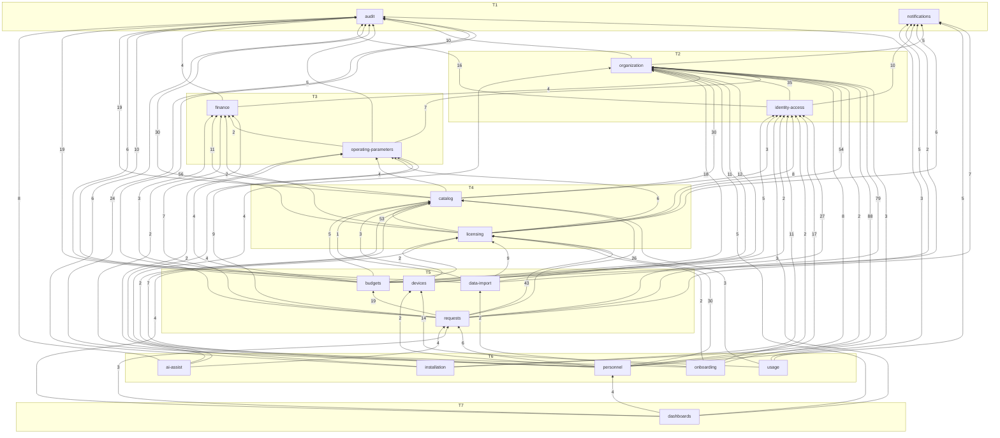

# Module graph

Generated by `pnpm arch:graph`; do not edit by hand. Tiers come from `scripts/arch/tiers.cjs`; an arrow is
"imports" (number = import statements). The gate `pnpm arch:check` refuses any arrow that points up a tier.

79 module edges.
